# Chapter 2. Analysis and Design

## 2.1. Functional Requirements (FR1-FR10)

### 2.1.1. Purpose and Conventions
This section specifies what the ScentStation platform shall do. Each requirement is written so that it can be verified by inspection, demonstration, or an automated test, and so that it can be traced forward into the implementation and test chapters.

* **Numbering:** Requirements are grouped into ten functional areas, FR1 through FR10. Individual requirements inside an area are numbered FRx.y and are stated as a single verifiable obligation using the keyword *shall*.
* **Actors:** Requirements reference the seven user roles defined in Section 1.4: Platform Super Administrator (PSA), Brand Administrator (BA), Operations Manager (OM), Technician (TE), Inventory Staff (IS), Viewer (VW), and Customer / Kiosk User (CU). The automated machine itself is treated as an external system actor, denoted DEV. *(Note: In the implementation scope of this project, hardware interactions of DEV are fully simulated via a Java Device Simulator communicating over MQTT).*
* **Relationship to other sections:** FR1-FR10 state system behaviour. Quality attributes are specified separately in Section 2.2. Section 2.1.13 lists the business rules that constrain several requirements at once; a business rule is binding on every requirement that references it.

---

### 2.1.2. Summary of Functional Areas

| ID | Functional Area | Primary Actors | Priority |
| :--- | :--- | :--- | :--- |
| **FR1** | Brand, User, and Access Management | PSA, BA | Must |
| **FR2** | Machine and Slot Management | BA, OM, IS | Must |
| **FR3** | Order and Payment Management | CU, OM | Must |
| **FR4** | Secure Dispensing Management | CU, DEV, OM | Must |
| **FR5** | IoT Device Monitoring and Communication | DEV, OM, TE | Must |
| **FR6** | Perfume Inventory and Level Monitoring | IS, OM | Must |
| **FR7** | Alert and Notification Management | OM, TE, IS | Should |
| **FR8** | Maintenance Management | OM, TE | Should |
| **FR9** | Dashboard and Reporting | PSA, BA, OM, VW | Should |
| **FR10** | Audit and Traceability | PSA, BA | Must |

---

### 2.1.3. FR1 - Brand, User, and Access Management
**Description:** The platform hosts several independent perfume brands on shared infrastructure. FR1 establishes tenant boundaries, user identity, and role-based authorisation. Every other functional area depends on the isolation guarantee defined here.
**Primary actors:** Platform Super Administrator, Brand Administrator.

| ID | Requirement |
| :--- | :--- |
| **FR1.1** | The system shall allow the PSA to create, update, activate, and suspend perfume-brand tenants. |
| **FR1.2** | The system shall allow the PSA to create and assign Brand Administrator accounts for each tenant. |
| **FR1.3** | The system shall associate each brand-scoped user account with exactly one tenant and assign one or more authorised roles. Platform-level accounts shall have platform-wide permissions as defined by the access-control policy. |
| **FR1.4** | The system shall restrict each user to the functions and data of the tenant and operational scope assigned to that user. |
| **FR1.5** | The system shall deny any attempt by a user of one brand to read or modify machines, products, transactions, inventory, or reports belonging to another brand. |
| **FR1.6** | The system shall allow authorised administrators to activate, deactivate, lock, and reset user accounts. |
| **FR1.7** | The system shall support permission assignment scoped by role, location, machine, or operational responsibility. |
| **FR1.8** | The system shall terminate or revoke all active sessions of an account when that account is disabled. |
| **FR1.9** | The system shall require additional authorisation for sensitive actions, specifically refunds, inventory adjustments, diagnostic sprays, and machine reconfiguration. |
| **FR1.10** | The system shall record every login attempt, account change, role change, and permission change (see FR10). |
| **FR1.11** | The system shall support read-only accounts (Viewer) that may consult dashboards and reports within their granted scope but may not create, modify, or delete any record. |

**Constrained by:** BR13.

---

### 2.1.4. FR2 - Machine and Slot Management
**Description:** FR2 covers the registration and configuration of physical sampling machines and the independently controlled slots they contain. A slot is the unit that holds one perfume bottle or cartridge and performs one dispensing action.
**Primary actors:** Brand Administrator, Operations Manager, Inventory Staff.

| ID | Requirement |
| :--- | :--- |
| **FR2.1** | The system shall register each machine using a unique serial number and device identity. |
| **FR2.2** | The system shall associate an activated machine with exactly one tenant and one operating location. |
| **FR2.3** | The system shall allow configuration of the number and identifiers of the slots available on each machine, with a minimum of four independently controlled slots per machine. |
| **FR2.4** | The system shall allow at most one active perfume bottle or cartridge to be assigned to a slot at any time. |
| **FR2.5** | The system shall allow configuration, per slot, of the assigned product, selling price, low-stock threshold, calibrated dosage or spray duration, and availability. |
| **FR2.6** | The system shall display, for each machine, its connectivity state, operating mode, firmware version, configuration version, and last communication time. |
| **FR2.7** | The system shall allow authorised users to enable or disable an entire machine or an individual slot. |
| **FR2.8** | The system shall maintain the installation, relocation, ownership, configuration, and service history of every machine. |
| **FR2.9** | The system shall record every configuration change in the audit log (see FR10). |

**Constrained by:** BR1, BR2.

---

### 2.1.5. FR3 - Order and Payment Management
**Description:** FR3 defines the customer-facing purchase flow, from fragrance selection to confirmed payment. Payment confirmation is the precondition for FR4; no dispensing may occur without it.
**Primary actors:** Customer / Kiosk User, Operations Manager.

| ID | Requirement |
| :--- | :--- |
| **FR3.1** | The system shall display to the customer all fragrances currently available on the machine, including brand, product name, description, fragrance notes, image, price, and usage instructions. |
| **FR3.2** | The system shall allow an order to be created only when the selected machine is online and operational, and the selected slot and product are available. |
| **FR3.3** | The system shall store, at order creation, the tenant, machine, slot, product, price, currency, and expiration time of the order. |
| **FR3.4** | The system shall fix the product and the price of an order at the moment of creation, so that a later price change does not affect an open order. |
| **FR3.5** | The system shall generate a unique payment reference and a dynamic QR code for each order. |
| **FR3.6** | The system shall receive payment notifications from the configured payment provider. |
| **FR3.7** | The system shall verify the webhook signature, payment reference, paid amount, currency, and transaction status before accepting a payment notification. |
| **FR3.8** | The system shall process a duplicated payment notification at most once. |
| **FR3.9** | The system shall mark an unpaid order as expired after the configured timeout. |
| **FR3.10** | The system shall prevent a failed, cancelled, or expired order from generating a dispensing command. |
| **FR3.11** | The system shall display the current payment status to the customer as waiting, successful, failed, cancelled, or expired. |
| **FR3.12** | The system shall maintain the complete order and payment status history. |
| **FR3.13** | The system shall support refund and manual-review workflows for orders in which payment succeeded but dispensing was unsuccessful. |
| **FR3.14** | The system shall support reconciliation of internal transactions against payment-provider records. |
| **FR3.15** | The system shall allow authorised users to search transactions by time, machine, location, product, payment reference, and status. |

**Constrained by:** BR3, BR4, BR5, BR6, BR9.

---

### 2.1.6. FR4 - Secure Dispensing Management
**Description:** FR4 is the safety-critical area of the system. It guarantees that a confirmed payment results in at most one physical spray, and that no spray occurs under unsafe conditions. Every requirement here is a Must.
**Primary actors:** Customer / Kiosk User, Machine (DEV), Operations Manager.

| ID | Requirement |
| :--- | :--- |
| **FR4.1** | The system shall generate a dispensing command only after the backend has verified the payment as successful. |
| **FR4.2** | The system shall assign every dispensing command a unique identifier, target machine, target slot, creation time, expiration time, and cryptographic signature. |
| **FR4.3** | The system shall allow at most one active dispensing command per order. |
| **FR4.4** | The system shall transmit the command to the addressed machine over a secure IoT channel. |
| **FR4.5** | The machine shall acknowledge a dispensing command before executing it. |
| **FR4.6** | The machine shall reject any command that is invalid, expired, duplicated, or addressed to a different machine or slot. |
| **FR4.7** | The system shall prevent dispensing while the machine is in maintenance mode, the door is open, the selected slot is empty, or a critical error is active. |
| **FR4.8** | The machine shall activate only the selected slot, for exactly one calibrated dispensing cycle. |
| **FR4.9** | The system shall record the command acknowledgement, execution time, result, relevant sensor readings, and failure code. |
| **FR4.10** | The system shall transition an order to DISPENSED only after receiving a successful execution result from the machine. |
| **FR4.11** | The system shall handle a timeout or an uncertain result without automatically issuing a second dispensing command. |
| **FR4.12** | The system shall route an unsuccessful or uncertain dispensing result to the operational review workflow. |
| **FR4.13** | The system shall guide the customer to place a test strip or wrist in the designated spraying area before dispensing. |
| **FR4.14** | The system shall display the dispensing status to the customer as processing, successful, or failed, and shall provide recovery instructions when payment succeeded but dispensing failed. |

**Constrained by:** BR6, BR7, BR8, BR14.

---

### 2.1.7. FR5 - IoT Device Monitoring and Communication
**Description:** FR5 defines the bidirectional link between the backend and the machines: liveness detection, telemetry collection, event reporting, and secure command delivery.
**Primary actors:** Machine (DEV), Operations Manager, Technician.

| ID | Requirement |
| :--- | :--- |
| **FR5.1** | The system shall receive periodic heartbeat messages from every registered machine. |
| **FR5.2** | The system shall classify a machine as online, unstable, or offline based on the time elapsed since its most recent heartbeat. |
| **FR5.3** | The system shall collect telemetry including slot weight, estimated remaining perfume, door state, leakage state, actuator state, and power status. |
| **FR5.4** | The system shall receive device events including startup, shutdown, reconnection, entry into maintenance mode, sensor error, and dispensing failure. |
| **FR5.5** | The system shall send secure commands for dispensing, diagnostics, status requests, and configuration updates. |
| **FR5.6** | The system shall correlate every command with its acknowledgement and its final execution result. |
| **FR5.7** | The system shall store significant telemetry and aggregate historical readings for reporting. |
| **FR5.8** | The machine shall buffer unsent events locally while the network is unavailable. |
| **FR5.9** | The system shall synchronise buffered events after reconnection without creating duplicate records. |
| **FR5.10** | The system shall track the firmware and configuration version reported by each machine. |
| **FR5.11** | The system shall reject communication originating from unregistered, revoked, or invalid devices. |

**Constrained by:** BR9.

---

### 2.1.8. FR6 - Perfume Inventory and Level Monitoring
**Description:** FR6 tracks physical perfume stock from batch receipt through installation, consumption, and disposal, and estimates the remaining quantity in each slot.
**Primary actors:** Inventory Staff, Operations Manager.

| ID | Requirement |
| :--- | :--- |
| **FR6.1** | The system shall manage inventory batches including product, batch number, quantity, received date, and expiration date. |
| **FR6.2** | The system shall register individual bottles or cartridges with unique identifiers. |
| **FR6.3** | The system shall classify each bottle or cartridge as available, installed, nearly empty, empty, damaged, or expired. |
| **FR6.4** | The system shall record the initial quantity or weight when a bottle or cartridge is installed into a slot. |
| **FR6.5** | The system shall estimate the remaining quantity from the count of successful sprays and the calibrated consumption per spray. |
| **FR6.6** | The system shall compare the estimated consumption against load-cell or level-sensor measurements where such a sensor is available. |
| **FR6.7** | The system shall update the estimated remaining perfume quantity after every confirmed customer spray and diagnostic spray, while recording diagnostic consumption separately from customer-sale inventory transactions. |
| **FR6.8** | The system shall raise a low-stock alert when the remaining amount falls below the configured threshold. |
| **FR6.9** | The system shall mark a slot unavailable when it no longer holds enough perfume for one further safe spray. |
| **FR6.10** | The system shall detect possible leakage or abnormal consumption when the measured loss differs significantly from the recorded dispensing activity. |
| **FR6.11** | The system shall record, for every refill or replacement, the employee, time, machine, slot, previous bottle, and new bottle. |
| **FR6.12** | The system shall require an authorised user and a mandatory reason for every manual inventory adjustment. |
| **FR6.13** | The system shall maintain the complete installation, refill, removal, adjustment, and disposal history. |

**Constrained by:** BR2, BR11.

---

### 2.1.9. FR7 - Alert and Notification Management
**Description:** FR7 turns raw device and business conditions into actionable, de-duplicated alerts delivered to the responsible staff.
**Primary actors:** Operations Manager, Technician, Inventory Staff.

| ID | Requirement |
| :--- | :--- |
| **FR7.1** | The system shall generate alerts for machine offline status, low stock, empty slots, opened doors, suspected leakage, sensor failure, actuator failure, and repeated dispensing failures. |
| **FR7.2** | The system shall classify each alert by type, severity, status, machine, location, and time of occurrence. |
| **FR7.3** | The system shall suppress duplicate alerts for the same unresolved problem. |
| **FR7.4** | The system shall notify the responsible users through in-system notifications and the configured external channels. |
| **FR7.5** | The system shall allow authorised users to acknowledge, assign, resolve, and reopen alerts. |
| **FR7.6** | The system shall automatically create a maintenance ticket for the configured critical alert types. |
| **FR7.7** | The system shall record the responsible user, acknowledgement time, resolution details, and resolution time for each alert. |
| **FR7.8** | The system shall escalate an alert that remains unresolved beyond the configured service time. |
| **FR7.9** | The system shall retain alert history for operational analysis. |

---

### 2.1.10. FR8 - Maintenance Management
**Description:** FR8 covers the maintenance ticket lifecycle, from detection through technician assignment, repair, verification, and return to service.
**Primary actors:** Operations Manager, Technician.

| ID | Requirement |
| :--- | :--- |
| **FR8.1** | The system shall allow maintenance tickets to be created manually or automatically from device alerts. |
| **FR8.2** | The system shall allow tickets to be assigned to technicians by brand, location, machine, or responsibility. |
| **FR8.3** | The system shall classify tickets by category, severity, priority, status, and due date. |
| **FR8.4** | The system shall prevent a machine with an open critical maintenance ticket from accepting new orders. |
| **FR8.5** | The system shall allow a technician to place a machine into maintenance mode, suspending new customer transactions. |
| **FR8.6** | The system shall require technician authentication before granting access to maintenance or diagnostic functions. |
| **FR8.7** | The system shall provide configurable inspection, repair, refill-support, and post-maintenance checklists. |
| **FR8.8** | The system shall allow a controlled test spray that is recorded separately from customer transactions. |
| **FR8.9** | The system shall record diagnostic results, corrective actions, replaced components, costs, and supporting evidence. |
| **FR8.10** | The system shall measure the elapsed time from incident detection to acknowledgement and to final resolution. |
| **FR8.11** | The system shall require a successful post-maintenance test before a machine returns to active service. |
| **FR8.12** | The system shall allow a ticket to be closed only after the repair result has been recorded. |
| **FR8.13** | The system shall maintain the maintenance and failure history of every machine and component. |

**Constrained by:** BR15.

---

### 2.1.11. FR9 - Dashboard and Reporting
**Description:** FR9 presents operational and business information within the scope each user is authorised to see.
**Primary actors:** Platform Super Administrator, Brand Administrator, Operations Manager, Viewer.

| ID | Requirement |
| :--- | :--- |
| **FR9.1** | The system shall display machines grouped by online, offline, maintenance, disabled, and error status. |
| **FR9.2** | The system shall report transaction volume and revenue by day, week, month, and custom period. |
| **FR9.3** | The system shall report the number of successful, pending, failed, expired, and refunded transactions. |
| **FR9.4** | The system shall report successful and failed dispensing rates. |
| **FR9.5** | The system shall identify orders in which payment succeeded but dispensing was not confirmed. |
| **FR9.6** | The system shall display the most frequently selected fragrances by brand, machine, location, and period. |
| **FR9.7** | The system shall display current inventory estimates, low-stock slots, and expected refill requirements. |
| **FR9.8** | The system shall report machine uptime, downtime, alert frequency, and average resolution time. |
| **FR9.9** | The system shall allow reports to be filtered by authorised brand, location, machine, product, and time range. |
| **FR9.10** | The system shall allow authorised users to export reports in CSV or Excel format. |
| **FR9.11** | The system shall restrict platform-wide reports to the Platform Super Administrator. |

---

### 2.1.12. FR10 - Audit and Traceability
**Description:** FR10 provides an auditable record for security investigation and end-to-end reconstruction of transactions.
**Primary actors:** Platform Super Administrator, Brand Administrator.

| ID | Requirement |
| :--- | :--- |
| **FR10.1** | The system shall record significant user actions, authentication events, device commands, payment events, inventory changes, and configuration updates. |
| **FR10.2** | The system shall store, for each audit record, the actor, tenant, action, target object, timestamp, source, and the relevant before-and-after values. |
| **FR10.3** | The system shall record every change to product prices, slot assignments, user permissions, inventory adjustments, refunds, and maintenance status. |
| **FR10.4** | The system shall prevent non-administrative users from editing or deleting audit records. |
| **FR10.5** | The system shall allow authorised administrators to search the audit log by time, user, machine, action, object, and severity. |
| **FR10.6** | The system shall maintain end-to-end traceability linking an order to its payment, dispensing command, device result, inventory deduction, operational incident, and refund where applicable. |

**Constrained by:** BR12.

---

### 2.1.13. Business Rules (BR1-BR15)
Business rules are invariants that hold across functional areas. Each rule binds every requirement that references it.

| ID | Business Rule |
| :--- | :--- |
| **BR1** | A machine shall belong to exactly one perfume-brand tenant at any given time. |
| **BR2** | A slot shall contain at most one active perfume bottle or cartridge at any given time. |
| **BR3** | Only available products installed in online and operational machines shall be selectable by a customer. |
| **BR4** | The product and the price of an order shall be fixed at the time the order is created. |
| **BR5** | Only the backend shall confirm that a payment is successful. A screenshot or a kiosk-displayed result shall not be accepted as proof of payment. |
| **BR6** | A successfully paid order shall result in at most one successful spray. |
| **BR7** | A command that is expired, invalid, duplicated, or incorrectly addressed shall be rejected by the device. |
| **BR8** | A machine shall not dispense while its door is open, it is under maintenance, the selected slot is empty, or a critical hardware error is active. |
| **BR9** | New orders shall not be accepted while a machine cannot communicate with the backend. |
| **BR10** | Only confirmed dispensing operations shall reduce customer-sale inventory; diagnostic sprays shall be recorded separately. |
| **BR11** | Every refill, inventory adjustment, diagnostic spray, price change, permission change, and refund shall be written to the audit log. |
| **BR12** | Audit records shall not be editable or deletable by normal users. |
| **BR13** | A user belonging to one perfume brand shall not access data belonging to another perfume brand. |
| **BR14** | An uncertain dispensing result shall require human review and shall not automatically produce another dispensing command. |
| **BR15** | A machine under maintenance shall return to active service only after the required checklist and the post-maintenance test have been completed. |


## 2.2. Non-Functional Requirements (NFR1-NFR9)

### 2.2.1. Purpose and Conventions
This section defines the quality attributes, operational constraints, and technical benchmarks that the ScentStation platform must satisfy. While Functional Requirements (FR1–FR10) specify *what* the system does, Non-Functional Requirements (NFR1–NFR9) specify *how well* the system performs its functions.

* **Numbering:** Requirements are organized into nine quality areas, designated NFR1 through NFR9. Individual requirements are identified as NFRx.y and are stated as verifiable engineering criteria.
* **Verification Methods:** Compliance shall be verified through performance load testing, security audits, fault-injection testing, manual inspection, or architectural reviews.
* **Scope Realism:** Quantified benchmarks (such as response times, target availability, RPO, and RTO) serve as evaluation targets within the project's testing and simulation environment.

---

### 2.2.2. Summary of Quality Attribute Areas

| ID | Quality Attribute Area | Primary Focus | Verification Method |
| :--- | :--- | :--- | :--- |
| **NFR1** | Performance | Response times, throughput, query efficiency | Load Testing (JMeter/Gatling) |
| **NFR2** | Security | Authentication, RBAC, tenant isolation, encryption | Security Inspection & Penetration Testing |
| **NFR3** | Reliability and Data Consistency | Idempotency, transaction safety, state accuracy | Integration & Fault-Injection Testing |
| **NFR4** | Availability | Heartbeat monitoring, offline handling, error states | Network Interruption Simulation |
| **NFR5** | Scalability | Multi-tenant growth, concurrent session support | Stress & Capacity Testing |
| **NFR6** | Usability | Clear UX, responsive UI, accessible status feedback | User Interface Inspection |
| **NFR7** | Maintainability and Testability | Modular design, logging, DB migration, test coverage | Static Code Analysis & Unit Testing |
| **NFR8** | Compatibility and Integration | REST API standards, PostgreSQL, MQTT protocol | Integration & Interface Testing |
| **NFR9** | Backup and Recovery | Data protection, backup verification, RPO/RTO targets | Disaster Recovery Simulation |

---

### 2.2.3. NFR1 - Performance

| ID | Requirement Statement |
| :--- | :--- |
| **NFR1.1** | **API Response Time:** The backend RESTful APIs shall achieve a 95th-percentile (P95) response time of no more than 500 milliseconds under defined testing workloads. |
| **NFR1.2** | **Page Loading Time:** Web-based administrative pages and portal dashboards shall load and render within 3 seconds under normal network conditions. |
| **NFR1.3** | **Database Optimization:** Database queries shall be optimized using appropriate indexing, pagination, and execution plan analysis to avoid unnecessary full-table scans. |
| **NFR1.4** | **Performance Validation:** The system shall undergo automated load testing to identify execution bottlenecks, memory leaks, and database connection pool contention. |

---

### 2.2.4. NFR2 - Security

| ID | Requirement Statement |
| :--- | :--- |
| **NFR2.1** | **Authentication & Password Safety:** All user access to protected resources shall require authentication. User passwords shall be cryptographically hashed using BCrypt prior to storage. |
| **NFR2.2** | **Role-Based Access Control (RBAC):** The system shall enforce strict role-based authorization ensuring users access only features aligned with their assigned duties. |
| **NFR2.3** | **Server-Side Tenant Data Isolation:** The backend shall strictly verify tenant ownership and access authorization on every request, preventing cross-tenant data access or modification through parameter, URL, or resource identifier tampering. |
| **NFR2.4** | **Input Validation & Sanitization:** All incoming API request payloads, query parameters, and header values shall be validated and sanitized to prevent SQL injection, XSS, and malformed data issues. |
| **NFR2.5** | **Protection of Sensitive Information:** Passwords, JWT secrets, payment credentials, and HMAC keys shall never be exposed in application logs, error stack traces, or client-side responses. |
| **NFR2.6** | **Device & Payment Command Security:** Dispensing control commands sent over MQTT shall be cryptographically signed using HMAC-SHA256 to prevent command forgery and tampering. |
| **NFR2.7** | **Audit Trail Logging:** All critical business, security, and configuration operations shall be automatically recorded in a secure and auditable log. |

---

### 2.2.5. NFR3 - Reliability and Data Consistency

| ID | Requirement Statement |
| :--- | :--- |
| **NFR3.1** | **Unique Transaction Identification:** Every dispensing command shall carry a unique UUID linked directly to its verified payment order to enforce idempotency. |
| **NFR3.2** | **Pre-Dispensing Payment Verification:** The system shall authorize a dispensing command if and only if the backend has verified successful payment confirmation from the payment gateway. |
| **NFR3.3** | **Duplicate Processing Prevention:** Repeated payment webhooks, duplicate MQTT messages, or retried device responses shall be rejected without causing duplicate orders or multiple sprays. |
| **NFR3.4** | **Dispensing Idempotency:** Exactly one confirmed paid transaction shall yield at most one calibrated physical spray. Uncertain results shall be routed to human review rather than triggering automatic second sprays. |
| **NFR3.5** | **Database Transactional Integrity:** ACID-compliant database transactions and concurrency control mechanisms (e.g., partial unique indexes) shall be enforced during order processing and inventory deductions. |
| **NFR3.6** | **Price Immutability:** An order shall permanently lock the product price at the exact moment of creation; subsequent price modifications in the catalog shall not alter pending or historical transactions. |
| **NFR3.7** | **Device State Accuracy:** Kiosks that are offline, disabled, or in maintenance mode shall be immediately marked unavailable, preventing customers from initiating new orders. |

---

### 2.2.6. NFR4 - Availability

| ID | Requirement Statement |
| :--- | :--- |
| **NFR4.1** | **Continuous Heartbeat Monitoring:** The system shall monitor kiosk connectivity via periodic MQTT heartbeat telemetry to detect disconnected or unstable devices in real time. |
| **NFR4.2** | **Graceful Offline Handling:** Upon detecting a lost heartbeat, the backend shall automatically mark the kiosk as `OFFLINE` and block new payment order generation for that machine. |
| **NFR4.3** | **Failure Logging & User Feedback:** System faults shall trigger clear, user-friendly error messages on client interfaces while recording technical failure details in system logs for investigation. |
| **NFR4.4** | **Controlled Operational Retries:** Automated retries for failed network operations shall be strictly bounded and idempotent, avoiding duplicate operations or inconsistent state updates. |
| **NFR4.5** | **Uncertain State Resolution:** If a hardware execution status cannot be confirmed within the timeout window, the order state shall transition to `UNCERTAIN` for operational review rather than assuming success or failure. |

---

### 2.2.7. NFR5 - Scalability

| ID | Requirement Statement |
| :--- | :--- |
| **NFR5.1** | **Multi-Tenant Expansion:** The database architecture and application logic shall seamlessly support the onboarding of new perfume brands without requiring schema alterations or code changes. |
| **NFR5.2** | **Data Volume Growth Support:** Relational tables (orders, telemetry, audit logs) shall be structured with proper indexing and partitioning strategies to sustain growing transaction volumes. |
| **NFR5.3** | **Modular 3-Tier Architecture:** The system shall maintain clear separation between Frontend, Backend REST APIs, and the MQTT IoT Gateway to allow independent scaling of components. |
| **NFR5.4** | **Seamless Device Provisioning:** The platform shall enable adding new physical or simulated sampling kiosks dynamically via configuration and registration APIs. |
| **NFR5.5** | **Concurrent User Load:** The backend shall be configured to support at least 100 concurrent active user sessions under testing conditions while maintaining acceptable latency and resource utilization. |

---

### 2.2.8. NFR6 - Usability

| ID | Requirement Statement |
| :--- | :--- |
| **NFR6.1** | **Intuitive Transaction Workflows:** Product browsing, fragrance selection, QR payment, and spray execution shall follow an intuitive, minimal-click user workflow on touch-screen kiosks. |
| **NFR6.2** | **Clear Visual Feedback:** Interfaces shall provide real-time feedback for all operational states, including dynamic payment waiting screens, processing spinners, and success/failure prompts. |
| **NFR6.3** | **Role-Tailored Interfaces:** Web administration portals shall dynamically adjust menus and navigation according to the authenticated user's specific role and scope. |
| **NFR6.4** | **Responsive Web Layouts:** Management dashboards shall adapt smoothly across various display resolutions (desktop, tablet) using responsive design frameworks. |
| **NFR6.5** | **Action Confirmation & Error Prevention:** Destructive or high-impact actions (such as deleting accounts, altering prices, or manual inventory overrides) shall require explicit user confirmation. |
| **NFR6.6** | **Multi-Modal Status Indicators:** System health and machine statuses shall be communicated using text labels and icons in addition to color coding to ensure accessibility. |

---

### 2.2.9. NFR7 - Maintainability and Testability

| ID | Requirement Statement |
| :--- | :--- |
| **NFR7.1** | **Clean & Modular Code Base:** Business logic shall follow clear architectural patterns (Controller-Service-Repository) to minimize coupling and enhance code readability. |
| **NFR7.2** | **Component Testability:** Individual services and components shall be designed for unit testing using mock frameworks (e.g., Mockito) without requiring live database connections. |
| **NFR7.3** | **Structured Operational Logging:** Application logs shall use structured formats (SLF4J/Logback) with configurable log levels (INFO, WARN, ERROR) to streamline troubleshooting. |
| **NFR7.4** | **Database Schema Version Control:** All database schema changes shall be managed using Flyway migration scripts to ensure reproducible deployments across development environments. |
| **NFR7.5** | **Comprehensive Test Scenario Coverage:** Test suites shall cover critical edge cases, including payment timeouts, offline kiosks, malformed payloads, duplicate webhooks, and uncertain sprays. |
| **NFR7.6** | **Automated Authorization Testing:** Integration tests shall explicitly verify that role-based and brand-based data isolation rules deny unauthorized cross-tenant requests. |
| **NFR7.7** | **Technical Documentation:** REST APIs shall be fully documented using OpenAPI/Swagger specifications, paired with technical setup guides for developer onboarding. |

---

### 2.2.10. NFR8 - Compatibility and Integration

| ID | Requirement Statement |
| :--- | :--- |
| **NFR8.1** | **RESTful API Standardization:** All HTTP APIs between Frontend and Backend shall adhere to RESTful principles, utilizing JSON payloads and standard HTTP status codes. |
| **NFR8.2** | **Database Compatibility:** The application shall strictly utilize PostgreSQL 16 as its relational database management system, leveraging native JSONB and partial index capabilities. |
| **NFR8.3** | **MQTT IoT Protocol Integration:** Device communication shall strictly adhere to MQTT 3.1.1 standards using structured JSON payloads over defined topic hierarchies (`scentstation/kiosk/{deviceId}/...`). |
| **NFR8.4** | **Payload Validation & Error Filtering:** Incoming MQTT telemetry and event messages shall be validated against defined schemas before processing to discard malformed or corrupted packets. |
| **NFR8.5** | **Command-Request Correlation:** Every MQTT dispensing command shall explicitly correlate with its backend order ID and be tracked through a defined execution state machine. |
| **NFR8.6** | **Externalized Configuration Management:** Environment-specific configurations, database credentials, and secret keys shall be managed via environment variables and external properties files (`application.yml`). |

---

### 2.2.11. NFR9 - Backup and Recovery

| ID | Requirement Statement |
| :--- | :--- |
| **NFR9.1** | **Comprehensive Data Backup:** Automated backup procedures shall cover all relational data, including user accounts, product catalogs, transactions, inventory levels, and audit logs. |
| **NFR9.2** | **Backup Storage Security:** Data backup files shall be encrypted at rest and restricted to authorized platform administrators to prevent unauthorized access or tampering. |
| **NFR9.3** | **Data Restoration Verification:** Backup restoration routines shall include automated checksum and relational integrity checks to ensure data consistency post-recovery. |
| **NFR9.4** | **Periodic Recovery Testing:** System recovery procedures shall be periodically tested within the staging environment to validate restoration scripts and operational readiness. |
| **NFR9.5** | **Target Recovery Point Objective (RPO):** The system design targets an RPO of $\le$ 24 hours, ensuring that potential data loss in a recovery scenario does not exceed 24 hours of transactions. |
| **NFR9.6** | **Target Recovery Time Objective (RTO):** The system design targets an RTO of $\le$ 4 hours, aiming to restore normal platform operations within 4 hours of a major disruption. |

## 2.3. Functional Decomposition Diagram (FDD)

### 2.3.1. Overview and decomposition principles
The Functional Decomposition Diagram (FDD) illustrates the hierarchical functional structure of the ScentStation platform, organizing high-level business goals into granular operational modules. Designed around a 3-Tier Architecture integrated with a Multi-Tenant Architecture, the platform encapsulates the complete end-to-end workflow — spanning customer interactions at the interactive kiosk, IoT-driven order and payment processing, and centralized administrative management and analytics.

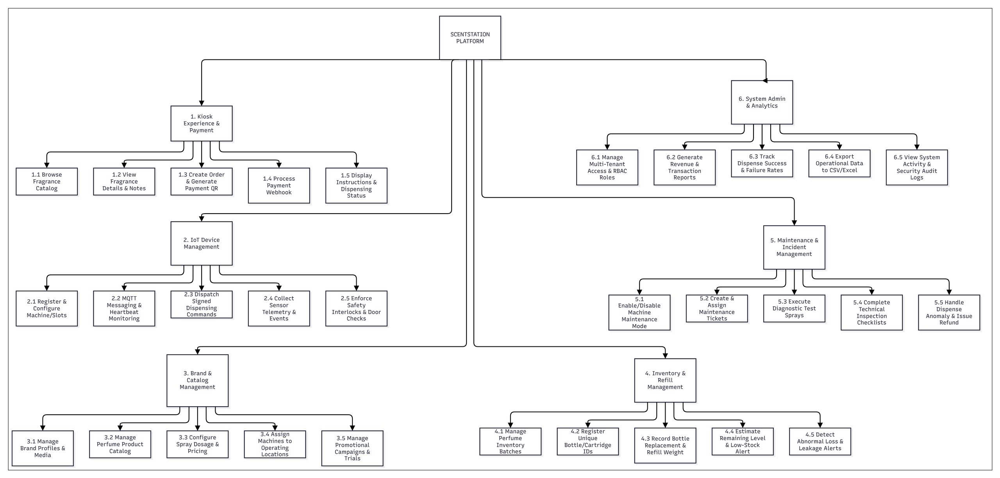

*Figure 2.1. Functional Decomposition Diagram (FDD) of the ScentStation platform.*

The ScentStation platform is structured into six core functional subsystems:

1. **Kiosk Experience & Payment:** Manages the end-user fragrance discovery, order creation, QR payment, and real-time status rendering on touch-screen kiosks.
2. **IoT Device Management:** Handles bidirectional communication, heartbeat telemetry monitoring, signed MQTT command dispatching, and hardware safety checks.
3. **Brand & Catalog Management:** Provides multi-tenant administrative portals for perfume brands to manage product catalogs, pricing, spray dosages, and locations.
4. **Inventory & Refill Management:** Tracks physical perfume inventory batches, bottle registration, replacement operations, level estimation, and leakage detection.
5. **Maintenance & Incident Management:** Standardizes technical maintenance tickets, technician checklists, diagnostic test sprays, and anomaly refunds.
6. **System Admin & Analytics:** Delivers high-level platform administration, role-based access control, business analytics dashboards, and security audit logging.

### 2.3.2. Detailed subsystem analysis

**Subsystem 1 — Kiosk Experience & Payment.** This subsystem serves as the primary touch-screen Kiosk User Interface (UI) for end customers experiencing perfume sampling.

| ID | Function | Description |
| :--- | :--- | :--- |
| 1.1 / 1.2 | Browse Fragrance Catalog; View Fragrance Details & Notes | The kiosk UI queries available perfume catalogs from the backend in real time. Displayed data includes high-resolution imagery, product descriptions, fragrance note pyramids (Top, Heart, and Base notes), and the calibrated price per spray. |
| 1.3 | Create Order & Generate Payment QR | Upon fragrance selection, the system initializes a pending order. Simultaneously, the backend verifies device safety constraints (machine ONLINE and slot non-empty per BR3 and BR9) and calls the payment gateway API to construct a dynamic payment QR code. |
| 1.4 | Process Payment Webhook | The system listens for incoming webhook notifications from the payment gateway upon successful customer transfer. The backend validates the cryptographic signature, matches order metadata and paid amounts, and transitions the order state to PAID (enforcing BR5). |
| 1.5 | Display Instructions & Dispensing Status | Provides real-time visual guidance on the kiosk screen, directing the customer to position a scent strip or wrist in the spraying chamber while rendering live status updates (Processing → Success / Failure). |

**Subsystem 2 — IoT Device Management.** This subsystem manages bidirectional communication, sensor telemetry ingestion, and secure command execution between the Java backend and kiosk devices over the lightweight MQTT protocol.

| ID | Function | Description |
| :--- | :--- | :--- |
| 2.1 | Register & Configure Machine/Slots | Enables registering new kiosks using unique device identities (serial numbers) and mapping specific perfume products and pricing to individual slots. |
| 2.2 | MQTT Messaging & Heartbeat Monitoring | Establishes MQTT pub/sub channels. The backend periodically receives heartbeat messages from each kiosk to classify connectivity states (ONLINE, UNSTABLE, OFFLINE) (NFR4.1, NFR4.2). |
| 2.3 | Dispatch Signed Dispensing Commands | Upon payment confirmation (PAID), the backend encapsulates a unique command UUID, target slot ID, and an HMAC-SHA256 cryptographic signature, dispatching it to the kiosk over MQTT to enforce idempotency (BR6). |
| 2.4 | Collect Sensor Telemetry & Events | Ingests real-time sensor metrics (slot weight, door state, actuator health) and execution acknowledgment messages returned by the kiosk hardware. |
| 2.5 | Enforce Safety Interlocks & Door Checks | Enforces hardware-level safety checks: rejects dispensing commands if cabinet doors are open, slots are depleted, or critical errors are present (enforcing BR8). |

**Subsystem 3 — Brand & Catalog Management.** Provides tenant-isolated workspaces for Brand Administrators to configure business and product parameters.

| ID | Function | Description |
| :--- | :--- | :--- |
| 3.1 / 3.2 | Manage Brand Profiles & Media; Manage Perfume Product Catalog | Configures brand profile metadata, promotional banners, product lines, and fragrance pyramids. |
| 3.3 | Configure Spray Dosage & Pricing | Sets the selling price per spray and configures calibrated spray durations (actuator activation times in milliseconds) per slot. |
| 3.4 | Assign Machines to Operating Locations | Links registered sampling kiosks to physical operating venues (e.g., shopping malls, retail stores). |
| 3.5 | Manage Promotional Campaigns & Trials | Manages marketing campaigns, discount codes, or temporary free-trial pricing rules. |

**Subsystem 4 — Inventory & Refill Management.** Maintains precise traceability of physical perfume inventory from central batch receiving to individual kiosk slots.

| ID | Function | Description |
| :--- | :--- | :--- |
| 4.1 / 4.2 | Manage Perfume Inventory Batches; Register Unique Bottle/Cartridge IDs | Tracks inventory batches (received dates, expiration dates) and assigns unique identifiers (barcodes/RFIDs) to individual perfume bottles. |
| 4.3 | Record Bottle Replacement & Refill Weight | Logs replacement operations performed by Inventory Staff, capturing employee metadata, timestamp, machine ID, slot ID, and initial bottle weight. |
| 4.4 | Estimate Remaining Level & Low-Stock Alert | Automatically calculates remaining liquid volumes based on successful spray counts. Triggers automated low-stock alerts when liquid levels drop below configurable thresholds. |
| 4.5 | Detect Abnormal Loss & Leakage Alerts | Cross-references estimated consumption against load-cell sensor measurements, triggering abnormal loss alerts if unexpected weight drops occur. |

**Subsystem 5 — Maintenance & Incident Management.** Standardizes technical workflows to maintain hardware reliability and service availability.

| ID | Function | Description |
| :--- | :--- | :--- |
| 5.1 | Enable/Disable Machine Maintenance Mode | Switches kiosks into Maintenance Mode, automatically blocking customer order creation during hardware repairs. |
| 5.2 | Create & Assign Maintenance Tickets | Generates incident tickets automatically from system alerts or manually, dispatching them to assigned Technicians. |
| 5.3 | Execute Diagnostic Test Sprays | Allows authenticated technicians to execute diagnostic test sprays. Consumption from test sprays is logged separately and excluded from sales revenue (BR10). |
| 5.4 | Complete Technical Inspection Checklists | Enables technicians to complete repair logs, record replaced spare parts, and fulfill technical verification checklists prior to machine reactivation. |
| 5.5 | Handle Dispense Anomaly & Issue Refund | Provides tools for Operations Managers to investigate transaction anomalies (e.g., successful payment with unconfirmed spray) and trigger authorized refunds or compensatory sprays. |

**Subsystem 6 — System Admin & Analytics.** Provides high-level system control, data security, and business intelligence for Platform Super Administrators and Brand Administrators.

| ID | Function | Description |
| :--- | :--- | :--- |
| 6.1 | Manage Multi-Tenant Access & RBAC Roles | Manages tenant boundary settings, user accounts, and Role-Based Access Control across the seven user roles defined in Section 1.4. |
| 6.2 / 6.3 | Generate Revenue & Transaction Reports; Track Dispense Success & Failure Rates | Aggregates financial analytics, transaction volumes, popular fragrance trends, and hardware success/failure performance metrics. |
| 6.4 | Export Operational Data to CSV/Excel | Exports operational logs and financial reports to standard CSV/Excel formats for accounting and auditing. |
| 6.5 | View System Activity & Security Audit Logs | Provides a searchable, tamper-resistant audit trail recording critical user actions, permission updates, inventory adjustments, and device events for security compliance (BR11, BR12). |

### 2.3.3. Summary matrix of functional subsystems

| Subsystem | Primary User Roles | Key Protocol / Tech | Core Business Objective |
| :--- | :--- | :--- | :--- |
| 1. Kiosk Experience & Payment | Customer / Kiosk User | Next.js, REST API, Webhooks | Seamless fragrance discovery and QR payment |
| 2. IoT Device Management | Machine (DEV), Operations Manager | Java, MQTT, HMAC-SHA256 | Secure command dispatch and telemetry monitoring |
| 3. Brand & Catalog Management | Brand Administrator | Spring Boot, REST API | Tenant-isolated product and pricing management |
| 4. Inventory & Refill Management | Inventory Staff, Operations Manager | Spring Data JPA, PostgreSQL | Real-time stock level estimation and refill tracking |
| 5. Maintenance & Incident Management | Technician, Operations Manager | Web Portal, MQTT Test Commands | Incident ticket resolution and diagnostic testing |
| 6. System Admin & Analytics | Platform Super Admin, Brand Admin, Viewer | Recharts, Flyway, Audit Logs | Multi-tenant governance, reporting, and audit trails |

### 2.3.4. Traceability to requirements and use cases
Every functional area defined in Section 2.1 is covered by exactly one FDD subsystem, and every use case of Section 2.4 belongs to exactly one subsystem.

| FDD subsystem | Requirements | Use cases |
| :--- | :--- | :--- |
| 1. Kiosk Experience & Payment | FR3 | UC-04, UC-05, UC-06 |
| 2. IoT Device Management | FR4, FR5 | UC-07, UC-08, UC-09 |
| 3. Brand & Catalog Management | FR1, FR2 | UC-01, UC-02, UC-03 |
| 4. Inventory & Refill Management | FR6 | UC-10, UC-11, UC-12 |
| 5. Maintenance & Incident Management | FR7, FR8 | UC-13, UC-14, UC-15 |
| 6. System Admin & Analytics | FR9, FR10 | UC-16, UC-17, UC-18 |

### 2.3.5. Design value of the FDD
The Functional Decomposition Diagram highlights several key software engineering strengths of the ScentStation platform:

1. **High Modularity:** Clear subsystem boundaries reduce inter-module coupling, enabling parallel development across the Java Backend and Next.js Frontend teams.
2. **Strict Business Rule Enforcement:** Every function mapped in the FDD adheres to core platform invariants (BR1–BR15), ensuring robust tenant data isolation, command idempotency, and operational safety.
3. **Traceability and Testability:** The hierarchical structure establishes a direct foundation for the Requirements Traceability Matrix, linking Functional Requirements (FR1–FR10) directly to source code modules and test case specifications.

---

## 2.4. Use Case Diagram

### 2.4.1. Notation and conventions
The diagrams follow standard UML 2.5 use case notation.

* **System boundary:** the rectangle encloses everything the team builds. Anything outside it is an external actor.
* **Association:** a plain line between an actor and a use case means the actor participates in it.
* **«include»:** a dashed arrow from the base use case to the included one. The included behaviour is mandatory and always executes.
* **«extend»:** a dashed arrow from the extending use case to the base one. The behaviour is optional and executes only when the stated guard condition holds. Every «extend» in this report carries its guard in braces.
* **Generalization:** a solid line with a hollow triangle, used only between actors. A specialised actor inherits every use case of its parent.
* **«external»:** a stereotype marking an actor that is not a human user of the platform, namely the IoT device and the payment provider.

Because the full model does not fit legibly on one page, it is presented as one actor-hierarchy page plus six functional packages, one per FDD branch.

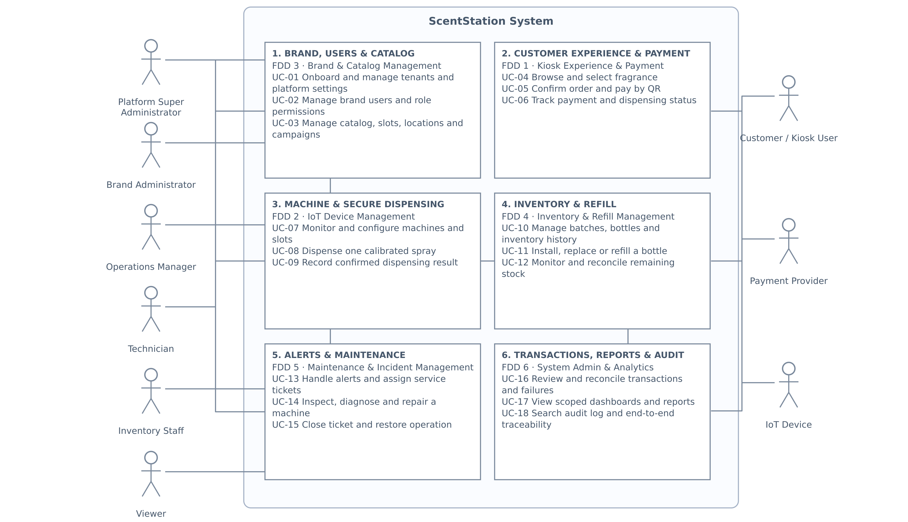

*Figure 2.2. Use case overview of the ScentStation platform.*

### 2.4.2. Actors

| Code | Actor | Type | Description |
| :--- | :--- | :--- | :--- |
| **PSA** | Platform Super Administrator | Human | Operates the platform itself: onboards tenants, sets platform policy, investigates the audit log. Not scoped to any brand. |
| **BA** | Brand Administrator | Human | Highest authority inside one brand: manages that brand's users, catalogue, pricing and locations. |
| **OM** | Operations Manager | Human | Day-to-day operation of machines, transactions and alerts within an assigned scope. |
| **TE** | Technician | Human | Inspects, repairs and returns machines to service. |
| **IS** | Inventory Staff | Human | Manages batches and bottles, performs refills and reconciles stock. |
| **VW** | Viewer | Human | Read-only access to dashboards and reports within a granted scope. Creates, modifies and deletes nothing. |
| **CU** | Customer / Kiosk User | Human | Anonymous end user at the kiosk. Browses, orders, pays and receives a sample. |
| **DEV** | IoT Device | «external» | The sampling machine. Reports heartbeat and telemetry, executes signed dispensing commands and returns results over MQTT. |
| **PP** | Payment Provider | «external» | Issues the payment QR code and confirms payment to the backend. |

PSA, BA, OM, TE, IS and VW all inherit from an abstract **Authenticated User**, which owns UC-00 (Sign in / Sign out). CU is not a generalisation of Authenticated User because the kiosk flow requires no account.

### 2.4.3. Use case inventory

| ID | Use case | Primary actors | Related behaviour | Trace |
| :--- | :--- | :--- | :--- | :--- |
| **UC-00** | Sign in / Sign out | Authenticated User | — | FR1 |
| **UC-01** | Onboard and manage tenants and platform settings | PSA | «extend» Provision Brand Administrator *{tenant onboarding}* | FR1 |
| **UC-02** | Manage brand users and role permissions | BA | «include» Enforce tenant and access scope | FR1 |
| **UC-03** | Manage catalog, slots, locations and campaigns | BA | «include» Configure prices, hours, dose and stock thresholds | FR2 |
| **UC-04** | Browse and select fragrance | CU | «include» View details, price and usage instructions | FR3 |
| **UC-05** | Confirm order and pay by QR | CU, PP | «include» Check availability and generate payment QR | FR3 |
| **UC-06** | Track payment and dispensing status | CU | «extend» Show recovery guidance *{paid, spray failed}* | FR3 |
| **UC-07** | Monitor and configure machines and slots | OM, DEV | «include» Receive heartbeat, telemetry and device events | FR5 |
| **UC-08** | Dispense one calibrated spray | DEV | «include» Verify payment, command and safety interlocks | FR4 |
| **UC-09** | Record confirmed dispensing result | DEV | «include» Update stock and command / event history | FR4 |
| **UC-10** | Manage batches, bottles and inventory history | IS | «include» Register bottle ID, quantity and expiry | FR6 |
| **UC-11** | Install, replace or refill a bottle | IS | «include» Verify slot and fragrance; record refill and weight | FR6 |
| **UC-12** | Monitor and reconcile remaining stock | IS | «extend» Adjust inventory *{authorised + reason}* | FR6 |
| **UC-13** | Handle alerts and assign service tickets | OM | «extend» Auto-create ticket *{critical alert rule}* | FR7 |
| **UC-14** | Inspect, diagnose and repair a machine | TE, DEV | «include» Maintenance mode, checklist and test spray | FR8 |
| **UC-15** | Close ticket and restore operation | TE, DEV | «include» Record repair and pass post-maintenance test | FR8 |
| **UC-16** | Review and reconcile transactions and failures | OM, PP | «extend» Refund or authorised retry *{policy permits}* | FR3, FR9 |
| **UC-17** | View scoped dashboards and reports | VW, BA, PSA | «extend» Export CSV / Excel *{export permission}* | FR9 |
| **UC-18** | Search audit log and end-to-end traceability | PSA | «extend» Investigate security and revoke access *{suspicion}* | FR10 |

---

## 2.5. Use Case Specification

### 2.5.1. Purpose and template
Section 2.4 states *which* use cases exist. This section states *how each one behaves*. Every use case listed in Section 2.4.3 is specified using a single fixed template so that the specifications can be compared, reviewed and turned directly into test cases.

| Field | Content |
| :--- | :--- |
| **Use case ID / Name** | The identifier and name exactly as they appear in Section 2.4.3. |
| **Description** | One or two sentences stating the goal from the primary actor's point of view. |
| **Actors** | Primary actor first, then supporting actors. |
| **Trigger** | The event that starts the use case. |
| **Preconditions** | What must be true before the flow may begin. |
| **Postconditions** | Success guarantee, and the guaranteed state on failure. |
| **Main flow** | Numbered steps, alternating actor action and system response. |
| **Alternative flows** | Branches that still reach the goal, numbered from the main-flow step they leave. |
| **Exception flows** | Branches that do not reach the goal, numbered the same way. |
| **Business rules** | The BR identifiers from Section 2.1.13 that constrain this use case. |
| **Requirements trace** | The FR identifiers this use case realises. |

### 2.5.2. Writing conventions
* Steps are written in the present tense and name the acting party explicitly ("The customer selects…", "The system verifies…").
* A step never describes a screen widget. User interface behaviour belongs to Section 2.10.
* Every alternative and exception flow states the step it branches from and the step it returns to, or states that the use case terminates.
* Every exception flow states the resulting persisted state, so that no failure path leaves the system undefined.
* Where a use case depends on behaviour marked «include» or «extend» in Section 2.4.3, that behaviour is referenced by name rather than repeated.

### 2.5.3. Index of specifications
The nineteen specifications UC-00 through UC-18 are produced from the template above and are maintained as the companion document *Use Case Specification* (Jira SCENT-12), stored in the project Google Drive folder referenced in the README. UC-05 (*Confirm order and pay by QR*) and UC-08 (*Dispense one calibrated spray*) are the two reference specifications: they exercise the payment boundary and the safety-interlock boundary respectively, and the remaining specifications follow their level of detail.

---

## 2.6. Data Flow Diagram (DFD)

### 2.6.1. Overview
Data Flow Diagrams (DFDs) provide a graphical representation of how data moves through the ScentStation platform. Unlike functional decomposition, DFDs focus on the transformation of data inputs into outputs through system processes, external entities, and persistent data stores. The DFD modeling hierarchy for ScentStation is structured across three formal levels:

* **Context Diagram (Level 0):** Represents the entire ScentStation platform as a single process (Process 0.0), mapping all incoming and outgoing data flows between the system and its eight external entities.
* **Level 1 DFD:** Decomposes Process 0.0 into six major functional processes (1.0 to 6.0), establishing the core data stores (D1 to D6) and inter-process data routing.
* **Level 2 DFD (Process 1.0):** Provides a detailed operational view of Process 1.0 (Kiosk Experience & Payment), exploding it into sub-processes 1.1 through 1.5 to map exact order lifecycle events, payment webhook verification, and signed MQTT command triggers.

### 2.6.2. Context Diagram (Level 0)

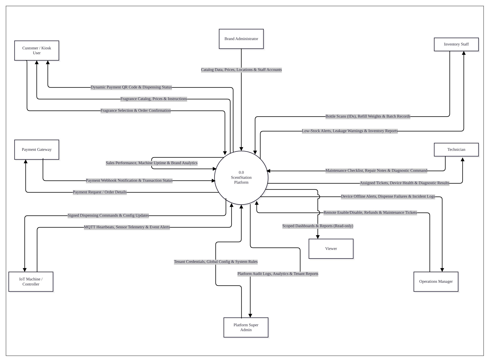

*Figure 2.3. DFD level 0 — context diagram.*

The Level 0 Context Diagram establishes the scope boundary of the ScentStation platform (Process 0.0) by defining its interactions with eight external entities.

**External entities**

| External Entity | Entity Type | Role and Description in ScentStation |
| :--- | :--- | :--- |
| Customer / Kiosk User | Human User | End customer who browses fragrances, creates orders, pays via QR, and receives trial sprays at kiosks. |
| Brand Administrator | Human User | Tenant-level admin who manages product catalogs, spray pricing, machine locations, and staff accounts. |
| Operations Manager | Human User | Operational staff who monitors device health, manages incident tickets, and triggers refunds or retries. |
| Technician | Human User | Technical staff who inspects hardware, executes diagnostic test sprays, and fills maintenance checklists. |
| Inventory Staff | Human User | Warehouse staff who records bottle replacements, registers batch barcodes, and logs refill weights. |
| Platform Super Admin | Human User | Global admin who configures tenant boundaries, manages platform credentials, and monitors system audit logs. |
| Payment Gateway | External System | Third-party payment provider (VNPay/VietQR) that generates payment QR payloads and dispatches payment webhooks. |
| IoT Machine / Controller | External System (DEV) | Physical or software-simulated kiosk hardware communicating telemetry, heartbeats, and executing spray commands over MQTT. |

**Context data flows**

| External Entity | Data flow into the system | Data flow out of the system |
| :--- | :--- | :--- |
| Customer / Kiosk User | Fragrance Selection & Order Confirmation | Fragrance Catalog, Prices & Instructions; Dynamic Payment QR Code & Dispensing Status |
| Brand Administrator | Catalog Data, Prices, Locations & Staff Accounts | Sales Performance, Machine Uptime & Brand Analytics |
| Operations Manager | Remote Enable/Disable, Refunds & Maintenance Tickets | Device Offline Alerts, Dispense Failures & Incident Logs |
| Technician | Maintenance Checklist, Repair Notes & Diagnostic Commands | Assigned Tickets, Device Health & Diagnostic Results |
| Inventory Staff | Bottle Scans (IDs), Refill Weights & Batch Records | Low-Stock Alerts, Leakage Warnings & Inventory Reports |
| Platform Super Admin | Tenant Credentials, Global Config & System Rules | Platform Audit Logs, Analytics & Tenant Reports |
| Payment Gateway | Payment Webhook Notification & Transaction Status | Payment Request / Order Details |
| IoT Machine / Controller | MQTT Heartbeats, Sensor Telemetry & Event Alerts | Signed Dispensing Commands & Config Updates |

### 2.6.3. Level 1 DFD — System decomposition

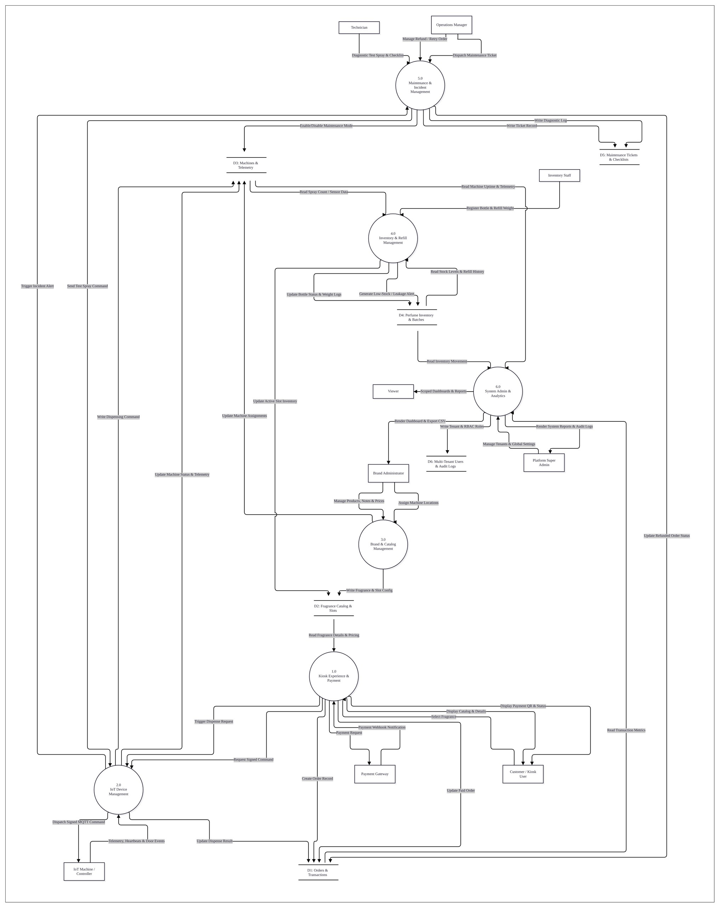

*Figure 2.4. DFD level 1 — major processes and data stores.*

The Level 1 DFD partitions Process 0.0 into six major operational processes and introduces six persistent data stores (D1 to D6) to enforce data persistence and tenant isolation.

**Persistent data stores**

| Store ID | Data Store Name | Primary Entities & Attributes Stored | Associated Processes |
| :--- | :--- | :--- | :--- |
| D1 | Orders & Transactions | Order ID, Tenant ID, Customer QR, Amount, Payment Status (PENDING, PAID, EXPIRED, DISPENSED, REFUNDED), TxRef | 1.0, 3.0, 5.0, 6.0 |
| D2 | Fragrance Catalog & Slots | Product ID, Brand ID, Fragrance Notes, Price per Spray, Slot Assignment, Active Status | 1.0, 3.0, 4.0 |
| D3 | Machines & Telemetry | Machine Serial Number, Slot IDs, Connectivity (ONLINE/OFFLINE), Door State, Weight Sensors, Firmware Version | 1.0, 2.0, 4.0, 5.0 |
| D4 | Perfume Inventory & Batches | Batch Number, Bottle UUID, Initial Volume, Estimated Remaining Volume, Low-Stock Thresholds, Refill History | 4.0, 6.0 |
| D5 | Maintenance Tickets & Checklists | Ticket ID, Machine ID, Assigned Technician, Incident Category, Diagnostic Logs, Checklist Status | 5.0 |
| D6 | Multi-Tenant Users & Audit Logs | User ID, Tenant ID, Password Hash (BCrypt), RBAC Roles, Audit Metadata (Actor, Action, Timestamp, Before/After Values) | 6.0 |

**Major processes and inter-process data routing**

| Process | Data routing |
| :--- | :--- |
| 1.0 Kiosk Experience & Payment | Fetches product pricing and active slots from D2. Upon payment confirmation via Payment Gateway webhook, updates D1 to PAID and emits *Trigger Dispense Request* to Process 2.0. |
| 2.0 IoT Device Management | Receives *Trigger Dispense Request* from Process 1.0, constructs signed MQTT commands, sends them to the IoT Machine (DEV), reads execution acknowledgments, and updates D3 and D1 (to DISPENSED). |
| 3.0 Brand & Catalog Management | Writes brand profiles, products, prices, and slot configurations into D2 and maps machine assignments into D3. |
| 4.0 Inventory & Refill Management | Reads spray execution events from D3, estimates remaining volume, updates stock levels in D4, and emits *Low-Stock Alerts* to Inventory Staff. |
| 5.0 Maintenance & Incident Management | Generates maintenance tickets in D5, receives diagnostic test commands from Technicians, routes test sprays to Process 2.0, and updates refunded orders in D1. |
| 6.0 System Admin & Analytics | Queries transaction metrics from D1, inventory movements from D4, and tenant logs from D6 to render administrative dashboards and CSV reports. |

### 2.6.4. Level 2 DFD — Process 1.0 Kiosk Experience & Payment


*Figure 2.5. DFD level 2 — Kiosk Experience & Payment.*

The Level 2 DFD explodes Process 1.0 into five granular sub-processes (1.1 through 1.5) to detail the customer purchase flow, secure payment webhook verification, and idempotent command triggering.

**Data store interactions.** Process 1.0 interacts with three external entities (Customer / Kiosk User, Payment Gateway, IoT Machine / Controller) and reads and writes across three persistent data stores:

* **D1: Orders & Transactions** — complete customer order records, payment statuses (PENDING, PAID, EXPIRED, DISPENSED, FAILED, REFUNDED), transaction references, and payment webhooks.
* **D2: Fragrance Catalog & Slots** — perfume catalog metadata, fragrance note pyramids (Top, Heart, Base), pricing per spray, slot availability, and brand assignments.
* **D3: Machines & Telemetry** — machine connectivity states (ONLINE/OFFLINE), slot configurations, actuator health, weight sensor telemetry, and door state interlocks.

**Sub-process specification**

| ID | Sub-Process | Incoming Data Flows (Source) | Outgoing Data Flows / Store Operations (Destination) |
| :--- | :--- | :--- | :--- |
| 1.1 | Browse Fragrance Catalog | *Request Fragrance List* (Customer) | Reads D2 (*Read Available Products & Slots*); sends *Display Catalog & Prices* (Customer) |
| 1.2 | View Fragrance Details & Notes | *Select Specific Perfume* (Customer) | Reads D2 (*Read Notes, Images & Slot Status*); sends *Display Fragrance Profile & Spray Cost* (Customer) |
| 1.3 | Create Order & Generate Payment QR | *Confirm Order Selection* (Customer); *Return QR Payload & TxRef* (Payment Gateway) | Reads D2 (*Verify Slot Availability & Price*); writes D1 (*Write Pending Order Record* → PENDING); sends *Request Dynamic Payment QR* (Payment Gateway); sends *Display Payment QR & Countdown* (Customer) |
| 1.4 | Process Payment Webhook | *Send Signed Payment Webhook* (Payment Gateway) | Validates webhook signature and amount; updates D1 (*Update Order Status to PAID*); emits *Trigger Dispense Signal* (1.5) |
| 1.5 | Dispatch Signed Command & Dispense | *Trigger Dispense Signal* (1.4); *Report Dispense Execution Result* (IoT Machine) | Reads D1 (*Read Paid Order & Target Slot*); checks D3 (*Verify Machine Health & Door State*); dispatches *Signed MQTT Dispense Command* (IoT Machine); writes D1 (*Update Order to DISPENSED / FAILED*); writes D3 (*Record Sensor Telemetry & Weight*); sends *Display Final Instructions & Spray Status* (Customer) |

**Execution sequence.** The real-time operational workflow follows a deterministic six-step sequence across sub-processes 1.1 through 1.5:

1. **Catalog browsing (1.1).** The customer initiates interaction at the touch-screen kiosk by sending *Request Fragrance List*. Sub-process 1.1 queries D2 via *Read Available Products & Slots* to filter active products installed in online machines, then returns *Display Catalog & Prices* to render the main menu.
2. **Scent profile discovery (1.2).** The customer taps a perfume card, sending *Select Specific Perfume*. Sub-process 1.2 queries D2 via *Read Notes, Images & Slot Status* to fetch the scent profile (Top, Heart, Base notes), price per spray, and slot availability, and returns *Display Fragrance Profile & Spray Cost*.
3. **Order creation and payment generation (1.3).** The customer confirms the selection. Sub-process 1.3 performs a real-time availability check against D2 (*Verify Slot Availability & Price*), writes a new order record into D1 with status PENDING, sends *Request Dynamic Payment QR* to the Payment Gateway, receives *Return QR Payload & TxRef*, and renders *Display Payment QR & Countdown* with an expiration timer.
4. **Asynchronous payment verification (1.4).** The customer scans the QR code and authorizes payment in their banking app. The Payment Gateway dispatches *Send Signed Payment Webhook* to sub-process 1.4, which validates the webhook signature, currency, and amount, updates the order in D1 to PAID, and emits *Trigger Dispense Signal* to sub-process 1.5.
5. **Safety check and signed command dispatch (1.5).** Sub-process 1.5 fetches the paid order from D1, performs a pre-dispense safety check against D3 (*Verify Machine Health & Door State*) to ensure the kiosk is online, its door is closed, and it is not under maintenance (BR8), then dispatches a signed MQTT payload carrying a unique command UUID and HMAC-SHA256 signature to the IoT Machine.
6. **Hardware execution and status rendering (1.5).** The IoT Machine acknowledges the command, activates the calibrated solenoid valve for one spray cycle, and returns *Report Dispense Execution Result* (SUCCESS / FAIL). Sub-process 1.5 updates the order in D1 to DISPENSED or FAILED, records post-spray telemetry and bottle weight into D3, and displays the final instructions and spray status to the customer.

The handling of a result that never arrives, which leaves the order in the `UNCERTAIN` state required by NFR4.5, is specified with the complete order state machine in Section 2.9.

### 2.6.5. Design value of the DFD
The DFD specifications reflect three key software engineering design values for ScentStation:

1. **Payment and Dispensing Idempotency:** Explicit mapping of payment gateway webhooks and signed MQTT commands guarantees that only verified payments trigger hardware actuation.
2. **Multi-Tenant Data Isolation:** Data stores D2, D4, and D6 enforce tenant boundaries, ensuring multi-brand isolation across all data read/write paths.
3. **Deterministic State Transitions:** The Level 2 DFD maps the principal state transitions (PENDING → PAID → DISPENSED), ensuring transactional integrity and auditability.

---

## 2.7. Database Design (ERD)

### 2.7.1. Design principles
The schema is built on PostgreSQL 16 and follows five rules that are applied without exception.

1. **Shared-schema multi-tenancy.** Every tenant-owned table carries a `brand_id` foreign key. Tenant isolation is enforced in the application layer on every query, satisfying NFR2.3 and BR13. `USERS.brand_id` and `AUDIT_LOGS.brand_id` are nullable, because platform-level accounts and platform-level audit records belong to no single brand.
2. **Normalisation to third normal form,** with two deliberate and documented exceptions: `ORDERS.price_snapshot` and the `jsonb` payload columns.
3. **Immutable financial history.** `ORDERS.price_snapshot` copies the price at the moment the order is created. A later change to `PRODUCTS.price_per_spray` or `MACHINE_SLOTS.price` cannot alter a pending or historical order. This implements BR4 and NFR3.6.
4. **Time zone correctness.** Every point-in-time column uses `timestamptz`, never `timestamp`. Only `INVENTORY_BATCHES.expiration_date`, which is a calendar date, uses `date`.
5. **Semi-structured payloads in `jsonb`,** never in `text`. Device event payloads and audit before-and-after values vary in shape, so they are stored as `jsonb` and remain queryable and indexable.

### 2.7.2. Entity inventory
The schema contains twenty-three tables in seven groups.

**A. Tenancy and identity**

| Table | Purpose | Notable columns |
| :--- | :--- | :--- |
| `BRANDS` | The tenant. One perfume brand. | `name` unique, `status` |
| `ROLES` | The role catalogue. | `role_name` unique |
| `USERS` | Platform and brand accounts. | `brand_id` nullable (null = platform super administrator), `email` unique, `password_hash`, `token_version` |
| `USER_ROLES` | Assignment of roles to users. | Composite primary key (`user_id`, `role_id`) |

`USERS.token_version` is an integer that is incremented whenever an account is disabled, locked or has its permissions changed. Issued JWTs carry the value they were signed with, so every token minted before the increment is rejected at the next request. This is how FR1.8 revokes active sessions without server-side session storage.

**B. Catalogue and physical assets**

| Table | Purpose | Notable columns |
| :--- | :--- | :--- |
| `LOCATIONS` | Sites where machines are placed. | `brand_id`, `address`, `status` |
| `PRODUCTS` | The fragrance catalogue of one brand. | `fragrance_notes`, `price_per_spray` (default price), `status` |
| `MACHINES` | A physical or simulated kiosk. | `serial_number` unique, `device_identity` unique, `connection_status`, `operating_status`, `last_seen_at` |
| `MACHINE_SLOTS` | One fragrance position inside a machine. | `slot_number` (unique together with `machine_id`), `price` nullable, `spray_duration_ms`, `low_stock_threshold` |

`MACHINE_SLOTS.price` is nullable by design: a null means "use `PRODUCTS.price_per_spray`", so a brand-wide price change does not require updating every slot, while a single location can still be priced differently.

`MACHINES` separates `connection_status` (online / offline, derived from the heartbeat) from `operating_status` (active, maintenance, disabled, error, set by people and by rules). The two are independent: a machine can be online and under maintenance at the same time, and both must block new orders.

**C. Inventory**

| Table | Purpose | Notable columns |
| :--- | :--- | :--- |
| `INVENTORY_BATCHES` | A delivery of bottles of one product. | `batch_number`, `quantity_received`, `expiration_date` |
| `INVENTORY_BOTTLES` | One physical bottle. | `bottle_code` unique, `slot_id` nullable, `initial_quantity`, `remaining_quantity`, `installed_at`, `removed_at` |
| `INVENTORY_MOVEMENTS` | Every change to a bottle's quantity. | `movement_type`, `quantity_before`, `quantity_after`, `reason` |

`INVENTORY_BOTTLES.slot_id` is null while a bottle is in the warehouse and is set when the bottle is installed. A partial unique index guarantees that at most one bottle is installed in a slot at any time, implementing BR2.

`INVENTORY_MOVEMENTS` records `quantity_before` and `quantity_after` rather than only the delta, so that the stock level can be reconstructed and audited at any past point in time. `reason` is mandatory when `movement_type = 'ADJUSTMENT'`, which is how FR6 and BR11 make manual corrections accountable.

**D. Orders and payment**

| Table | Purpose | Notable columns |
| :--- | :--- | :--- |
| `ORDERS` | One customer purchase of one spray. | `price_snapshot`, `currency`, `status`, `expires_at` |
| `PAYMENTS` | The payment attempt for an order. | `provider_reference` unique, `payment_method`, `amount`, `status`, `paid_at` |
| `PAYMENT_REFUNDS` | A refund against a payment. | `refund_reference` unique, `amount`, `reason`, `status` |

`PAYMENTS.provider_reference` is unique, so a payment webhook delivered twice by the provider cannot create two payment records. This is the database-level half of NFR3.3.

**E. Device control and telemetry**

| Table | Purpose | Notable columns |
| :--- | :--- | :--- |
| `DISPENSE_COMMANDS` | One signed command sent to a machine. | `command_reference` unique, `idempotency_key` unique, `signature`, `expires_at` (TTL 30 s), `acked_at`, `executed_at`, `failure_reason` |
| `DEVICE_EVENTS` | Discrete events reported by a machine. | `event_type`, `event_reference` unique, `event_data` (`jsonb`) |
| `TELEMETRY_READINGS` | Periodic sensor readings. | `weight_g`, `estimated_remaining`, `door_open`, `leak_detected`, `actuator_state`, `power_status` |

`DISPENSE_COMMANDS` is the safety-critical table. `signature` holds the HMAC-SHA256 signature required by NFR2.6; `expires_at` gives the command a thirty-second time to live so that a message delayed in the broker cannot fire a spray minutes later (BR7); `idempotency_key` plus a partial unique index on `order_id` together guarantee that one paid order yields at most one live command, implementing BR6 and NFR3.4. The separation of `acked_at` from `executed_at` is what makes the `UNCERTAIN` state of NFR4.5 representable: a command that was acknowledged but never reported as executed is exactly a command with `acked_at` set and `executed_at` null.

`TELEMETRY_READINGS` is kept separate from `DEVICE_EVENTS` because the two have different shapes, different volumes and different retention needs: telemetry is high-frequency numeric data suitable for aggregation, while events are low-frequency discrete occurrences.

**F. Operations: incidents, alerts and maintenance**

| Table | Purpose | Notable columns |
| :--- | :--- | :--- |
| `INCIDENTS` | A business-level problem, optionally tied to an order. | `incident_type`, `severity`, `status`, `resolved_at` |
| `ALERTS` | A machine-level condition requiring attention. | `alert_type`, `severity`, `status`, `acknowledged_at`, `resolved_at` |
| `NOTIFICATIONS` | Delivery of an alert to a user. | `notification_type`, `status`, `read_at` |
| `MAINTENANCE_TICKETS` | A unit of maintenance work. | `category`, `priority`, `status`, `due_at`, `corrective_action`, `completed_at` |
| `MAINTENANCE_TASKS` | One checklist item inside a ticket. | `sort_order` (unique together with `ticket_id`), `task_result`, `status` |

`ALERTS` and `INCIDENTS` are distinct on purpose. An alert is raised by the machine or by a rule; an incident is the business consequence, such as a customer who paid and received nothing. Several alerts may be grouped under one incident, and an alert may exist with no incident at all.

**G. Audit**

| Table | Purpose | Notable columns |
| :--- | :--- | :--- |
| `AUDIT_LOGS` | Append-only record of significant actions. | `action`, `entity_type`, `entity_id`, `old_values` (`jsonb`), `new_values` (`jsonb`), `source_ip` |

`old_values` and `new_values` are `jsonb` so that one table can audit every entity type without a column per entity. Write access is restricted to the application and no role is granted `UPDATE` or `DELETE`, implementing BR12 and FR10.4.

### 2.7.3. Relationships

| Parent | Cardinality | Child | Meaning |
| :--- | :--- | :--- | :--- |
| `BRANDS` | 0..1 → 0..* | `USERS` | A user belongs to one brand, or to none if platform-level |
| `BRANDS` | 1 → 0..* | `LOCATIONS`, `PRODUCTS`, `MACHINES` | Everything operational is owned by exactly one brand |
| `USERS` | 1 → 0..* | `USER_ROLES` | A user holds one or more roles |
| `ROLES` | 1 → 0..* | `USER_ROLES` | A role is held by zero or more users |
| `LOCATIONS` | 0..1 → 0..* | `MACHINES` | A machine may be unplaced (in storage) |
| `MACHINES` | 1 → 1..* | `MACHINE_SLOTS` | A machine has at least one slot |
| `PRODUCTS` | 0..1 → 0..* | `MACHINE_SLOTS` | A slot may be configured with no product yet |
| `PRODUCTS` | 1 → 0..* | `INVENTORY_BATCHES` | A batch is a delivery of one product |
| `INVENTORY_BATCHES` | 1 → 0..* | `INVENTORY_BOTTLES` | A bottle comes from exactly one batch |
| `MACHINE_SLOTS` | 0..1 → 0..* | `INVENTORY_BOTTLES` | A bottle is in a slot or in the warehouse |
| `INVENTORY_BOTTLES` | 1 → 0..* | `INVENTORY_MOVEMENTS` | Every quantity change is recorded |
| `MACHINES`, `MACHINE_SLOTS`, `PRODUCTS` | 1 → 0..* | `ORDERS` | An order fixes machine, slot and product |
| `ORDERS` | 1 → 0..* | `PAYMENTS` | An order may be paid after a failed first attempt |
| `PAYMENTS` | 1 → 0..* | `PAYMENT_REFUNDS` | A payment may be refunded in full or in part |
| `ORDERS` | 1 → 0..* | `DISPENSE_COMMANDS` | Historical commands are retained; only one may be live |
| `MACHINES` | 1 → 0..* | `DEVICE_EVENTS`, `TELEMETRY_READINGS`, `ALERTS`, `INCIDENTS`, `MAINTENANCE_TICKETS` | All machine-scoped operational data |
| `INCIDENTS` | 0..1 → 0..* | `ALERTS` | Alerts may be grouped under an incident |
| `ALERTS` | 0..1 → 0..* | `NOTIFICATIONS`, `MAINTENANCE_TICKETS` | An alert may notify users and may open a ticket |
| `MAINTENANCE_TICKETS` | 1 → 0..* | `MAINTENANCE_TASKS` | A ticket contains its checklist |
| `USERS` | 0..1 → 0..* | `AUDIT_LOGS`, `INVENTORY_MOVEMENTS`, `INCIDENTS`, `ALERTS`, `MAINTENANCE_TICKETS`, `MAINTENANCE_TASKS` | Responsibility and assignment |

### 2.7.4. Key constraints and indexes
Four constraints carry business rules that cannot be expressed by foreign keys alone and are therefore enforced in the database rather than only in application code.

```sql
-- BR2: at most one bottle may be installed in a slot at any time.
CREATE UNIQUE INDEX uq_bottle_active_slot
    ON inventory_bottles (slot_id)
    WHERE slot_id IS NOT NULL AND status = 'INSTALLED';

-- BR6: a paid order may have at most one command still in flight.
CREATE UNIQUE INDEX uq_command_active_order
    ON dispense_commands (order_id)
    WHERE status IN ('PENDING', 'SENT', 'ACKED');

-- One slot number may appear only once per machine.
CREATE UNIQUE INDEX uq_slot_number_per_machine
    ON machine_slots (machine_id, slot_number);

-- NFR3.3: a webhook or MQTT message delivered twice is absorbed, not duplicated.
CREATE UNIQUE INDEX uq_payment_provider_ref ON payments (provider_reference);
CREATE UNIQUE INDEX uq_command_idempotency  ON dispense_commands (idempotency_key);
CREATE UNIQUE INDEX uq_device_event_ref     ON device_events (event_reference);
```

Supporting indexes required by the reporting and monitoring requirements of FR9 are declared on `(brand_id, created_at)` for `ORDERS`, `PAYMENTS` and `AUDIT_LOGS`, and on `(machine_id, occurred_at)` for `TELEMETRY_READINGS` and `DEVICE_EVENTS`.

### 2.7.5. Schema diagram
Figure 2.6 shows all twenty-three tables with their full column lists and the cardinality of every relationship, in crow's-foot notation.


*Figure 2.6. Entity Relationship Diagram (ERD) of the ScentStation database.*

---

## 2.8. System Architecture

### 2.8.1. Architectural overview
ScentStation is a three-tier web application extended with an IoT gateway. The four runtime components are deployed and scaled independently, as required by NFR5.3.

```
┌───────────────┐   HTTPS / REST   ┌────────────────────┐    MQTT 3.1.1    ┌──────────────┐
│   Frontend    │ ───────────────> │      Backend       │ ───────────────> │  IoT Device  │
│    Next.js    │ <─────────────── │    Spring Boot     │ <─────────────── │  / Simulator │
│ Kiosk + Admin │       JSON       │  REST + IoT gateway│    JSON payload  └──────────────┘
└───────────────┘                  └─────────┬──────────┘
                                             │ JDBC
                                   ┌─────────┴──────────┐
                                   │    PostgreSQL 16   │
                                   └────────────────────┘
```

The backend is the only component that writes to the database and the only component authorised to confirm a payment or to emit a dispensing command. The kiosk never talks to the device directly, and the device never talks to the payment provider. This single rule is what makes BR5 and BR6 enforceable.

### 2.8.2. Backend layering
The backend follows a strict Controller → Service → Repository → Entity layering, as required by NFR7.1. Calls go downward only; a controller never reaches a repository directly, and an entity never depends on a service.

| Layer | Responsibility | Spring construct |
| :--- | :--- | :--- |
| Controller | HTTP endpoint, request validation, DTO mapping, status codes | `@RestController` |
| Service | Business rules, transaction boundaries, orchestration | `@Service`, `@Transactional` |
| Repository | Data access, query definition | `@Repository`, Spring Data JPA |
| Entity | Persistent domain model | `@Entity` |

Dependencies between layers are injected by the Spring IoC container rather than constructed, so that each layer depends on an interface rather than on a concrete class. This is what allows services to be unit-tested against mocks without a live database, as required by NFR7.2.

The IoT gateway is implemented as a set of Spring components alongside the REST controllers. It subscribes to the device topics, validates and deserialises incoming payloads, and calls the same service layer that the REST controllers use. There is therefore exactly one implementation of each business rule, regardless of whether it is reached from the web or from a device.

### 2.8.3. MQTT topic contract
Device communication uses MQTT 3.1.1 with JSON payloads over a fixed topic hierarchy, as required by NFR8.3.

| Topic | Direction | Purpose |
| :--- | :--- | :--- |
| `scentstation/kiosk/{deviceId}/heartbeat` | Device → Backend | Liveness signal; a missed heartbeat marks the machine `OFFLINE` (NFR4.1, NFR4.2) |
| `scentstation/kiosk/{deviceId}/telemetry` | Device → Backend | Periodic sensor readings: weight, door, leak, actuator, power |
| `scentstation/kiosk/{deviceId}/event` | Device → Backend | Discrete events: door opened, error raised, slot emptied |
| `scentstation/kiosk/{deviceId}/command` | Backend → Device | Signed dispensing command carrying its `idempotency_key` and TTL |
| `scentstation/kiosk/{deviceId}/ack` | Device → Backend | Command received and accepted, or rejected with a reason |
| `scentstation/kiosk/{deviceId}/result` | Device → Backend | Final execution outcome of a command |

`ack` and `result` are deliberately separate topics. An acknowledgement proves only that the device received the command; it does not prove that the spray occurred. Keeping them apart is what allows the backend to distinguish success, failure and the `UNCERTAIN` state of NFR4.5 instead of guessing.

### 2.8.4. Security architecture
Security is applied in four layers, each independently verifiable.

1. **Authentication.** Stateless JWT bearer tokens. Passwords are hashed with BCrypt (NFR2.1). Revocation uses the `token_version` mechanism described in Section 2.7.2.
2. **Authorisation.** Role-based access control at the method level, combined with tenant scoping. Every tenant-scoped query is filtered by `brand_id` at the persistence layer, so an unscoped query cannot be written by accident (NFR2.2, NFR2.3, BR13).
3. **Transport.** HTTPS between browser and backend. Commands crossing the MQTT broker are additionally protected by the signature in layer 4, so their integrity does not depend on the broker.
4. **Command integrity.** Every dispensing command is signed with HMAC-SHA256 and carries a thirty-second TTL. The device verifies the signature, the addressed device identity, the expiry and the idempotency key before actuating, and rejects the command if any check fails (NFR2.6, BR7).

### 2.8.5. Technology stack

| Tier | Technology |
| :--- | :--- |
| Frontend | Next.js, React, TypeScript, Tailwind CSS |
| Backend | Java 21, Spring Boot 3, Spring Security, Spring Data JPA |
| Database | PostgreSQL 16 (`jsonb`, partial indexes), Flyway migrations |
| Messaging | Eclipse Mosquitto broker, Eclipse Paho client |
| Security | JWT, BCrypt, HMAC-SHA256 |
| Testing | JUnit 5, Mockito |
| Tooling | IntelliJ IDEA, VS Code, Git, GitHub, Jira, Docker |

---

## 2.9. Main Business Workflow (Ordering - Payment - Spraying)

### 2.9.1. Scope
This section traces one complete customer transaction across all four components, from fragrance selection to the inventory deduction that closes it. It is the workflow that binds FR3, FR4, FR5 and FR6 together, and the one that the business rules BR3 through BR10 exist to protect.

### 2.9.2. Order state machine
The state names below are the ones used by data store D1 in the Data Flow Diagrams of Section 2.6, whose Level 2 diagram shows the principal path `PENDING → PAID → DISPENSED`. Three further states are added here because the requirements demand them: `DISPENSING` separates "command sent" from "result known", `UNCERTAIN` is required by NFR4.5, and `CANCELLED` is required by FR3.11.

| State | Meaning | Next states |
| :--- | :--- | :--- |
| `PENDING` | Order exists, price fixed, payment QR issued, awaiting payment | `PAID`, `CANCELLED`, `EXPIRED` |
| `PAID` | Payment confirmed by the backend from the provider | `DISPENSING` |
| `DISPENSING` | Signed command sent, awaiting the device result | `DISPENSED`, `FAILED`, `UNCERTAIN` |
| `DISPENSED` | Spray confirmed, inventory deducted | — (terminal) |
| `FAILED` | The device reported a definite failure or rejected the command | `REFUNDED` |
| `UNCERTAIN` | No confirmed result within the timeout | `DISPENSED`, `FAILED` (by human review only) |
| `CANCELLED` | The customer abandoned the order before paying | — (terminal) |
| `EXPIRED` | Not paid within the validity window | — (terminal) |
| `REFUNDED` | Refund completed against the payment | — (terminal) |

A payment attempt that the provider reports as unsuccessful is recorded in `PAYMENTS.status`; the order itself stays `PENDING`, so the customer may retry until the order expires.

`UNCERTAIN` is the state that makes the workflow safe. It is reached whenever the backend cannot prove either outcome, and it is the only state that no automatic process may leave: resolution requires a person, and no second dispensing command is ever generated from it (BR14, NFR4.5).

### 2.9.3. Main flow

1. The customer browses the fragrances available on that machine. Only products installed in an online, operational machine with a non-empty slot are offered (BR3).
2. The customer selects a fragrance. The backend creates the order, copies the effective price into `price_snapshot` and sets `expires_at` (BR4). State becomes `PENDING`.
3. The backend requests a payment QR code from the payment provider and displays it on the kiosk with a countdown.
4. The customer pays. The provider notifies the backend over its webhook.
5. The backend verifies the webhook signature, payment reference, amount, currency and transaction status (FR3.7). Only this verification may mark the order paid; what the kiosk displays is never accepted as proof (BR5). State becomes `PAID`.
6. The backend creates a dispensing command: a new `idempotency_key`, an HMAC-SHA256 signature over the payload, and an expiry thirty seconds in the future. The partial unique index on `order_id` guarantees that this is the only command in flight for the order (BR6). State becomes `DISPENSING`.
7. The command is published to `scentstation/kiosk/{deviceId}/command`.
8. The device verifies the signature, the device identity, the expiry and the idempotency key. A command failing any check is rejected and never actuated (BR7). It then checks its safety interlocks: door closed, not in maintenance, slot not empty, no critical hardware error (BR8). It publishes its decision to the `ack` topic.
9. The device actuates the pump for the configured `spray_duration_ms` and publishes the outcome to the `result` topic.
10. The backend records the result, deducts the dispensed quantity from `INVENTORY_BOTTLES.remaining_quantity` and writes the corresponding row to `INVENTORY_MOVEMENTS` (BR10). State becomes `DISPENSED`.
11. The kiosk shows the completion screen and returns to the idle state.

### 2.9.4. Exception handling

| Failure point | Condition | System response |
| :--- | :--- | :--- |
| Step 2 | Machine goes offline before payment | Order is not created; new orders are refused while the machine cannot communicate (BR9) |
| Step 3–4 | Customer does not pay within the validity window, cancels, or the provider reports failure | Order becomes `EXPIRED` or `CANCELLED`; a failed payment attempt leaves the order `PENDING`. None of these states can ever generate a command (FR3.10) |
| Step 4 | The provider delivers the same webhook twice | The second is absorbed by the unique index on `provider_reference`; no second order and no second command (NFR3.3) |
| Step 8 | The device rejects the command | Order becomes `FAILED` with the rejection reason recorded; an incident is opened and the payment becomes refundable |
| Step 8 | A safety interlock blocks actuation | Same as above; the machine's `operating_status` is updated and an alert is raised |
| Step 9 | No `result` arrives before the timeout | Order becomes `UNCERTAIN`. An incident is opened for human review. No second command is generated (BR14) |
| Step 9 | The device publishes the same result twice | The second is absorbed by the command's idempotency key; inventory is deducted once (NFR3.4) |
| Step 10 | Inventory deduction fails | The transaction is rolled back; the order is held for review rather than being reported as complete |

Every path through this table ends in a persisted, named state. There is no path on which the system silently does nothing, and no path on which a customer's payment is consumed without a corresponding record that an operator can act on.

---

## 2.10. User Interface Design (UI/UX)

### 2.10.1. Scope and principles
The platform presents two distinct interfaces. The **kiosk interface** is used by anonymous customers on a touch screen in a retail environment; it is optimised for a minimal number of taps and for legibility at a distance. The **management portal** is used by authenticated staff on desktop and tablet; it is optimised for density, filtering and bulk review.

Both follow the usability requirements of Section 2.2.8:

* Every operational state has a visible representation; no state is silent (NFR6.2).
* Menus and actions are rendered according to the authenticated user's role and scope, so a user is never shown a control they are not permitted to use (NFR6.3, NFR2.2).
* Destructive or high-impact actions — deleting accounts, changing prices, adjusting inventory, issuing refunds — require explicit confirmation (NFR6.5).
* Status is conveyed by text and icon in addition to colour, so that the interface remains usable without colour perception (NFR6.6).
* Management screens are responsive across desktop and tablet resolutions (NFR6.4).

### 2.10.2. Screen inventory
Each screen below is specified as a set of interactive elements, each with its user interaction and the required system response.

| # | Screen | Primary users | Trace |
| :--- | :--- | :--- | :--- |
| 1 | Login / Authentication | All authenticated roles | FR1, UC-00 |
| 2 | Dashboard | PSA, BA, OM, VW | FR9, UC-17 |
| 3 | Notifications / Alerts | OM, TE, IS | FR7, UC-13 |
| 4 | Profile / Account | All authenticated roles | FR1 |
| 5 | Brands | PSA, BA | FR1, UC-01, UC-02 |
| 6 | Perfume Products | BA | FR2, UC-03 |
| 7 | Machines | OM, TE | FR2, FR5, UC-07 |
| 8 | Transactions | OM, BA | FR3, FR9, UC-16 |
| 9 | Inventory | IS, OM | FR6, UC-10, UC-12 |
| 10 | Refill / Replacement | IS | FR6, UC-11 |
| 11 | Maintenance | TE, OM | FR8, UC-14, UC-15 |
| 12 | Users & Roles | PSA, BA | FR1, UC-02 |
| 13 | Reports | PSA, BA, OM, VW | FR9, UC-17 |
| 14 | Settings | PSA, BA | FR1, FR2, FR10 |
| 15 | Kiosk Experience | CU | FR3, UC-04, UC-05, UC-06 |

Screen 14, *Settings*, is further organised into nine tabs: General, Brands, Machines, Payment, Notifications, System, Security, Integrations and Audit Logs.

### 2.10.3. Specification format
For each interactive element the specification records three things:

| Field | Content |
| :--- | :--- |
| **Element** | The control, its label as rendered, and its purpose |
| **User interaction** | What the user does with it |
| **System response** | What the system must do, including the behaviour when no data matches and when the user lacks permission |

Specifying the empty result and the unauthorised result for every element, rather than only the successful one, is what makes the screens testable against NFR6.2 and NFR2.2.

### 2.10.4. Interface mockups
The mockups below show every screen listed in Section 2.10.2. They define the visual layout and the controls that the element-by-element specification refers to.

#### Management portal

**Login / Authentication.** Sign-in with email and password, remember-me, password recovery and the role-based access notice. After authentication the user is routed to the screens permitted by their role.


*Figure 2.7. Login / Authentication.*

**Dashboard.** KPI cards, transaction and revenue trend, machine status, top brands, recent transactions, active alerts, inventory status, maintenance overview and machine locations, all filtered by date range, brand and the user's scope.

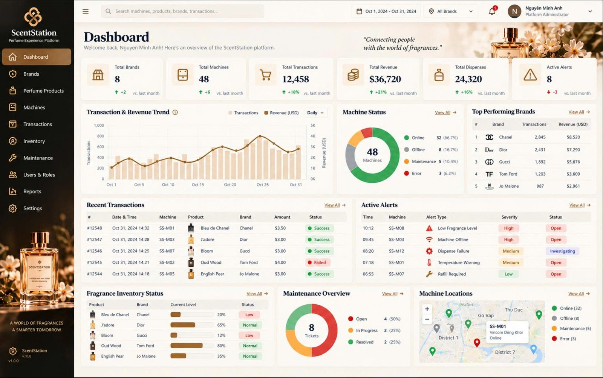

*Figure 2.8. Dashboard.*

**Notifications / Alerts.** Alert summary by severity, alert categories, search and filters, the alert table and the detail panel with *Mark as Resolved*, *Create Maintenance Ticket* and *View Machine*.

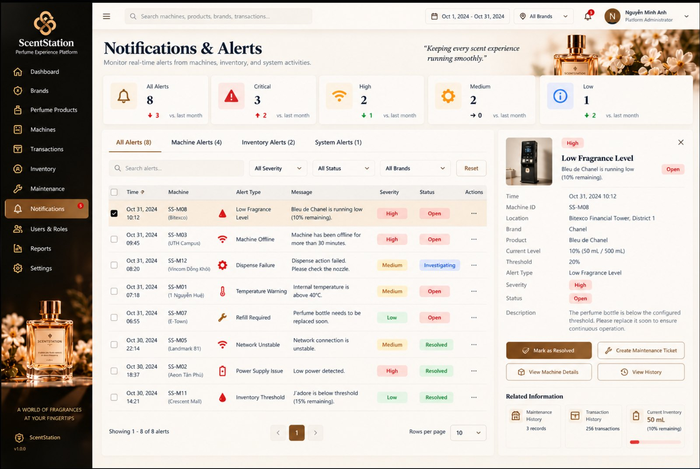

*Figure 2.9. Notifications / Alerts.*

**Profile / Account.** Profile information, password change, two-factor authentication, personal preferences and the list of active sessions with sign-out.

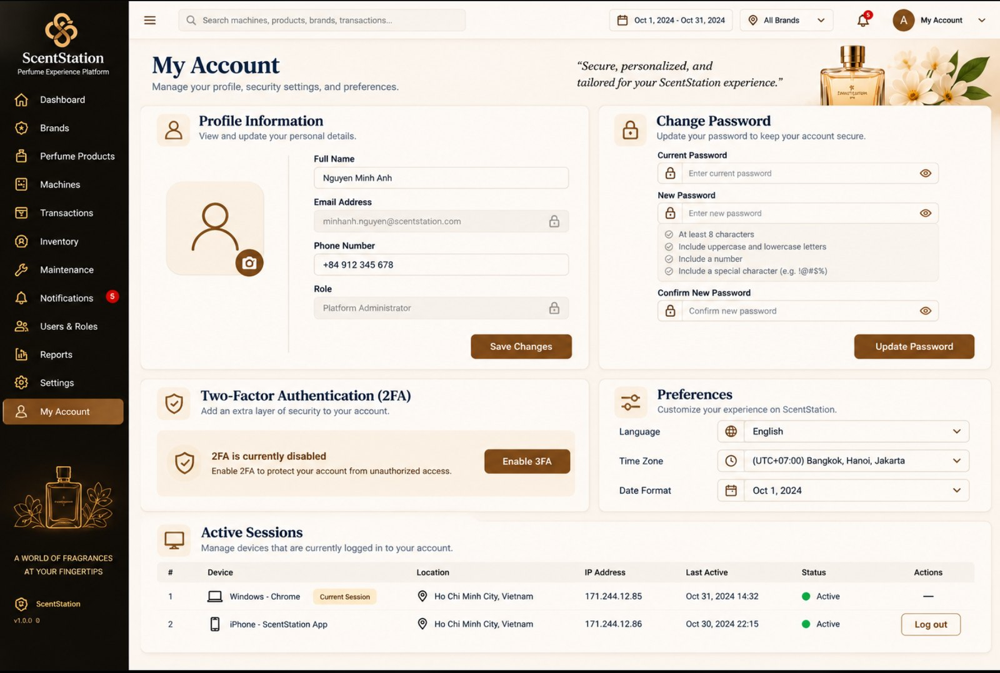

*Figure 2.10. Profile / Account.*

**Brands.** Brand list with search, status filter, sorting and grid or list view; the brand detail panel shows overview, products, machines, transactions, performance and brand images.


*Figure 2.11. Brands.*

**Perfume Products.** Product catalogue with brand, category and status filters, summary cards, product cards and the detail panel covering usage in machines, inventory and analytics.


*Figure 2.12. Perfume Products.*

**Machines.** Machine overview, map and list views, machine cards and the detail panel with real-time sensors, perfume slots, remote control, restart, logs and ticket creation.

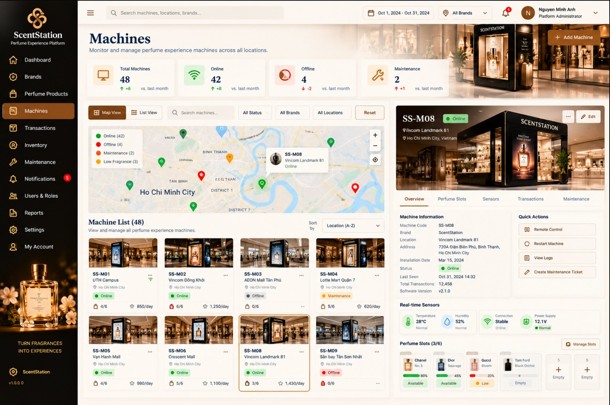

*Figure 2.13. Machines.*

**Transactions.** Transaction summary, trend, top products and machines, search, status and payment filters, the transaction table, transaction detail and export.


*Figure 2.14. Transactions.*

**Inventory.** Inventory overview, search and filters, views by product, brand, location and machine, stock receipt, stock movements, low-stock alerts and stock trend.

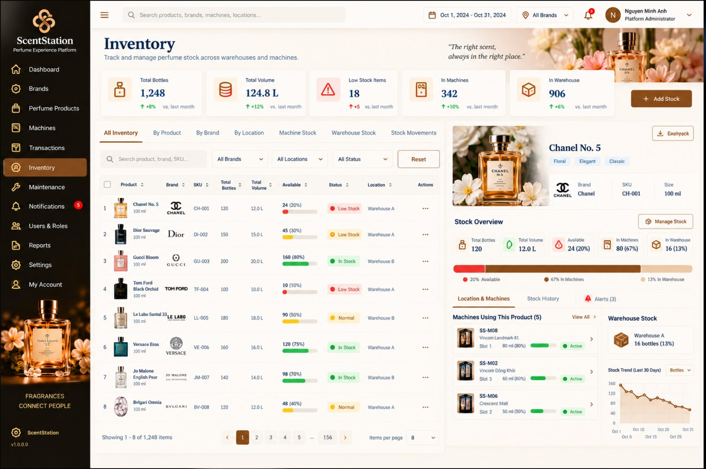

*Figure 2.15. Inventory.*

**Refill / Replacement.** Refill task overview, task creation and assignment to a technician, the refill or replacement process, bottle confirmation, post-refill testing and task history.

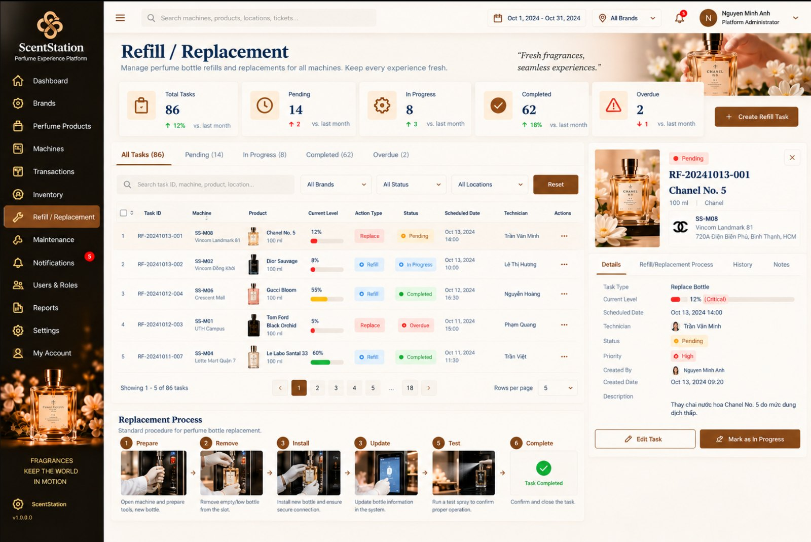

*Figure 2.16. Refill / Replacement.*

**Maintenance.** Maintenance summary and trend, tickets by issue type, upcoming maintenance, the ticket table and the ticket detail with inspection checklist, timeline, attachments and completion.

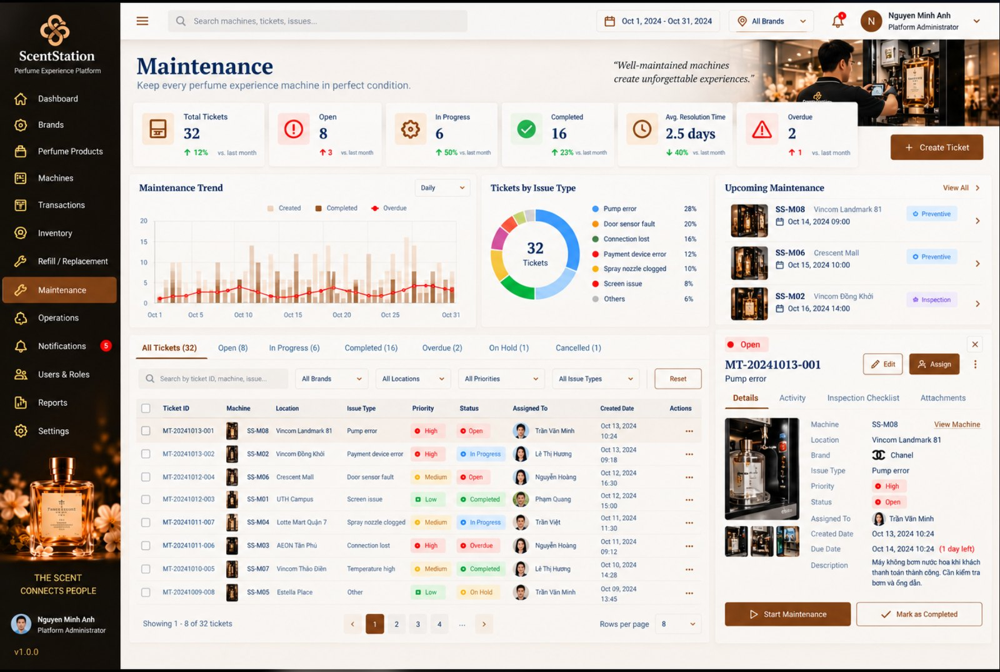

*Figure 2.17. Maintenance.*

**Users & Roles.** User summary, user list, invitation, role and permission management, brand access scoping, user profile and access-request history.


*Figure 2.18. Users & Roles.*

**Reports.** Report KPIs and categories, revenue trend and revenue by brand, top machines and products, payment methods, sales by location, revenue against sprays, the daily heatmap, export and custom reports.


*Figure 2.19. Reports.*

#### Settings
The Settings screen is organised as nine tabs. Each tab is restricted to the roles that own that configuration area.

**Settings — General:** platform information, appearance and theme, system preferences, email, notifications, data management, security and integration overview.


*Figure 2.20. Settings — General.*

**Settings — Brands:** per-brand basic information, visual identity, operational settings, access and permissions, locations and machines.

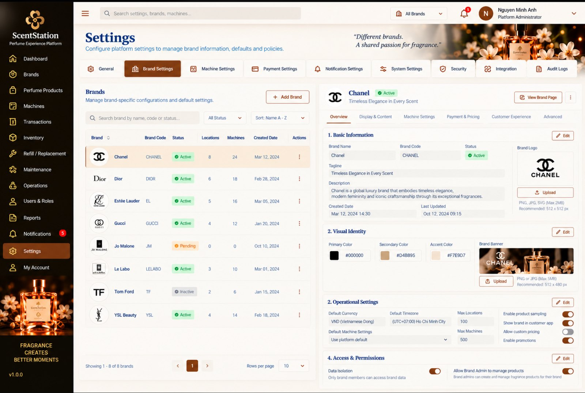

*Figure 2.21. Settings — Brands.*

**Settings — Machines:** per-machine basic information, status and health, dispensing configuration, product configuration, network, display and location.

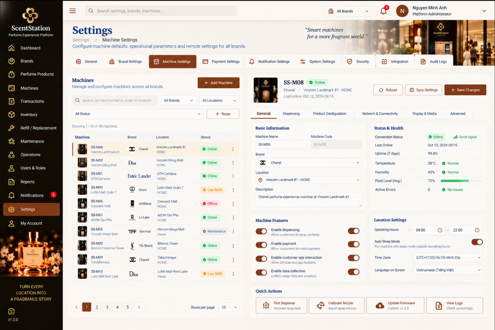

*Figure 2.22. Settings — Machines.*

**Settings — Payment:** payment overview, payment methods and their configuration, payment-flow settings, pricing and tax, transaction settings.

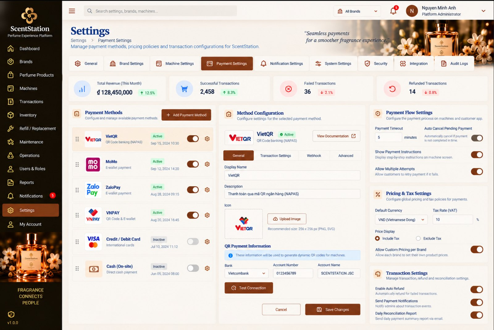

*Figure 2.23. Settings — Payment.*

**Settings — Notifications:** notification channels, email configuration, event triggers, default recipients, templates and test notifications.

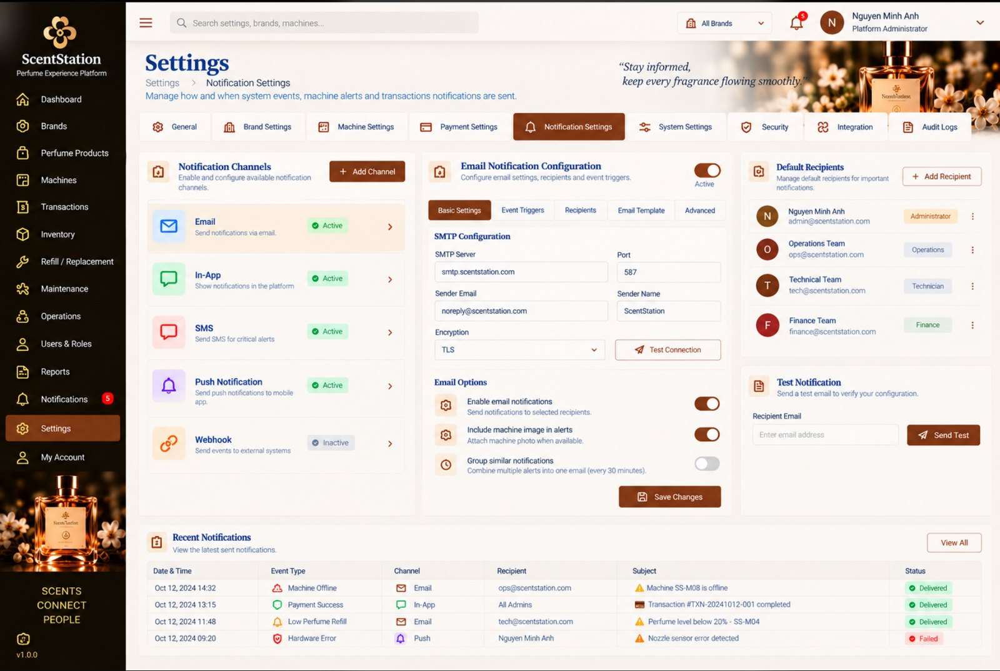

*Figure 2.24. Settings — Notifications.*

**Settings — System:** platform information, operational policies, data retention and backup, maintenance mode, system operations and service health.

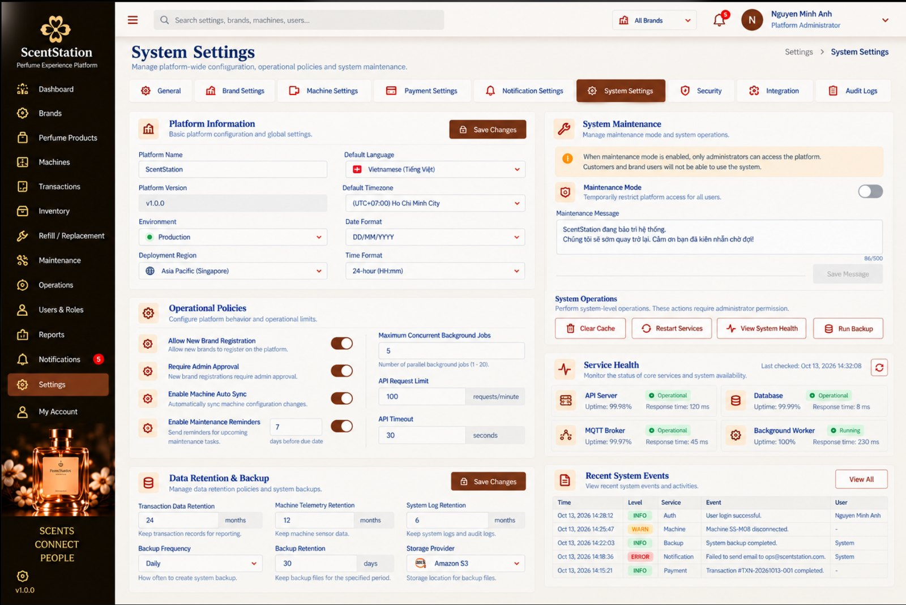

*Figure 2.25. Settings — System.*

**Settings — Security:** password and authentication policy, session management, account lockout, IP access control, active sessions and security events.

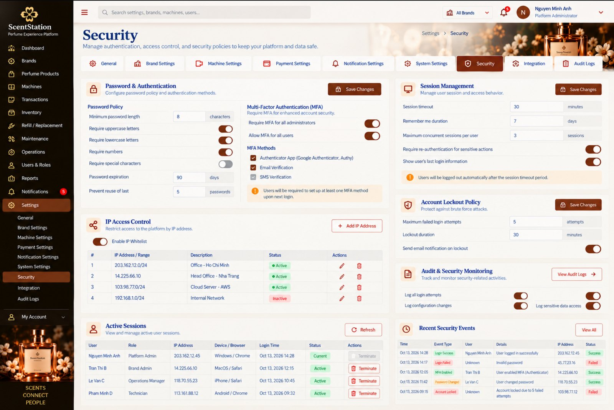

*Figure 2.26. Settings — Security.*

**Settings — Integrations:** integration list and configuration, MQTT broker connection, webhook and event delivery, and integration history.

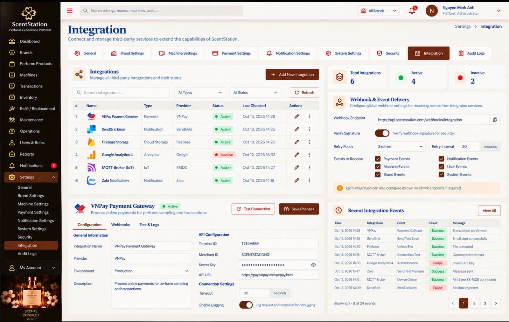

*Figure 2.27. Settings — Integrations.*

**Settings — Audit Logs:** audit-log search, quick filters, the log table, log detail and export.

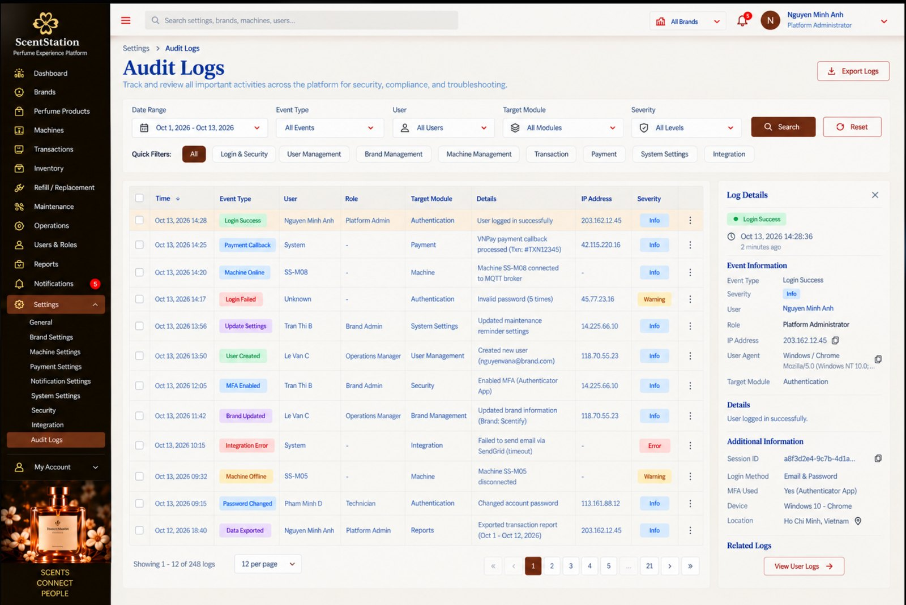

*Figure 2.28. Settings — Audit Logs.*

#### Kiosk interface
**Kiosk Experience.** The customer-facing touch screen: fragrance discovery, category tabs, product cards, usage guidance, the selected-item panel and the payment QR code. It is the only screen used by the Customer / Kiosk User and requires no sign-in.


*Figure 2.29. Kiosk Experience.*
