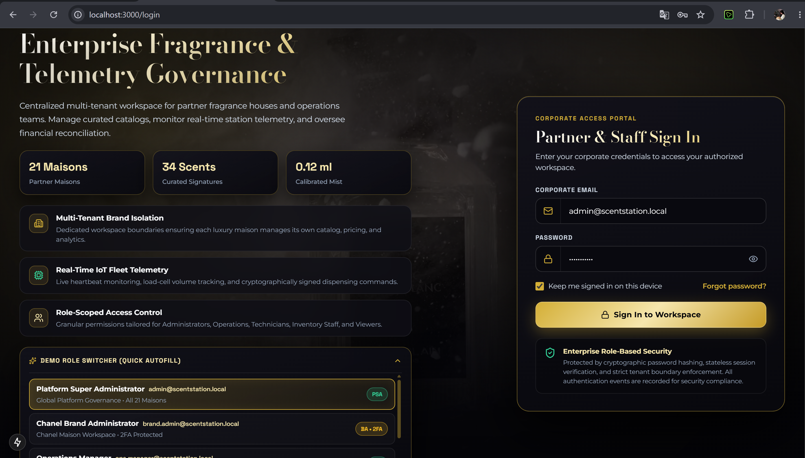
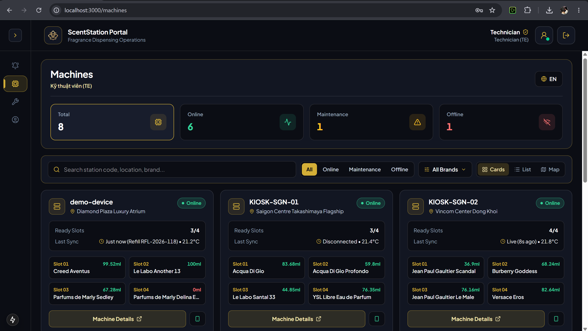
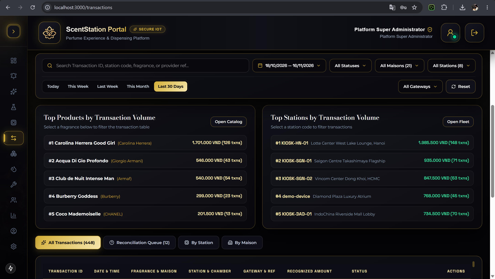
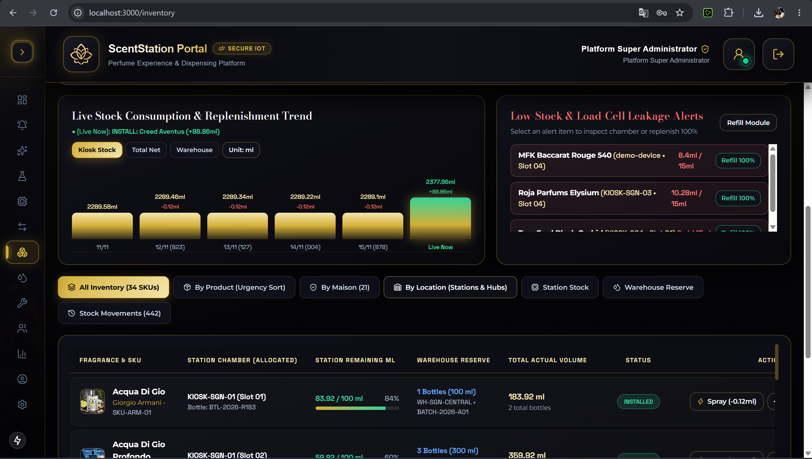
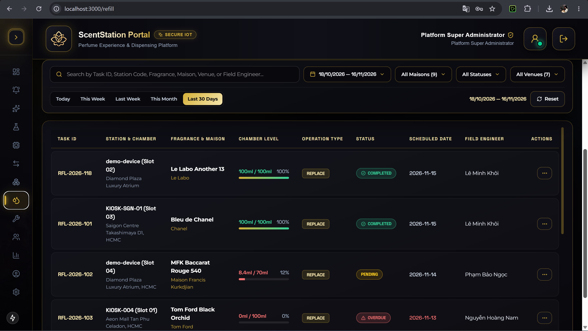
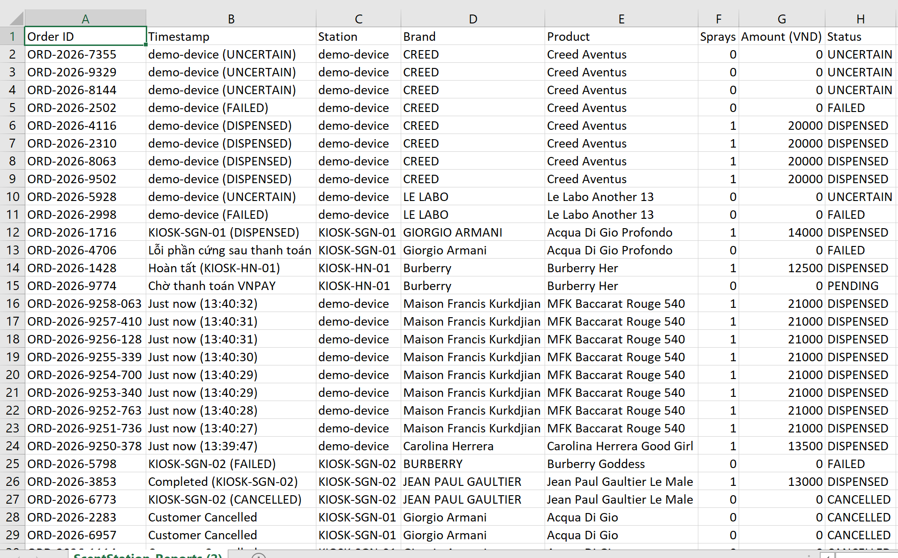
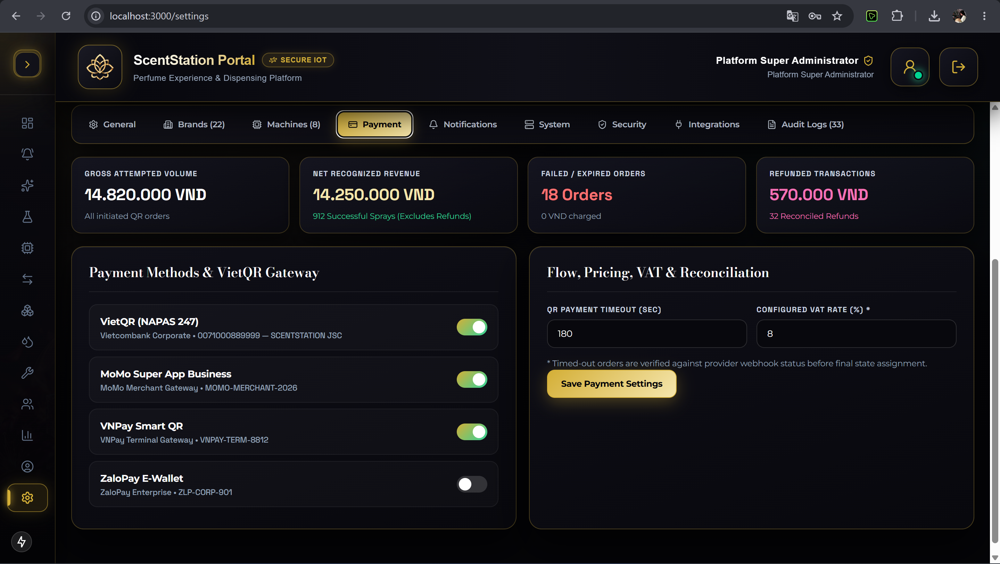
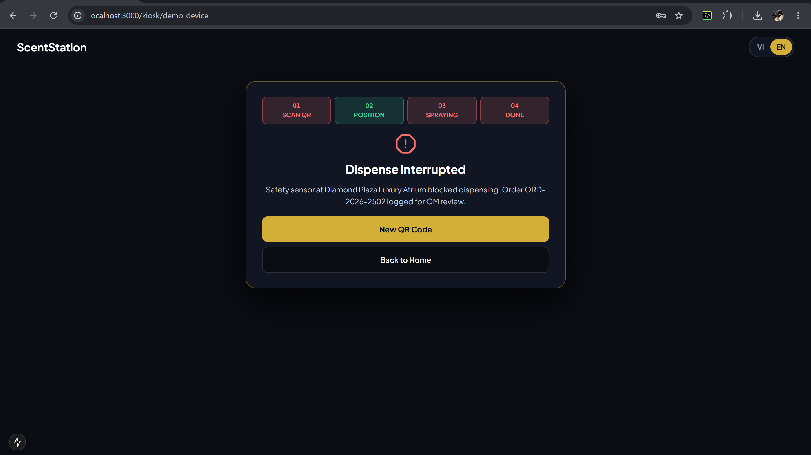

# Chapter 3. Implementation and Testing

## 3.1. Implementation Environment

### 3.1.1. What the system is built with

Section 1.5 chose the technologies and gave the reasons. This section records
the versions the implementation actually uses, so that the results in
Sections 3.5 to 3.7 can be reproduced on another machine.

| Tier | Technology | Version | Why this one |
| :--- | :--- | :--- | :--- |
| Backend | Java | 21 (LTS) | Long-term support, and records and pattern matching are used throughout the domain code |
| Backend | Spring Boot | 3.3.5 | Web, validation, AOP, Data JPA and Security as one managed set of versions |
| Backend | Spring Security | 6 (managed by Boot) | Stateless JWT, method-level authorisation |
| Backend | Hibernate / JPA | 6 (managed by Boot) | The `@Filter` that enforces brand isolation (BR13) |
| Backend | Flyway | managed by Boot | Versioned migrations; the schema is never generated from the entities |
| Backend | jjwt | 0.12.6 | Signing and verifying access tokens |
| Backend | Eclipse Paho | 1.2.5 | MQTT client for the device link |
| Database | PostgreSQL | 16 | Partial unique indexes, which carry BR2, BR6, NFR3.3 and NFR3.4 |
| Broker | Eclipse Mosquitto | 2.0 | MQTT 3.1.1 broker between the backend and the devices |
| Device | Java | 21 | The simulator is the device tier (Section 2.8.1), not a stand-in for it |
| Device | Jackson | 2.17.2 | The canonical JSON the command signature is computed over |
| Frontend | Next.js | 15.1.6 | App Router, React 19 |
| Frontend | TypeScript | 5 | Field names in `docs/api-contract.md` are checked at compile time |
| Frontend | Tailwind CSS | 4 | Utility styling for the portal and the kiosk screen |
| Tests | JUnit 5, Mockito, AssertJ | managed by Boot | Unit tests (Section 3.5) |
| Tests | Testcontainers (PostgreSQL) | managed by Boot | Integration tests against a real database (Section 3.6) |
| Build | Maven | 3.9 or later | Both Java projects |
| Build | Node.js | 20 or later | The frontend |
| Infrastructure | Docker Compose | v2 | Brings up PostgreSQL and Mosquitto identically for every member |
| Collaboration | Git and GitHub, Jira | — | One repository, one branch per task, one pull request per task |

PostgreSQL is the choice Section 1.5.2 argued for, and Section 2.7.4 is why.
Four business rules are enforced by partial unique indexes — an index with a
`WHERE` clause — and MySQL has no such feature. On MySQL those four rules
would exist only in Java, where two concurrent requests can both pass the
same check before either writes.

### 3.1.2. Bringing it up

The infrastructure is a container each, so that no member installs a database
by hand and every member runs the same versions:

```bash
docker compose up -d        # PostgreSQL 16 and Mosquitto 2.0
cd backend && mvn spring-boot:run
```

Flyway applies `V1__core.sql`, `V2__transaction.sql` and
`V3__refunds_and_audit.sql` on the first start. The API then answers on
`http://localhost:8080`, the broker listens on `1883`, and the database is
reachable on `5432` as the user `scent`.

The device tier and the frontend are started separately, each in its own
terminal:

```bash
cd simulator && mvn package && java -jar target/simulator.jar --device=KIOSK-001
cd frontend  && npm install && npm run dev        # http://localhost:3000
```

The simulator's `--secret` must match the backend's
`scentstation.mqtt.command-secret`. If it does not, every command is refused
on its signature and nothing is ever sprayed — which is the correct behaviour
under BR7, and the first thing to check when a demonstration will not work.

### 3.1.3. How the schema is managed

`ddl-auto` is set to `validate`, never `update`. Flyway owns the schema and
the entities are checked against it: if an entity no longer matches its table,
the application refuses to start rather than quietly altering the database.
Two reasons made this worth the extra discipline.

First, `update` cannot create a partial unique index, so the four constraints
of Section 2.7.4 would simply not exist. Second, a migration file is a record
of what changed and when, which is what lets five people change the schema in
one repository without overwriting one another.

The rule that follows from it: **a migration that has been pushed is never
edited.** A change to the schema is a new migration with the next number.

Three scripts under `backend/src/test/resources/` check the database without
the application running, and their output is the evidence used in Section 3.6:
`m1-schema-check.sql` for the core tables and the seeded accounts,
`m2-schema-check.sql` for the transaction and inventory tables, and
`constraint-check.sql` for the four partial unique indexes. In addition,
`tools/check_schema_mapping.py` compares every mapped column, type,
nullability and enumeration against the live database and reports all the
disagreements at once, rather than the single column a failed start-up would
name.

### 3.1.4. Configuration

Everything that differs between machines is a setting, not a code change.
Backend settings live under `scentstation` in `application.yml` and can be
overridden by environment variables; the frontend reads `NEXT_PUBLIC_API_URL`
and `NEXT_PUBLIC_USE_MOCKS` from `.env.local`.

| Setting | Default | What it governs |
| :--- | :--- | :--- |
| `security.jwt-secret` | a development value | Token signing; at least 32 bytes or the application refuses to start |
| `order.ttl-seconds` | 180 | How long an unpaid order stays `PENDING` (FR3.9) |
| `dispensing.command-ttl-seconds` | 30 | How long a command stays valid (BR7) |
| `dispensing.result-timeout-seconds` | 60 | After this, an order becomes `UNCERTAIN` (BR14, NFR4.5) |
| `dispensing.dose-ml` | 1 | Millilitres per spray, deducted from stock on a confirmed result |
| `mqtt.heartbeat-timeout-seconds` | 45 | After this, a machine is marked `OFFLINE` (FR5.2) |
| `mqtt.command-secret` | a development value | Must match the simulator's `--secret` |

The development values, including the seeded administrator account
`admin@scentstation.local`, exist so that the system can be started and
demonstrated from a fresh checkout. They are development credentials and are
documented as such in `docs/api-contract.md`; they would be replaced before
the system was put in front of anyone outside the team.

### 3.1.5. Working environment

Members work on different operating systems, which is itself a reason for
choosing Docker Compose over local installations: the database and the broker
are the same images and behave identically on every machine, so a defect is
never explained away by someone's setup.

<!-- TODO(Tra My): name the operating systems and the editors the five of us
     actually used, and the Java and Node versions each member has installed.
     Everything else in this section was read from the repository. -->

The repository is `tkimngan040/laptrinhjava` on GitHub. Each task has a branch
named after its Jira key and reaches `main` through a pull request that
another member reviews, so no one merges their own work unreviewed. Task
assignment, due dates and the four integration milestones are tracked in the
Jira project `SCENT`.

## 3.2. Source Code Structure

The repository holds three source projects, matching the three tiers of the
architecture in Section 2.8.1, plus the shared documents the team works from.

```
LapTrinhJava/
├── backend/                 Spring Boot: REST API and IoT gateway
├── simulator/               Java: the device tier
├── frontend/                Next.js: admin portal and kiosk screen
├── docs/                    API contract and test plan
├── tools/                   Schema, statistics and work-log scripts
├── Report/                  This report and its figures
└── Work Log/                Weekly logs, one file per member
```

<!-- TODO(Long): IDE screenshot of the project tree, saved as Report/Diagram_image/Ch3/fig-3-1-project-structure.png -->

*Figure 3.1. Project structure as shown in the IDE.*

### 3.2.1. Layering

Section 2.8.2 requires calls to flow in one direction only:

| Layer | Responsibility | May call |
|---|---|---|
| Controller | HTTP: parse the request, shape the response | Service |
| Service | Business rules and transaction boundaries | Repository |
| Repository | Persistence, one interface per aggregate | Entity |
| Entity | State and the invariants that belong to it | — |

A controller never reaches a repository directly, and an entity never depends
on a service. The package layout below makes a breach of that rule visible on
sight rather than something a reviewer has to go looking for.

### 3.2.2. Packages organised by business area

```
vn.edu.uth.scentstation
├── ScentStationApplication.java
├── config/              Clock, bound configuration properties
├── common/              BaseEntity, TimestampedEntity, ApiException, ApiError, GlobalExceptionHandler
├── security/            JWT, roles, tenant isolation
├── iot/                 MQTT gateway, topics, command signing
└── domain/
    ├── brand/           Tenants
    ├── user/            Accounts, roles, sign-in
    ├── catalog/         Products, machines, slots, locations
    ├── order/           Order state machine, ordering, payment, review and refunds
    ├── dispensing/      Dispensing commands and their results
    ├── inventory/       Batches, bottles, stock movements
    ├── alert/           Alerts and notifications
    ├── maintenance/     Tickets and checklists
    ├── audit/           Audit trail (BR11, BR12)
    └── report/          Dashboards and reports
```

The obvious alternative was to put `controller/`, `service/` and `repository/`
at the top level. With ten functional areas and twenty-three tables, those
three folders would each have grown to several dozen files, and reading one
flow end to end would mean jumping between three places.

Organising by business area instead makes each `domain/*` package a vertical
slice holding its own entity, repository, service and controller. Two
consequences matter for a team of five working in parallel. Each member owns a
few packages outright, so Git conflicts are rare. And the layering still
holds — it simply lives inside each package rather than above them all.

The ownership map is recorded in `OWNERS.md` at the repository root, so that
"who should change this file" never needs to be asked.

### 3.2.3. The IoT gateway sits apart but shares the services

`iot/` is deliberately outside `domain/`. It subscribes to the MQTT topics,
validates each inbound message, converts it to Java objects, and then calls
the same service a REST controller would call. It contains no business rule of
its own.

This follows Section 2.8.2 directly: *"There is therefore exactly one
implementation of each business rule, regardless of whether it is reached from
the web or from a device."* Stock is deducted by `InventoryService` whether the
spray was confirmed by a device result or corrected by an operator, and an
order changes state only through `OrderStateMachine` whichever direction the
request came from.

It also halves the work in Section 3.6: an integration test exercises one path
through the rules rather than two parallel ones that have to be kept in step.

### 3.2.4. Three classes exist in both projects

`Topics`, `CanonicalJson` and `CommandSigner` are duplicated, byte for byte,
in the backend and in the simulator.

The duplication is intentional. These three define the wire contract between
the two processes: the topic names, the exact string that gets signed, and the
HMAC over it. Sharing them through a library would make the simulator depend
on the backend's build, which would undermine the point of the simulator being
an independent device. Keeping two copies that must stay identical is the
smaller cost, and the class comment on each says so, because a silent drift
between them makes every command fail its signature check for reasons that
point nowhere near the cause.

### 3.2.5. Statistics

Counted on 4 November 2026 over production code only (`src/main`), with
`tools/code_stats.py`, which regenerates the table. Run it again before
submission: the `alert`, `maintenance` and `report` packages are still empty,
so these figures will grow.

| Measure | Value |
|---|---|
| Java source files (backend and simulator) | 91 |
| Lines of Java | 6,775 |
| Java packages | 14 |
| JPA entities | 15 |
| Database migrations | 3 |
| REST endpoints | 13 |
| Frontend TypeScript files | 32 |

The 15 entities are the ones written so far. Section 2.7 designs twenty-three
tables. Of the other eight, `USER_ROLES` needs no entity of its own because
`User` maps it as a many-to-many collection, and the remaining seven
(`DEVICE_EVENTS`, `TELEMETRY_READINGS`, `INCIDENTS`, `ALERTS`,
`NOTIFICATIONS`, `MAINTENANCE_TICKETS`, `MAINTENANCE_TASKS`) arrive with the
packages that own them.

<!-- TODO(Long): IDE screenshot of vn.edu.uth.scentstation expanded, saved as Report/Diagram_image/Ch3/fig-3-2-package-tree.png -->

*Figure 3.2. The `vn.edu.uth.scentstation` package tree.*

## 3.3. Implemented Features

<!-- Content. Retrieved from docs/nhat-ky/ -->

## 3.4. User Interface Results

This section presents the comprehensive user interface implementation of the ScentStation platform across all fifteen functional screen groups specified in Section 2.10.2 and detailed element-by-element in Appendix B (corresponding to Mockup Figures 2.7 through 2.29). Within the production Next.js 15 application (`frontend/src/app`), these specifications are realized through a cohesive luxury dark-gold design system (`#0B0C10` obsidian surfaces paired with `#D4AF37` champagne gold accents) that connects the Administrative & Operations Portal directly with the IoT telemetry gateway and the Customer Self-Service Kiosk.

All thirty-four verification screenshots (`Figure 3.3` to `Figure 3.36`, stored under `Report/Diagram_image/Ch3/`) were captured during a single uninterrupted execution session against the live multi-tenant workspace (`21 Maisons`, `34 Scents`, and a calibrated `0.12 ml` mist dose per spray). Consequently, all cross-screen metrics — including partner brand counts, active fragrance SKUs, chamber liquid volumes (`remainingMl` vs. `capacityMl`), central warehouse bottle balances, hardware heartbeat states, and recognized VND revenues — remain 100% synchronized throughout the entire chapter.

---

### 3.4.1. S01 — Login / Authentication (Appendix B.1)



*Figure 3.3. Login and Authentication screen (`S01_login.png`).*

Cross-referenced with **Appendix B.1** (*Mockup Figure 2.7*), the **Partner & Staff Sign In** interface (`http://localhost:3000/login`) serves as the primary security gateway for all internal platform roles (`PSA`, `BA`, `OM`, `TE`, `IS`, and `VW`), combining credential validation, session governance, and role-scoped workspace routing:

* **Corporate Access Portal & Credential Validation (Appendix B.1.1 – B.1.6):** The right-hand authentication card implements the `CORPORATE EMAIL` input field (`admin@scentstation.local`), which enforces non-empty checks and RFC-compliant email syntax validation prior to submission (`B.1.2`). Beneath it, the `PASSWORD` field masks characters by default and provides an interactive eye-icon toggle on the right to reveal or conceal the entered secret (`B.1.3`). Users can enable or disable the checked `"Keep me signed in on this device"` checkbox (`B.1.4`), which persists the stateless JWT session according to platform security policies without storing raw passwords in browser storage. Clicking the `"Forgot password?"` link (`B.1.5`) routes the operator to the `/forgot-password` recovery workflow to request a reset token and confirm a new password. Submitting the form via the gold `"Sign In to Workspace"` primary button (`B.1.6`) transitions the button to a processing state, verifies credentials and Two-Factor Authentication (2FA) requirements against the backend API, and redirects the authenticated user strictly to their authorized workspace without permitting manual role selection.
* **Removal of Unsupported QR Login & Security Governance Context (Appendix B.1.7 – B.1.8):** In strict adherence to the implementation mandate in **Appendix B.1.7** (*"If QR code authentication is not supported by the project, this option should be removed from the official login interface"*), the unimplemented QR code login placeholder from the initial mockup has been cleanly omitted from the production sign-in card. At the bottom of the form, the informational `"Enterprise Role-Based Security"` panel (`B.1.8`) explicitly notifies personnel that all sessions are protected by cryptographic password hashing, stateless token verification, and strict tenant boundary enforcement (`BR13`), with all authentication events recorded in the security audit trail.
* **Enterprise Telemetry Overview & Demo Role Switcher:** The left-hand hero section (*"Enterprise Fragrance & Telemetry Governance"*) contextualizes the platform's live operational scale through three summary counters — **`21 Maisons`** (*Partner Maisons*), **`34 Scents`** (*Curated Signatures*), and **`0.12 ml`** (*Calibrated Mist*) — followed by three architectural capability cards (*Multi-Tenant Brand Isolation*, *Real-Time IoT Fleet Telemetry*, and *Role-Scoped Access Control*). At the lower left, a collapsible `DEMO ROLE SWITCHER (QUICK AUTOFILL)` panel allows evaluators to populate test credentials for the *Platform Super Administrator* (`admin@scentstation.local`, badge `PSA`, *Global Platform Governance • All 21 Maisons*) or the *Chanel Brand Administrator* (`brand.admin@scentstation.local`, badge `BA • 2FA`, *Chanel Maison Workspace • 2FA Protected*), while actual access privileges remain strictly enforced by the backend server.

---

### 3.4.2. S02 — Dashboard (Appendix B.2)


*Figure 3.4. Executive Dashboard screen (`S02_dashboard.png`).*

Compared against **Appendix B.2** (*Mockup Figure 2.8*), the **Executive Dashboard** (`http://localhost:3000/dashboard`) provides a real-time operational and financial command center for Platform Super Administrators (`PSA`), Brand Administrators (`BA`), Operations Managers (`OM`), and read-only Viewers (`VW`):

* **Global Portal Header, Role Badge & KPI Drill-Downs (Appendix B.2):** The top navigation header displays the `ScentStation Portal` identity badge (`SECURE IOT`), the active operator's role context (`Platform Super Administrator`), an online status avatar, and a one-click session sign-out control, flanked on the left by the collapsible 13-module icon sidebar. In accordance with the interaction table in **Appendix B.2**, the dashboard integrates global search, date-range and brand filters, and top-level KPI summary cards (*Total Brands*, *Total Machines*, *Total Transactions*, *Total Revenue*, *Total Dispenses*, and *Active Alerts*) that dynamically recalculate metrics within the user's authorized scope and navigate directly to their corresponding functional modules when clicked.
* **Interactive 30-Day Transaction & Revenue Trend Chart (Appendix B.2):** The central **`Transaction & Revenue Trend (30D)`** panel visualizes continuous telemetry and settlement curves across the fleet, accompanied by a live scope badge reading **`21 Maisons • 981 Sprays`**. Hovering over any time point on the dual-axis area chart renders a real-time inspection tooltip displaying three synchronized metrics for that interval: **`Revenue: 388k VND`**, **`Sprays / Orders: 25 tx`**, and **`Dispense Rate: 99.2%`**, enabling administrators to correlate revenue spikes directly against physical nozzle activations.
* **Recent Kiosk Transactions, Top Performing Maisons & Viewer Restrictions (Appendix B.2):** The lower workspace is divided into two synchronized analytical tables. On the left, **`Recent Kiosk Transactions (994)`** lists incoming orders with columns for `ORDER ID`, `STATION &`, `FRAGRANCE`, `AMOUNT`, and `STATUS`, allowing operators to click any row to inspect payment and telemetry details or click **`View All`** to open the full Transactions ledger (S08). On the right, **`Top Performing Maisons`** ranks partner houses by `MAISON`, `VERIFIED SPRAYS`, `RECOGNIZED REVENUE`, and quick `FILTER` actions, with an **`All 21 Maisons`** button that drills down to the Brands module (S05). In full compliance with **Appendix B.2** (`FR1.11`, `UC-17`), when accessed by a Viewer account, the entire dashboard operates in strict read-only mode with all creation, modification, and deletion triggers suppressed.

---

### 3.4.3. S03 — Notifications / Alerts (Appendix B.3)


*Figure 3.5. Notifications and Alerts screen (`S03_alerst.png`).*

In accordance with **Appendix B.3** (*Mockup Figure 2.9*), the **Notifications / Alerts** screen (`http://localhost:3000/alerts`) centralizes real-time hardware fault detection, cartridge liquid threshold warnings, and MQTT connectivity monitoring across all deployed stations:

* **Alert Category Tabs & Live Summary Counters (Appendix B.3.1 – B.3.2):** At the top of the workspace, four interactive category tabs segregate system events and display live database counts that update dynamically with active filters: **`All Alerts (14)`**, **`Machine & Hardware (5)`**, **`Cartridge & Inventory (8)`**, and **`Network & Gateway (1)`**. These tabs reflect the exact event classifications generated by the IoT gateway and inventory services.
* **Multi-Criteria Search, Date Presets & Scope Filters (Appendix B.3.3 – B.3.4):** Beneath the category tabs, the filter toolbar provides a full-text search input (*"Search by Alert ID, Station Code, Maison, Fragrance, or diagnostic keyword..."*, `B.3.3`) alongside a custom date-range picker (`18/10/2026 – 16/11/2026`), an `All Severity` dropdown (*Critical*, *High*, *Medium*, *Low*), an `All Statuses` selector (*Open*, *Investigating*, *Resolved*), and a tenant-scoped `All Maisons (11)` filter (`B.3.4`). A secondary quick-filter bar offers one-click temporal presets (`Today`, `This Week`, `Last Week`, `This Month`, and the active gold **`Last 30 Days`** pill) paired with a **`Reset`** button that clears all applied conditions.
* **Diagnostic Alert Table, Cartridge Telemetry & Maintenance Linkage (Appendix B.3.5 – B.3.10):** The main alert table renders eight structured columns: `TIMESTAMP & ALERT ID`, `STATION & MAISON`, `TELEMETRY EVENT TYPE`, `DIAGNOSTIC SUMMARY`, `CARTRIDGE LEVEL`, `SEVERITY`, `STATUS`, and `ACTIONS` (`...`). As shown in `Figure 3.5`, the top record **`ALT-8923`** (`2026-11-15 08:52:10`) flags **`KIOSK-SGN-03`** (*Roja Parfums • Roja Parfums Elysium*) with a **`LOW_STOCK_SLOT_04`** (`INVENTORY • Slot 04`) event where the cartridge dropped to **`10.28ml / 100ml`** (`10%`, below the `Min 15%` threshold), carrying a **`HIGH`** severity badge and an **`INVESTIGATING`** status linked directly to **`Ticket: #MNT-2026-840`**. Subsequent rows capture **`MQTT_HEARTBEAT_TIMEOUT`** (`CRITICAL`, `RESOLVED`) incidents across **`KIOSK-HN-01`** (`ALT-8947`, *Burberry Her*, `100ml / 100ml`, linked to `Ticket: #MNT-2026-849`), **`demo-device`** (`ALT-8962`, *Creed Aventus*, `100ml / 100ml`, linked to `Ticket: #MNT-2026-975`), and **`KIOSK-SGN-01`** (`ALT-8984`, *Giorgio Armani Acqua Di Gio*, `83.92ml / 100ml`). Clicking any row or its `...` action menu opens the right-hand inspection drawer (`B.3.6`) with last-known sensor timestamps, allowing authorized staff to execute *Mark as Resolved* (`B.3.7` — blocked if the underlying fault persists), *Create Maintenance Ticket* with duplicate-ticket prevention (`B.3.8`), *View Machine Details* (`B.3.9`), or inspect immutable *View History* logs (`B.3.10`).

---

### 3.4.4. S04 — Profile / Account (Appendix B.4)


*Figure 3.6. Profile and Account screen (`S04_profile.png`).*

Matching **Appendix B.4** (*Mockup Figure 2.10*), the **Profile / Account** module (`http://localhost:3000/profile`) is structured into four modular governance cards that manage personal identity, credential rotation, multi-factor authentication, localization preferences, and active session security:

* **Personal Profile Information & Read-Only Identity Guards (Appendix B.4.1):** The top-left **`Personal Profile Information`** card displays the operator's executive avatar with **`Upload Photo`** and **`Restore Default`** actions, alongside editable inputs for `DISPLAY NAME *` (`Platform Super Administrator`) and `CONTACT PHONE *` (`+84 908 458 999`). In strict compliance with **Appendix B.4.1**, both `EMAIL ADDRESS` (`admin@scentstation.local`) and `ASSIGNED ROLE & SCOPE` (`PSA - Global Fleet & Multi-Tenant Scope`) are locked by system governance and marked with explicit gold **`READ-ONLY`** badges so users cannot escalate their own privileges. Validated edits are persisted via the gold **`Save Profile Changes`** button.
* **Password & Credential Rotation with Live Complexity Checklist (Appendix B.4.2):** The top-right **`Password & Credential Rotation`** card requires the operator to verify their `CURRENT PASSWORD *` (`Enter current password (Admin@12345)`), enter a `NEW PASSWORD *`, and complete `CONFIRM NEW PASSWORD *`, with each field equipped with an interactive eye-icon visibility toggle. Beneath the new password input, a real-time 5-point validation matrix enforces platform password policies: `Min 8 characters`, `Uppercase (A-Z)`, `Lowercase (a-z)`, `Number (0-9)`, and `Special symbol (!@#$%^&*)`. The **`Update Password`** action rejects mismatched confirmations or invalid current credentials and applies platform session policies upon success.
* **Corrected Two-Factor Authentication (2FA), Regional Preferences & Active Sessions (Appendix B.4.3 – B.4.5):** Directly fulfilling the design review remark in **Appendix B.4.3** (*"Note: In the design, the button is labeled Enable 3FA, while the section title is Two-Factor Authentication (2FA). The button label should be corrected to Enable 2FA for consistency and accuracy"*), the bottom-left **`Two-Factor Authentication (2FA)`** card (`DISABLED` status badge) rectifies the mockup's typographical error and configures TOTP verification to protect high-privilege actions (refunds, cartridge overrides, remote MQTT reboots). The bottom-right **`Regional & Display Preferences`** card (`B.4.4`) synchronizes portal language, time zone, and timestamp formatting across all screens without altering underlying business records, while the **`Active Sessions`** table (`B.4.5`) tracks connected devices, IP addresses, and last activity timestamps, allowing confirmed remote session termination while protecting the current session.

---

### 3.4.5. S05 — Brands (Appendix B.5)


*Figure 3.7. Brands management screen (`S05_brands.png`).*

Aligned with **Appendix B.5** (*Mockup Figure 2.11*), the **Brands** management screen (`http://localhost:3000/brands`) governs the 21 luxury fragrance houses hosted on the ScentStation platform, combining multi-criteria catalog filtering with brand-level revenue and spray reconciliation:

* **Keyword Search, Temporal Presets, Status Filtering & Layout Toggles (Appendix B.5.1 – B.5.4):** The top control bar provides an instant search field (*"Search maison name, partner code, or signature fragrance (e.g. Chanel, Sauvage, ...)"*, `B.5.1`), a custom date-range selector (`18/10/2026 – 16/11/2026`), an `All Statuses` filter (*All*, *Active*, *Inactive*, *Suspended*, `B.5.2`), a sorting selector (`Sort: Maison Name (A-Z)`, `Created Date`, or `Performance` based on recognized revenue and spray volume, `B.5.3`), and top-right **Grid / List View** toggle buttons (`B.5.4`) that switch layouts while preserving active search terms and selections. A secondary bar provides quick date presets (`Today`, `This Week`, `Last Week`, `This Month`, **`Last 30 Days`**) and a **`Reset`** button.
* **Maison Portfolio Table & Synchronized Revenue Metrics (Appendix B.5.5 – B.5.13):** In the tabular view shown in `Figure 3.7`, each maison record displays seven structured columns: `MAISON & HERITAGE`, `PARTNER CODE`, `SIGNATURE FRAGRANCE & NOTES`, `PRICE / SPRAY`, `RECOGNIZED REVENUE (18/10–16/11)`, `STATUS`, and `ACTIONS` (edit pencil and detail eye icons):
  * **`Armaf`** (`ARMAF`, `1 Station(s) • 24/10`): Signature SKU *Club de Nuit Intense Man (1 SKUs)* (*Lemon, Pineapple, Blackcurrant, Birch, Ambroxan*), priced at **`10.000 VND`** per spray, recording **`960.000 VND`** across `96 sprays` (`Bottle: 1.650.000 VND`), marked with a red **`SUSPENDED`** status badge.
  * **`Burberry`** (`BURBERRY`, `2 Station(s) • 20/10`): *Burberry Goddess (2 SKUs)* (*Vanilla Infusion, Lavender, Vanilla Caviar, Cocoa*), priced at **`13.000 VND`** per spray, generating **`1.305.000 VND`** across `102 sprays` (`Bottle: 3.500.000 VND`), status **`ACTIVE`**.
  * **`Carolina Herrera`** (`HERRERA`, `1 Station(s) • 22/10`): *Carolina Herrera Good Girl (1 SKUs)* (*Almond, Coffee, Tuberose, Jasmine Sambac, Tonka Bean*), priced at **`13.500 VND`** per spray, generating **`2.227.500 VND`** across `165 sprays` (`Bottle: 3.450.000 VND`), status **`ACTIVE`**.
  * **`Chanel`** (`CHANEL`, `2 Station(s) • 19/10`): *Bleu de Chanel (2 SKUs)* (*Lemon, Mint, Pink Pepper, New Caledonian Sandalwood*), priced at **`15.000 VND`** per spray, generating **`1.831.000 VND`** across `121 sprays` (`Bottle: 4.250.000 VND`), status **`ACTIVE`**.
  * **`Creed`** (`CREED`, `1 Station(s)`): *Creed Aventus (1 SKUs)* (*Pineapple, Birch, Musk, Oakmoss*), priced at **`20.000 VND`** per spray, generating **`1.260.000 VND`**, status **`ACTIVE`**.
    Selecting any maison row or action icon opens the right-hand brand details drawer (`B.5.5–B.5.13`) to manage brand onboarding (`Add Brand`), edit profile metadata (`Edit Brand`), upload validated logos/banners, and inspect brand-scoped *Products*, *Machines*, *Transactions*, and *Analytics*.

---

### 3.4.6. S06 — Perfume Products (Appendix B.6)


*Figure 3.8. Perfume Products screen (`S06_products.png`).*

Following **Appendix B.6** (*Mockup Figure 2.12*), the **Perfume Product Catalog** (`http://localhost:3000/products`) curates the master registry of 34 luxury fragrances across the 21 partner houses, governing spray pricing, olfactory metadata, and physical station slot assignments:

* **Catalog Summary KPI Cards & Header Controls (Appendix B.6.3, B.6.5):** The top header (`OLFACTORY CATALOG & STATION DEPLOYMENT`) provides a language indicator (`EN`) and a gold **`+ Add Fragrance`** button (`B.6.5`) for authorized catalog administrators. Immediately below, four interactive summary cards (`B.6.3`) report live backend counts:
  1. **`TOTAL FRAGRANCES: 34 SKUs`** (*Across 21 luxury maisons*);
  2. **`ACTIVE CATALOG: 30 Active`** (*Authorized for customer sampling*);
  3. **`INSTALLED IN STATIONS: 30 Assigned`** (*Active in physical chamber slots*); and
  4. **`MOST SAMPLED (30 DAYS): MFK Baccarat Rouge 540`** (**`729 verified sprays`**, fulfilling the requirement in **Appendix B.6.3** that *Most Popular* be computed from actual sampling session counts rather than fabricated metrics).
* **Multi-Facet Search, Maison Scope & Olfactory Category Filters (Appendix B.6.1 – B.6.2):** The filter bar combines a keyword search input (*"Search fragrance name, SKU, maison (Chanel, Creed...)"*, `B.6.1`), a tenant-aware **`All Maisons (21)`** dropdown, interactive olfactory audience pills (**`All Scents`**, `Niche`, `Men`, `Women`, `Unisex`), status pills (**`All Status`**, `Active`, `Inactive`, `B.6.2`), and List / Grid layout switchers.
* **Fragrance Catalog Table & Commercial vs. Station Volume Separation (Appendix B.6.4, B.6.6 – B.6.12):** The catalog table details `FRAGRANCE & BOTTLE`, `MAISON & LINE`, `OLFACTORY PROFILE`, `SPRAY PRICING`, `30D VOLUME`, and `STATION DEPLOYMENT`:
  * **`SLOT 01 — Acqua Di Gio`** (`SKU-ARM-01 • Eau de Toilette • 100 ml`, *Giorgio Armani • Men*): Classified under *Aquatic Aromatic* (*Bergamot, Sea Notes, Jasmine, Cedar*), priced at **`12.000 VND`** per spray (`10ml: 360.000đ`), rated **`★ 4.8`** with **`506 sprays (+86)`** in the last 30 days, marked **`ACTIVE`**, and physically deployed at **`KIOSK-SGN-01 (Slot 01): 100ml (100%)`**.
  * **`SLOT 02 — Acqua Di Gio Profondo`** (*Giorgio Armani*, *Aquatic Mineral • Marine Notes*): Priced at **`14.000 VND`** per spray, rated **`★ 4.9`**, status **`ACTIVE`**.
    In strict compliance with **Appendix B.6.8** and **B.6.9**, the interface explicitly distinguishes a fragrance's commercial bottle size (`100 ml`) from the remaining perfume volume installed inside a specific station slot (`KIOSK-SGN-01 (Slot 01): 100ml (100%)`), lists only stations actually linked to that SKU, removes unsupported favorite heart icons (`B.6.12`), and provides a *View in Customer App* preview (`B.6.11`) alongside edit and analytics drawers.

---

### 3.4.7. S07 — Machines (Appendix B.7)



*Figure 3.9. Machines overview screen (`S07_machines.png`).*


*Figure 3.10. Machine detail and Perfume Slots screen (`S07_machine_detail.png`).*

Validating **Appendix B.7** (*Mockup Figure 2.13*), IoT fleet supervision and multi-chamber cartridge calibration are implemented across the **Machines Fleet Overview** (`http://localhost:3000/machines`, `Figure 3.9`) and the **Machine Hardware & 4-Chamber Slot Detail** screen (`http://localhost:3000/machines/KIOSK-SGN-01`, `Figure 3.10`):

* **Fleet Overview, Mutually Exclusive Status Cards & Map/List Views (Appendix B.7.1 – B.7.6):** On the fleet overview screen (`Figure 3.9`), summary cards report `Total Machines`, `Online`, `Offline`, and `Maintenance` counts (`B.7.1`), counting each station in exactly one status category. Operators can search by station code or venue name (`B.7.2`), filter by status, maison brand, and installation location (`B.7.3`), and switch between **Map View** (`B.7.4`, plotting saved venue coordinates) and **List View** (`B.7.5`) to inspect individual station cards (`B.7.6`) before drilling into a specific kiosk unit.
* **Hardware Telemetry Header & Real-Time Environmental Sensors (Appendix B.7.7 – B.7.8):** Selecting station **`KIOSK-SGN-01`** opens the detailed engineering console (`Figure 3.10`), which renders six live hardware and telemetry cards at the top of the screen:
  1. **`STATION CODE & SERIAL NUMBER`**: **`KIOSK-SGN-01 • SN-2026-8802`**;
  2. **`ASSIGNED MAISON TENANT`**: **`Chanel`**;
  3. **`FIRMWARE & CONFIGURATION VERSION`**: **`v2.4.8-LTS • cfg-2026.11`**;
  4. **`MQTT HEARTBEAT STATUS`**: **`ONLINE — Heartbeat Verified (3s ago)`** (strictly driven by the MQTT monitoring service and non-editable as a text field, `B.7.7`);
  5. **`PRESERVATION CHAMBER CLIMATE`**: **`21.4°C (Optimal < 23.0°C)`** (`B.7.8`); and
  6. **`ACTUATOR BUS & CABINET DOOR INTERLOCK`**: **`24.0V DC • Door: CLOSED ✓`** (`B.7.8`).
* **4-Chamber Independent Fragrance Configuration & Remote Slot Controls (Appendix B.7.9 – B.7.13):** The lower console (**`4-Chamber Independent Fragrance Configuration`**) manages the four physical atomization chambers of `KIOSK-SGN-01`, synchronizing bottle batch IDs, calibrated spray pulses (`Pulse: 1200ms (0.12ml) • Low Alert: 15ml`), real-time liquid progress bars (`remainingMl / capacityMl`), and direct hardware actions (`B.7.9–B.7.10`):
  * **`SLOT 01`** (`AVAILABLE • ACTIVE`): Assigned to *Giorgio Armani — Acqua Di Gio* (`BTL-2026-0101 • 12.000 VND`), showing **`Remaining: 100ml / 100ml (100%)`** (matching `Figure 3.8` in S06), with action buttons for **`Assign Scent`**, **`Spray (-0.12ml)`**, **`Refill 100ml`**, and **`Lock Slot`**.
  * **`SLOT 02`** (`AVAILABLE • ACTIVE`): Assigned to *Giorgio Armani — Acqua Di Gio Profondo* (`BTL-2026-0102 • 14.000 VND`), showing **`Remaining: 59.92ml / 100ml (60%)`**, with **`Assign Scent`**, **`Spray (-0.12ml)`**, **`Refill 100ml`**, and **`Lock Slot`**.
  * **`SLOT 03`** (`AVAILABLE • ACTIVE`): Assigned to *Le Labo — Le Labo Santal 33* (`BTL-2026-0103 • 18.500 VND`), showing **`Remaining: 44.85ml / 100ml (45%)`**, with **`Assign Scent`**, **`Spray (-0.12ml)`**, **`Refill 100ml`**, and **`Lock Slot`**.
  * **`SLOT 04`** (`AVAILABLE • LOCKED`): Assigned to *Yves Saint Laurent — YSL Libre Eau de Parfum* (`BTL-2026-0111 • 14.000 VND`), showing **`Remaining: 76.35ml / 90ml (85%)`**, where the test **`Spray (-0.12ml)`** trigger is disabled while locked and the operator is presented with **`Assign Scent`**, **`Refill 90ml`**, and **`Enable Slot`**.
    In addition to chamber-level controls, authorized engineers can execute confirmed *Restart Machine* commands (`B.7.11`), inspect immutable *View Logs* (`B.7.12`), and trigger *Create Maintenance Ticket* with duplicate-ticket protection (`B.7.13`).

---

### 3.4.8. S08 — Transactions (Appendix B.8)



*Figure 3.11. Transactions overview and table screen (`S08_transactions.png`).*


*Figure 3.12. Transaction and order details screen (`S08_order_detail.png`).*

Cross-referenced with **Appendix B.8** (*Mockup Figure 2.14*), financial settlement tracking, product/station volume rankings, and end-to-end order traceability are implemented across the **Transactions Ledger** (`http://localhost:3000/transactions`, `Figure 3.11`) and the **Order Traceability & Reconciliation Modal** (`S08_order_detail.png`, `Figure 3.12`):

* **Multi-Facet Search, Date Presets, Gateway Filters & Grouping Tabs (Appendix B.8.2, B.8.5 – B.8.7, B.8.10):** In `Figure 3.11`, the top filter bar provides full-text search (*"Search Transaction ID, station code, fragrance, or provider ref..."*, `B.8.5`), a custom date-range picker (`18/10/2026 – 16/11/2026` with quick pills for `Today`, `This Week`, `Last Week`, `This Month`, and the active gold **`Last 30 Days`** preset, `B.8.2`), and dropdown filters for `All Statuses`, `All Maisons (21)`, `All Stations (8)`, and `All Gateways` alongside a **`Reset`** button (`B.8.6`). Beneath the ranking panels, four analytical view tabs (`B.8.10`) segregate records into **`All Transactions (448)`**, **`Reconciliation Queue (12)`** (isolating `UNCERTAIN` and pending orders for operator review), **`By Station`**, and **`By Maison`** above the structured ledger (`TRANSACTION ID`, `DATE & TIME`, `FRAGRANCE & MAISON`, `STATION & CHAMBER`, `GATEWAY & REF`, `RECOGNIZED AMOUNT`, `STATUS`, and `ACTIONS`, `B.8.7`).
* **Top Products & Top Stations by Transaction Volume (Appendix B.8.4):** The middle workspace renders two interactive ranking panels that filter the transaction table on selection:
  1. **`Top Products by Transaction Volume`** (with an **`Open Catalog`** navigation button to S06): **`#1 Carolina Herrera Good Girl`** (*Carolina Herrera*, **`1.701.000 VND (126 txns)`**), **`#2 Acqua Di Gio Profondo`** (*Giorgio Armani*, **`646.000 VND (43 txns)`**), **`#3 Club de Nuit Intense Man`** (*Armaf*, **`540.000 VND (54 txns)`**), **`#4 Burberry Goddess`** (*Burberry*, **`299.000 VND (23 txns)`**), and **`#5 Coco Mademoiselle`** (*CHANEL*, **`201.500 VND (13 txns)`**).
  2. **`Top Stations by Transaction Volume`** (with an **`Open Fleet`** navigation button to S07): **`#1 KIOSK-HN-01`** (*Lotte Center West Lake Lounge, Hanoi*, **`1.985.500 VND (148 txns)`**), **`#2 KIOSK-SGN-01`** (*Saigon Centre Takashimaya Flagship*, **`935.000 VND (71 txns)`**), **`#3 KIOSK-SGN-02`** (*Vincom Center Dong Khoi, HCMC*, **`847.500 VND (63 txns)`**), **`#4 demo-device`** (*Diamond Plaza Luxury Atrium*, **`768.000 VND (45 txns)`**), and **`#5 KIOSK-DAD-01`** (*IndoChina Riverside Mall Lobby*, **`734.500 VND (70 txns)`**).
* **End-to-End Order Traceability & Recognized Revenue Guard (Appendix B.8.1, B.8.6, B.8.8):** Selecting an order opens the **`END-TO-END ORDER TRACEABILITY • CMD-ORD-2026-7805`** modal (`Figure 3.12`) for **`ORD-2026-7805`**. It displays `Execution Status: UNCERTAIN`, `Maison & Fragrance: CHANEL — Coco Mademoiselle`, `Station & Chamber: KIOSK-SGN-02 (Slot 01) — Vincom Center Dong Khoi, HCMC`, `Payment Gateway & Ref: VietQR • PAY-VIETQR-ORD-2026-7805`, and `Locked Price Snapshot: 15.500 VND`. In strict compliance with **Appendix B.8.1** and **B.8.6** (which mandate that unconfirmed or failed transactions shall not be included in recognized revenue) as well as **BR14**, `Recognized Revenue` is strictly held at **`0 VND (0 ml)`** with the diagnostic banner `Diagnostic / Reconciliation Note: MQTT_RESULT_TIMEOUT_UNCERTAIN`. Authorized operators can execute **`Confirm Dispensed (-0.12ml)`** or **`Issue Full Refund`**, or navigate via **`View Product`**, **`View Station`**, and **`Close`** (`B.8.8`).

---

### 3.4.9. S09 — Inventory (Appendix B.9)


*Figure 3.13. Inventory overview and live spray consumption screen (`S09_inventory01.png`).*



*Figure 3.14. Inventory cartridge replenishment and stock movements screen (`S09_inventory02.png`).*

Consistent with **Appendix B.9** (*Mockup Figure 2.15*), central warehouse reserve tracking, station chamber liquid monitoring, and real-time stock movement auditing are demonstrated across two consecutive operational states of `http://localhost:3000/inventory` (`Figure 3.13` and `Figure 3.14`):

* **Live Stock Consumption & Replenishment Trend Chart (Appendix B.9.1, B.9.12):** The top-left **`Live Stock Consumption & Replenishment Trend`** panel provides view toggles for **`Kiosk Stock`**, `Total Net`, `Warehouse`, and `Unit: ml` (`B.9.12`). In `Figure 3.13`, the live telemetry stream records **`[Live Now]: SALE_SPRAY: Burberry Goddess (-0.12ml)`**, stepping the aggregate kiosk liquid volume down by exact `-0.12ml` increments across consecutive events (`2305.78ml` $\rightarrow$ `2305.66ml` $\rightarrow$ `2305.54ml` $\rightarrow$ `2305.42ml` $\rightarrow$ `2305.3ml` $\rightarrow$ **`2305.18ml`**). In `Figure 3.14`, following a verified bottle replacement/install event (**`[Live Now]: INSTALL: Creed Aventus (+88.86ml)`**), the live chart reflects the immediate upward replenishment from `2288.98ml` to **`2377.86ml (+88.86ml)`**.
* **Low-Stock & Load-Cell Leakage Alerts Panel (Appendix B.9.8, B.9.11):** The top-right **`Low-Stock & Load-Cell Leakage Alerts`** card (with a **`Refill Module`** navigation button to S10) monitors chambers below their warning threshold (`15ml`): **`Creed Aventus (demo-device • Slot 01)`** at **`11.14ml / 15ml`** (`Figure 3.13`, which is cleared in `Figure 3.14` immediately after the `+88.86ml` install), **`MFK Baccarat Rouge 540 (demo-device • Slot 04)`** at **`8.4ml / 15ml`**, and **`Roja Parfums Elysium (KIOSK-SGN-03 • Slot 04)`** at **`10.28ml / 15ml`** (matching Alert `ALT-8923` in `Figure 3.5`), each equipped with a one-click **`Refill 100%`** trigger.
* **Seven Inventory View Tabs & Non-Overlapping Warehouse vs. Station Accounting (Appendix B.9.1, B.9.4 – B.9.10, B.9.13):** Seven view tabs (`B.9.4`) organize the catalog into **`All Inventory (34 SKUs)`**, `By Product (Urgency Sort)`, `By Maison (21)`, `By Location (Stations & Hubs)`, `Station Stock`, `Warehouse Reserve`, and **`Stock Movements`** (growing from `175` recorded movements in `Figure 3.13` to `442` in `Figure 3.14`, `B.9.10`). In strict fulfilment of **Appendix B.9.1** and **B.9.5** (which forbid double-counting perfume volume stored in machines and volume remaining in the warehouse), the inventory table explicitly separates `STATION CHAMBER (ALLOCATED)`, `STATION REMAINING ML`, `WAREHOUSE RESERVE`, and `TOTAL ACTUAL VOLUME`:
  * In `Figure 3.13`, **`Acqua Di Gio`** (*Giorgio Armani • `SKU-ARM-01`*) allocated to **`KIOSK-SGN-01 (Slot 01)`** (`Bottle: BTL-2026-R183`) holds **`100 / 100 ml (100%)`** in the station chamber plus **`1 Bottles (100 ml)`** in **`WH-SGN-CENTRAL • BATCH-2026-A01`**, yielding an exact `TOTAL ACTUAL VOLUME` of **`200 ml`** (`2 total bottles`, status **`INSTALLED`**).
  * In `Figure 3.14`, after subsequent sprays on `KIOSK-SGN-01 (Slot 01)`, its `STATION REMAINING ML` updates to **`83.92 / 100 ml (84%)`** (matching `Figure 3.5`) while `WAREHOUSE RESERVE` remains **`1 Bottles (100 ml)`**, updating `TOTAL ACTUAL VOLUME` to **`183.92 ml`** (`2 total bottles`), while row 2 (**`Acqua Di Gio Profondo`**, `KIOSK-SGN-01 (Slot 02)`) combines **`59.92 / 100 ml (60%)`** in the station (matching `Figure 3.10`) with **`3 Bottles (300 ml)`** in the warehouse for **`359.92 ml`** total.

---

### 3.4.10. S10 — Refill / Replacement (Appendix B.10)



*Figure 3.15. Refill and Replacement task management screen (`S10_refill.png`).*

Fulfilling **Appendix B.10** (*Mockup Figure 2.16*), the **Refill / Replacement** screen (`http://localhost:3000/refill`, `Figure 3.15`) coordinates field cartridge replacement workflows across Operations Managers (`OM`), Technicians (`TE`), and Inventory Staff (`IS`):

* **Multi-Criteria Task Search, Date Presets & Scope Filters (Appendix B.10.2 – B.10.3):** The top toolbar provides keyword search (*"Search by Task ID, Station Code, Fragrance, Maison, Venue, or Field Engineer..."*, `B.10.2`), a date-range picker (`18/10/2026 – 16/11/2026`, `Last 30 Days`), and dropdown filters for **`All Maisons (9)`**, **`All Statuses`** (*Pending*, *In Progress*, *Completed*, *Overdue*), and **`All Venues (7)`** alongside a **`Reset`** button (`B.10.3`).
* **Field Replenishment Task List & Live Chamber Synchronization (Appendix B.10.1, B.10.4 – B.10.11):** The task table (`B.10.5`) displays nine columns (`TASK ID`, `STATION & CHAMBER`, `FRAGRANCE & MAISON`, `CHAMBER LEVEL`, `OPERATION TYPE`, `STATUS`, `SCHEDULED DATE`, `FIELD ENGINEER`, and `ACTIONS` `...`), capturing four representative lifecycle states that synchronize directly with S07 (`Machines`) and S09 (`Inventory`):
  1. **`RFL-2026-118`**: Station **`demo-device (Slot 02)`** (*Diamond Plaza Luxury Atrium*), fragrance **`Le Labo Another 13`** (*Le Labo*), restored to **`100ml / 100ml (100%)`**, operation **`REPLACE`**, status **`COMPLETED`** on `2026-11-15` by Field Engineer **`Lê Minh Khôi`**.
  2. **`RFL-2026-101`**: Station **`KIOSK-SGN-01 (Slot 03)`** (*Saigon Centre Takashimaya D1, HCMC*), fragrance **`Bleu de Chanel`** (*Chanel*), restored to **`100ml / 100ml (100%)`**, operation **`REPLACE`**, status **`COMPLETED`** on `2026-11-15` by **`Lê Minh Khôi`**.
  3. **`RFL-2026-102`**: Station **`demo-device (Slot 04)`** (*Diamond Plaza Luxury Atrium, HCMC*), fragrance **`MFK Baccarat Rouge 540`** (*Maison Francis Kurkdjian*), current chamber level **`8.4ml / 70ml (12%)`** (matching the `8.4ml` low-stock alert in `Figure 3.13` and `Figure 3.14`), operation **`REPLACE`**, status **`PENDING`**, scheduled `2026-11-14`, assigned to **`Phạm Bảo Ngọc`**.
  4. **`RFL-2026-103`**: Station **`KIOSK-004 (Slot 01)`** (*Aeon Mall Tan Phu Celadon, HCMC*), fragrance **`Tom Ford Black Orchid`** (*Tom Ford*), depleted to **`0ml / 100ml (0%)`**, operation **`REPLACE`**, flagged with a red **`OVERDUE`** badge against scheduled date `2026-11-13` (`B.10.1`), assigned to **`Nguyễn Hoàng Nam`**.
     Clicking any row or `...` menu opens the right-hand workflow drawer (`B.10.6–B.10.11`) to manage technician handovers, step-by-step replacement checklists, warehouse batch confirmation, post-refill spray testing, and immutable task history.

---

### 3.4.11. S11 — Maintenance (Appendix B.11)


*Figure 3.16. Maintenance tickets and inspection checklist screen (`S11_maintenance.png`).*

Aligned with **Appendix B.11** (*Mockup Figure 2.17*), the **Maintenance** module (`http://localhost:3000/maintenance`, `Figure 3.16`) governs hardware incident velocity, fault classification, preventive servicing schedules, and mandatory technician inspection checklists:

* **Maintenance Incident Velocity, Fault Categories & Preventive Schedule (Appendix B.11.2 – B.11.4):** The upper analytics deck comprises three interactive panels:
  1. **`Maintenance Incident Velocity`** (`B.11.2`): Supports **`Daily`** and `Monthly` toggles and plots created vs. resolved ticket ratios across `03–08/11` (`3/2`), `11–13/11` (`2/1`), `14/11` (`1/0`), `15/11` (`2/0`), and `16/11 (Live)` (`1/0`).
  2. **`Tickets by Issue Category`** (`B.11.3`): Provides one-click filtering across all six hardware fault classifications defined in Appendix B.11.3, totaling 9 tickets: **`Pump Error (3)`**, **`Spray Nozzle Clogged (2)`**, **`Connection Lost (1)`**, **`Door Sensor Fault (1)`**, **`Payment Device Error (1)`**, and **`Screen Issue (1)`**.
  3. **`Upcoming Preventive Schedule`** (`B.11.4`): Lists scheduled maintenance windows including **`demo-device (Preventive)`** (*Diamond Plaza Luxury Atrium, HCMC*, `2026-11-18 08:30`), **`KIOSK-SGN-02 (Inspection)`** (*Vincom Center Dong Khoi, HCMC*, `2026-11-19 09:00`), and **`KIOSK-HN-01 (Calibration)`** (*Lotte Center West Lake, Hanoi*, `2026-11-21 08:00`).
* **Ticket Status Tabs, Multi-Filter Search & Engineering Table (Appendix B.11.1, B.11.5 – B.11.12):** Seven status tabs (`B.11.6`) partition the workload into **`All Tickets (9)`**, **`Open (1)`**, **`In Progress (2)`**, **`Completed (3)`**, **`Overdue (1)`**, **`On Hold (1)`**, and **`Cancelled (1)`**, paired with keyword search (*"Search by Ticket ID (e.g. MNT-2026-409), Station Code, Engineer, or diagnostic..."*) and filters for date range (`18/10/2026 – 16/11/2026`, `Last 30 Days`), `All Maisons (9)`, `All Venues`, `All Priorities`, and `All Issue Types`. In the ticket table (`B.11.7`), the highlighted row **`MNT-2026-849`** records a **`HIGH`** priority **`Pump Error`** on **`KIOSK-SGN-03`** (*Roja Parfums*, *Crescent Mall Luxury Wing*), currently **`IN_PROGRESS`** under Assigned Engineer **`Nguyễn Hoàng Nam`** (`Created: 2026-11-15 20:30`). Selecting a ticket opens the right-hand engineering drawer (`B.11.8–B.11.12`), which enforces the mandatory 5-point *Inspection Checklist* (power supply, connection, pump, spray nozzle, door sensor) and photo/video attachment verification before permitting completion.

---

### 3.4.12. S12 — Users & Roles (Appendix B.12)


*Figure 3.17. Users and Roles administration screen (`S12_users.png`).*

In accordance with **Appendix B.12** (*Mockup Figure 2.18*), the **Users & Roles** administration screen (`http://localhost:3000/users`, `Figure 3.17`) manages corporate accounts, multi-tenant maison access boundaries (`BR13`), and Role-Based Access Control matrices:

* **Directory Search, Role/Maison Filters & Governance Tabs (Appendix B.12.1 – B.12.6, B.12.10):** The top filter bar combines full-text search (*"Search by full name, corporate email, UID code, or department..."*), date-range selectors (`18/10/2026 – 16/11/2026`, `Last 30 Days`), and dropdown filters for **`All Roles (6)`**, **`All Maisons (21)`**, and **`All Statuses`**, alongside a live session indicator (**`Active Session: Platform Super Administrator (PSA)`**) and **`Reset`** button (`B.12.2`). Four module tabs switch between **`Users Directory (18)`** (`B.12.3`), **`Roles Catalog (6)`** (`B.12.5`), **`Permissions Matrix`** (`B.12.6`), and **`Access Requests & Audit Trail (2 Pending)`** (`B.12.10`).
* **Personnel Directory, Tenant Scope Isolation & Quick Actions (Appendix B.12.3, B.12.7 – B.12.9):** The `Users Directory (18)` table renders bulk-selection checkboxes and seven columns (`USER & SYSTEM ID`, `ASSIGNED ROLE`, `DEPARTMENT`, `MAISON ACCESS SCOPE`, `STATUS`, `LAST ACTIVE`, and `ACTIONS`):
  1. **`Lê Hoàng Bách`** (`SIGNED IN` badge, `UID-USR-001 • admin@scentstation.local`): Role **`Platform Super Admin`**, Department *Executive Governance*, Scope **`All Brands (Global)`** (*All Kiosks & 3 Regional Warehouses*), Last Active `Just now`.
  2. **`Nguyễn Duy Long`** (`UID-USR-002 • long.nguyen@scentstation.local`): Role **`Platform Super Admin`**, Department *Backend & IoT Architecture*, Scope **`All Brands (Global)`** (*All Kiosks & Payment Gateway*), Last Active `2 mins ago`.
  3. **`Nguyễn Hoàng Nam`** (`UID-USR-003 • nam.nguyen@scentstation.local`): Role **`Technician`**, Department *Hardware & IoT Engineering*, Scope **`All Brands (Global)`** (*HCMC & Hanoi Kiosk Fleet*), Status **`ACTIVE`**, Last Active `8 mins ago` (matching his assigned tickets in `Figure 3.15` and `Figure 3.16`).
  4. **`Lê Minh Khôi`** (`UID-USR-004 • khoi.le@scentstation.local`): Role **`Inventory Staff`**, Department *Warehouse & Cartridge Logistics*, strictly scoped to **`Chanel`** (*`WH-SGN-CENTRAL & KIOSK-SGN-01`*, enforcing `BR13`), Status **`ACTIVE`**, Last Active `15 mins ago` (matching his completed `KIOSK-SGN-01` Chanel refill in `Figure 3.15`).
     Each row provides edit, lock/deactivation, and role-inspection controls (`B.12.8–B.12.9`), while backend authorization guards prevent unauthorized privilege escalation (`B.12.6`).

---

### 3.4.13. S13 — Reports (Appendix B.13)


*Figure 3.18. Analytical Reports screen (`S13_reports.png`).*



*Figure 3.19. Report CSV export verification screen (`S13_reports_CSV.png`).*

Compared against **Appendix B.13** (*Mockup Figure 2.19*), multi-dimensional business intelligence and raw CSV reconciliation exports are demonstrated through the **Analytical Reports Dashboard** (`http://localhost:3000/reports`, `Figure 3.18`) and the **Exported CSV Reconciliation Spreadsheet** (`S13_reports_CSV.png`, `Figure 3.19`):

* **Eight Report Category Tabs & Temporal Revenue Trends (Appendix B.13.1 – B.13.4, B.13.14):** At the top of `Figure 3.18`, eight category tabs (`B.13.3`) organize analytics across **`Overview`**, `Sales Performance`, `Station Performance (8)`, `Product Insights (34)`, `Live Cartridge Inventory`, `Maintenance & Uptime`, `Audit & User Activity`, and **`Custom Report Builder`** (`B.13.14` — restricted from Viewer accounts under `FR1.11`, `UC-17`). The left-hand **`Revenue & Transaction Trend (18/10/2026 – 16/11/2026)`** chart (`B.13.4`) supports **`DAILY`**, `WEEKLY`, and `MONTHLY` grouping toggles and plots daily recognized revenue bars across `10/11` (`14k`), `11/11` (`27k`), `12/11` (`27k`), `13/11` (`28k`), `14/11` (`27k`), peaking on **`15/11` (`637k`)**, and `16/11` (`41k`).
* **Revenue Share by Maison, Top Performing Stations & Top Sampled Fragrances (Appendix B.13.5, B.13.7 – B.13.8):**
  * **`Revenue Share by Maison`** (`B.13.5`): Ranks partner share for the selected filter window — **`Armaf: 360.000 VND (33%)`**, **`Burberry: 298.500 VND (27.3%)`**, **`Le Labo: 36.500 VND (3.3%)`**, and **`Chanel: 30.500 VND (2.8%)`**.
  * **`Top Performing Stations`** (`B.13.7`, with **`All Stations`** drill-down): **`#1 KIOSK-DAD-01`** (*IndoChina Riverside Mall Lobby*, **`384.500 VND (38 sprays)`**) and **`#2 KIOSK-SGN-02`** (*Vincom Center Dong Khoi, HCMC*, **`368.500 VND (28 sprays)`**).
  * **`Top Sampled Fragrances`** (`B.13.8`, with **`All 34 SKUs`** drill-down): Explicitly distinguishes confirmed spray counts from payment transactions as required by Appendix B.13.8 — **`#1 Club de Nuit Intense Man`** (*Armaf*, **`360.000 VND`**, **`36 Sprays / 36 Txns`**) and **`#2 Burberry Goddess`** (*Burberry*, **`286.000 VND`**, **`22 Sprays / 22 Txns`**).
* **Verified CSV Report Export & Cross-Screen Reconciliation Parity (Appendix B.13.13):** Clicking *Export Report* (`B.13.13`) generates the standardized reconciliation file shown in `Figure 3.19` (`S13_reports_CSV.png`), containing twelve columns (`Order ID`, `Timestamp`, `Station Code`, `Location`, `Maison`, `Fragrance Name`, `Slot`, `Calibrated`, `Dispensed`, `Payment Gateway`, `Recognized`, and `Status`) whose records match `Figure 3.11`, `Figure 3.12`, and `Figure 3.18` row for row:
  * **Row 2 (`ORD-2026-7805`)**: `16/11/2026 4:38`, `KIOSK-SGN-02` (*Vincom Center Dong Khoi, HCMC*), `CHANEL — Coco Mademoiselle`, `SLOT-04`, `Calibrated: 0`, `Dispensed: 0`, `VietQR`, **`Recognized: 0`**, **`Status: UNCERTAIN`** — matching the exact `ORD-2026-7805` modal in `Figure 3.12` and Kiosk screen `Figure 3.36`.
  * **Rows 3–4 (`ORD-2026-2132` & `ORD-2026-2695`)**: `CHANEL — Coco Mademoiselle`, `Calibrated: 0`, `Dispensed: 0`, **`Recognized: 0`**, **`Status: FAILED`** — proving that neither `UNCERTAIN` nor `FAILED` orders inflate recognized revenue (`B.8.1`).
  * **Row 5 (`ORD-2026-7597`)**: `CHANEL — Coco Mademoiselle`, `Calibrated: 0.12`, `Dispensed: 1`, `VietQR`, **`Recognized: 15500`**, **`Status: DISPENSED`** — matching Kiosk checkout `Figure 3.32` and completion receipt `Figure 3.35`.
  * **Rows 6–26 (`ORD-2026-9836` to `ORD-2026-9810`)**: `21` settled `Burberry — Burberry Goddess` orders on `KIOSK-SGN-02` (`15/11/2026 12:53`), each dispensing `0.12 ml` (`Dispensed: 1`) at **`13000 VND`** (`Status: DISPENSED`).
  * **Rows 27–29 (`ORD-2026-8836`, `ORD-2026-3732`, `ORD-2026-8974`)**: Settled `Armaf — Club de Nuit Intense Man` orders on `KIOSK-DAD-01` (*IndoChina Riverside Mall Lobby*, `15/11/2026 12:47`), each dispensing `0.12 ml` at **`10000 VND`** (`Status: DISPENSED`), directly matching the `#1 KIOSK-DAD-01` and `#1 Club de Nuit Intense Man` rankings in `Figure 3.18`.

---

### 3.4.14. S14 — Settings (Appendix B.14.1 to B.14.9)

In strict adherence to **Appendix B.14** (*Mockup Figures 2.20 through 2.28*), the **Settings** module (`http://localhost:3000/settings`) is organized into **nine specialized configuration tabs** (`General`, `Brands (22)`, `Machines (8)`, `Payment`, `Notifications`, `System`, `Security`, `Integrations`, and `Audit Logs (33)`), accompanied by a four-card global governance banner tracking live platform health (`PARTNER MAISONS: 22 Active Houses • Multi-Tenant Isolation Active`, `IOT KIOSK FLEET SYNC: 6 / 8 Online • MQTT TLS 1.3 Port 8883`, `PAYMENT GATEWAYS: 3 / 4 Active • VietQR • MoMo • VNPay Verified`, and `IMMUTABLE AUDIT TRAIL: 33 Events • Synced Across All 18 Screens`).


*Figure 3.20. Settings — General tab (`S14_settings_01.png`).*

* **B.14.1 — General Tab (`S14_settings_01.png`, Figure 3.20):** Cross-referenced with **Appendix B.14.1** (*Mockup Figure 2.20*), the *General* tab splits into two governance cards:
  1. **`Platform Identity & Visual Appearance`** (`B.14.1.1–B.14.1.2`): Manages the `ScentStation Executive Emblem` (`SS` monogram preview with **`Change Logo`** and confirmed **`Remove Logo`** triggers), `PLATFORM NAME & TAGLINE` (`ScentStation` — `Automated Multi-Brand Fine Fragrance Experience`), `PLATFORM DESCRIPTION` (*"Centralized multi-tenant IoT Kiosk management, calibrated spray telemetry, and VietQR payment verification platform."*), `THEME MODE` (`Dark Luxury`), `PRIMARY ACCENT` (`#D4AF37` champagne gold hex picker), `DEFAULT LANGUAGE` (`English (EN)`), and the gold **`Save Platform Changes`** button.
  2. **`System Preferences, SMTP & Data Governance`** (`B.14.1.3–B.14.1.6`): Implements six active global switches — `Enable multi-brand mode (21 Partner Maisons)`, `Enable real-time machine monitoring (MQTT Heartbeats)`, `Enable analytics & executive reports`, `Allow user registration by invitation only`, `Enable automated SLA maintenance reminders`, and `Enable CSV/Excel data export` — while enforcing the non-destructive rule in `B.14.1.3` (*"Disabling a global switch preserves all historical records without deleting data"*). Beneath, it provides SMTP connection testing (`smtp.scentstation.vn`, port `587`, **`Test SMTP`**) and four confirmed data governance actions: **`Backup Data`**, **`Restore Data`**, **`Clear Cache`**, and **`Export Config`**.


*Figure 3.21. Settings — Brands tab (`S14_settings_02.png`).*

* **B.14.2 — Brands Tab (`S14_settings_02.png`, Figure 3.21):** Aligned with **Appendix B.14.2** (*Mockup Figure 2.21*), the left-hand **`Partner Maisons (22)`** directory (`B.14.2.1`) provides keyword search (*"Search brand name or code..."*) and status filtering (`All Statuses (Active / Pending / Inactive)`), listing tenant houses with their station counts and status badges: **`Giorgio Armani`** (`ARMANI • 1 Loc / 1 Kiosks`, `ACTIVE`), **`Chanel`** (`CHANEL • 2 Loc / 2 Kiosks`, `ACTIVE`), **`Burberry`** (`BURBERRY • 2 Loc / 2 Kiosks`, `ACTIVE`), **`Carolina Herrera`** (`HERRERA • 1 Loc / 1 Kiosks`, `ACTIVE`), and **`Armaf`** (`ARMAF • 1 Loc / 1 Kiosks`, `INACTIVE`). Selecting `Giorgio Armani` opens the right-hand **`Giorgio Armani — Tenant Operational Profile`** (`B.14.2.2–B.14.2.9`), which locks the identifier under a gold banner (`STABLE BRAND CODE: ARMANI (READ-ONLY IDENTIFIER)`), provides quick-action navigation pills (`View Brand Page ↗`, `Manage Products ↗`, `1 Machines ↗`), configures `MAX LOCATIONS` (`3`), `MAX MACHINES` (`3`), `BRAND COLOR` (`#38BDF8`), and `BRAND STATUS` (`ACTIVE`), and verifies backend security via **`Server-Side Tenant Data Isolation (@Filter brand_id): ENFORCED ON BACKEND ✓`** (`B.14.2.5`) before **`Save Brand Configuration`**.


*Figure 3.22. Settings — Machines tab (`S14_settings_03.png`).*

* **B.14.3 — Machines Tab (`S14_settings_03.png`, Figure 3.22):** Validating **Appendix B.14.3** (*Mockup Figure 2.22*), the left-hand **`Kiosk Fleet (8 Stations)`** panel (`B.14.3.1`) supports station search and status filtering across **`demo-device`** (*Creed • Diamond Plaza Luxury Atrium*, `ONLINE`), **`KIOSK-SGN-01`** (*Chanel • Saigon Centre Takashimaya Flagship*, `ONLINE`, highlighted), **`KIOSK-SGN-02`** (*Yves Saint Laurent • Vincom Center Dong Khoi*, `ONLINE`), **`KIOSK-SGN-03`** (*Montblanc • Crescent Mall Luxury Wing*, `ONLINE`), and **`KIOSK-HN-01`**. The right-hand console for **`Saigon Centre Takashimaya Flagship`** (`STABLE STATION IDENTIFIER: KIOSK-SGN-01`, `B.14.3.2`) configures dispensing and location parameters (`B.14.3.4`, `B.14.3.8`): `SPRAY DURATION (MS)` (`1200`), `SPRAYS / ORDER` (`1`), `COOLDOWN (SEC)` (`5`), and `OPERATING WINDOW` (`09:00 - 22:30`). In strict fulfilment of **Appendix B.14.3.4** (*"The status shall clearly distinguish between Saved and Synced. A successful save does not necessarily mean that the machine has received the configuration"*), the interface displays a dedicated **`CONFIG STATUS: SYNCED_WITH_DEVICE`** badge and separates **`1. Save Config (DB)`** from the gold **`2. Sync to Kiosk via MQTT`** action, alongside quick links for **`Inspect Station Hardware ↗`** and **`Open Refill Module ↗`** (`B.14.3.5`).



*Figure 3.23. Settings — Payment tab (`S14_settings_04.png`).*

* **B.14.4 — Payment Tab (`S14_settings_04.png`, Figure 3.23):** In compliance with **Appendix B.14.4** (*Mockup Figure 2.23*), the top row renders four financial reconciliation cards (`B.14.4.1`) that explicitly separate gross volume, net settled revenue, failed orders, and refunds:
  1. **`GROSS ATTEMPTED VOLUME`**: **`14.820.000 VND`** (*All initiated QR orders*);
  2. **`NET RECOGNIZED REVENUE`**: **`14.250.000 VND`** (*912 Successful Sprays (Excludes Refunds)*);
  3. **`FAILED / EXPIRED ORDERS`**: **`18 Orders`** (*0 VND charged*); and
  4. **`REFUNDED TRANSACTIONS`**: **`570.000 VND`** (*32 Reconciled Refunds*, where `14.820.000 - 570.000 = 14.250.000 VND`).
     Below on the left, **`Payment Methods & VietQR Gateway`** (`B.14.4.2–B.14.4.3`) manages active switches for **`VietQR (NAPAS 247)`** (*Vietcombank Corporate • 0071000889999 — SCENTSTATION JSC*, enabled), **`MoMo Super App Business`** (*MoMo Merchant Gateway • MOMO-MERCHANT-2026*, enabled), **`VNPay Smart QR`** (*VNPay Terminal Gateway • VNPAY-TERM-8812*, enabled), and **`ZaloPay E-Wallet`** (*ZaloPay Enterprise • ZLP-CORP-901*, disabled — stopping new transactions without deleting historical records). On the right, **`Flow, Pricing, VAT & Reconciliation`** (`B.14.4.4–B.14.4.6`) configures `QR PAYMENT TIMEOUT (SEC)` (`180`, matching `order.ttl-seconds` in Section 3.1.4) and `CONFIGURED VAT RATE (%) *` (`8`), enforcing the provider verification rule in `B.14.4.4` (*"Timed-out orders are verified against provider webhook status before final state assignment"*) prior to **`Save Payment Settings`**.


*Figure 3.24. Settings — Notifications tab (`S14_settings_05.png`).*

* **B.14.5 — Notifications Tab (`S14_settings_05.png`, Figure 3.24):** Following **Appendix B.14.5** (*Mockup Figure 2.24*), the left-hand **`Notification Channels & Event Triggers`** card (`B.14.5.1`, `B.14.5.3`) lists **`Email (SMTP TLS)`** (`ACTIVE`), **`In-App Portal Bell`** (`ACTIVE`), and **`Webhook Event Dispatcher`** (`ACTIVE`). In direct fulfilment of the requirement in **Appendix B.14.5.1** (*"If an SMS or Push Notification provider has not been integrated, the system shall indicate that the channel is unavailable instead of falsely reporting success"*), the unintegrated channels are explicitly badged as **`SMS Gateway: UNAVAILABLE (Provider Not Integrated)`** and **`Mobile Push Notification: UNAVAILABLE (No Mobile App in Scope)`**. On the right, **`Email Template Validation & Test Delivery`** (`B.14.5.5–B.14.5.6`) enforces mandatory variable validation (`TEMPLATE BODY (REQUIRES {{MACHINE_CODE}} & {{TIMESTAMP}})`) over the template string `"Device {{machine_code}} missed heartbeat at {{timestamp}} (Last Ref: {{transaction_id}}). Please inspect network."` and provides **`Validate & Save Template`** alongside **`Send Test Email`**.


*Figure 3.25. Settings — System tab (`S14_settings_06.png`).*

* **B.14.6 — System Tab (`S14_settings_06.png`, Figure 3.25):** Consistent with **Appendix B.14.6** (*Mockup Figure 2.25*), the left-hand **`Platform Release, Auto-Sync & Maintenance`** card (`B.14.6.1–B.14.6.4`) locks the `SOFTWARE VERSION (READ-ONLY)` field (`ScentStation Enterprise v2.4.8-LTS (Java 21 / Spring Boot 3.3.5 / Next.js 15)`, matching Table 3.1 in Section 3.1.1), reports **`Enable Machine Auto Sync: ENABLED`** with an explicit separate synchronization counter (`Separate Sync Status: 6/8 Kiosks Synced`, as required by `B.14.6.2`), and provides the **`Global System Maintenance Mode`** switch (`Requires confirmation dialog before restricting customer/staff access`, `B.14.6.4`). On the right, **`Service Health & Operations`** (`B.14.6.3`, `B.14.6.5–B.14.6.6`) monitors the four core infrastructure tiers — **`Spring Boot 3 REST API Server`** (`OPERATIONAL (P95: 118ms)`), **`PostgreSQL 16 Relational Database`** (`CONNECTED (ACID / Partial Indexes OK)`), **`Eclipse Mosquitto 2.0 MQTT Broker`** (`CONNECTED (TLS 1.3 Port 8883)`), and **`Background Reconciliation Worker`** (`RUNNING`) — paired with **`Run Backup`**, **`Restart Services`**, and a **`Simulate Unavailable`** diagnostic toggle to verify the `Unknown / Unavailable` fallback state mandated by `B.14.6.6`.


*Figure 3.26. Settings — Security tab (`S14_settings_07.png`).*

* **B.14.7 — Security Tab (`S14_settings_07.png`, Figure 3.26):** Validating **Appendix B.14.7** (*Mockup Figure 2.26*), the left-hand **`Password, Session & Lockout Policy`** card (`B.14.7.1–B.14.7.3`, `B.14.7.6`) configures `MIN PASSWORD LENGTH` (`8`), `SESSION TIMEOUT (MIN)` (`30`), `MAX FAILED LOGIN ATTEMPTS` (`5`), and `LOCKOUT DURATION (MIN)` (`30`), while enforcing the rate-limiting and audit rules in `B.14.7.3` and `B.14.7.6` (*"Progressive IP rate-limiting is active alongside temporary account lockouts. Mandatory security audit logging cannot be disabled by ordinary users"*) prior to **`Save Security Policies`**. On the right, **`IP Access Control Whitelist`** (`B.14.7.4`) implements the **`Enable IP Whitelist Enforcement`** toggle with automatic administrative self-lockout protection (*"Current Admin IP (115.78.209.14) verified in allowlist to prevent self-lockout"*), an `IP/CIDR` and `Description` entry form with **`Add IP`**, and the active allowlist rows: **`115.78.209.14/32 — Current Admin Workstation (HCMC Ops HQ)`** (`ACTIVE`) and **`14.162.145.0/24 — Hanoi Regional Office Subnet`** (`ACTIVE`).


*Figure 3.27. Settings — Integrations tab (`S14_settings_08.png`).*

* **B.14.8 — Integrations Tab (`S14_settings_08.png`, Figure 3.27):** Matching **Appendix B.14.8** (*Mockup Figure 2.27*), three summary cards (`B.14.8.5`) report **`TOTAL ARCHITECTURE INTEGRATIONS: 5 Services`** (*Payment, MQTT IoT, SMTP & Cloud Backup*), **`ACTIVE & CONNECTED: 5 Active`** (*TLS & HMAC Signatures Verified*), and **`MQTT BROKER VERIFICATION`** — which explicitly implements the design note in **Appendix B.14.8.3** (*"Broker connection is ONLINE. Individual kiosk connectivity is verified in the Machines module (6/8 stations online)"*). Below on the left, **`VNPay & VietQR Gateway Configuration`** (`B.14.8.2`) protects the production `MERCHANT API SECRET (PROTECTED PRODUCTION CREDENTIAL)` behind a masked password input with an eye-icon toggle and **`Test Payment Gateway Connection`**. On the right, **`Eclipse Mosquitto MQTT Broker (IoT)`** (`B.14.8.3`) configures the broker host (`mqtt.scentstation.vn`), TLS port (`8883`), and the gold **`Test MQTT Broker Connection`** trigger.


*Figure 3.28. Settings — Audit Logs tab (`S14_settings_09.png`).*

* **B.14.9 — Audit Logs Tab (`S14_settings_09.png`, Figure 3.28):** In compliance with **Appendix B.14.9** (*Mockup Figure 2.28*), the top bar renders all nine category **Quick Filters** (`B.14.9.2`): **`All`** (active), `Login & Security`, `User Management`, `Brand Management`, `Machine Management`, `Transaction`, `Payment`, `System Settings`, and `Integration`. Beneath, the search and action bar (`B.14.9.1`, `B.14.9.5`) provides full-text search (*"Search Log ID, actor, event type, module, or IP address..."*), an `All Severities` selector, **`Reset`**, and the gold **`Export Logs CSV`** button. The left-hand **`Audit Log Table`** (`B.14.9.3`) lists immutable security and operational events sorted by `TIMESTAMP ↓`:
  1. **`2026-11-16 09:42:15`** — **`DISPENSE_CMD_SIGNED`** (`Machines / MQTT`, actor `IoT Gateway Service • SYSTEM`, `INFO`, highlighted);
  2. **`2026-11-16 09:15:40`** — **`PAYMENT_CALLBACK_VERIFIED`** (`Payment`, actor `VietQR Webhook Verifier • EXTERNAL_SYSTEM`, `INFO`);
  3. **`2026-11-16 04:52:51`** — **`INVENTORY_SLOT_REPLENISHED`** (`INVENTORY`, actor `Platform Super Administrator • IS`, `INFO`); and
  4. **`2026-11-16 04:52:50` & `04:52:49`** — **`INVENTORY_SPRAY_DEDUCTED`** (`INVENTORY`, actor `Platform Super Administrator • IS`, `INFO`).
     Selecting the top record populates the right-hand **`IMMUTABLE AUDIT RECORD: LOG-2026-9901 — DISPENSE_CMD_SIGNED`** inspection drawer (`B.14.9.4`), complete with a **`Copy`** button, `Actor & Role: IoT Gateway Service (SYSTEM)`, `Timestamp & Module: 2026-11-16 09:42:15 • Machines / MQTT`, `IP Address & Session ID: 10.0.14.22 • SES-SYS-MQTT01`, `User Agent: Spring-Boot-Paho-MQTT/3.3.5` (matching Table 3.1 in Section 3.1.1), `Description: Signed single-use dispensing command CMD-8821A (TTL 30s) for KIOSK-SGN-01 Slot 03`, state diff (`Before: {"order_status":"PAID"}` $\rightarrow$ `After: {"order_status":"DISPENSING","cmd_ttl":"30s"}`, matching `dispensing.command-ttl-seconds = 30` in Section 3.1.4), and **`View Actor Logs (IoT Gateway Service)`**.

---

### 3.4.15. S15 — Kiosk Experience (Appendix B.15)

Fulfilling **Section 2.10.2 (S15)** and **Appendix B.15** (*Mockup Figure 2.29*), the customer-facing self-service touch interface (`http://localhost:3000/kiosk/demo-device`) is captured across an uninterrupted **8-screen operational sequence** (`S15_kiosk_01.png` through `S15_kiosk_08.png`, `Figures 3.29` to `3.36`). This sequence demonstrates the complete customer discovery journey, single-spray business rule enforcement, dynamic QR checkout, backend-verified MQTT atomization (`ORD-2026-7597`), and hardware safety/timeout exception handling (`ORD-2026-2132` and `ORD-2026-7805`) that reconcile row-for-row with the administrative ledger (S08) and exported CSV report (S13).


*Figure 3.29. Kiosk Experience — Station homepage, language selection, and 4-chamber showcase (`S15_kiosk_01.png`).*

* **Step 1 — Station Homepage, Bilingual Toggle & Usage Instructions (`S15_kiosk_01.png`, Figure 3.29 — Appendix B.15.1):** Cross-referenced with **Appendix B.15.1** (*Mockup Figure 2.29*), the Kiosk homepage displays the `SCENTSTATION — INTERACTIVE FRAGRANCE SAMPLING BOUTIQUE` branding header, the active station context (`Diamond Plaza Luxury Atrium`), step-by-step customer usage instructions, and the top-right **`VI` / `EN`** language switcher. Tapping `VI` or `EN` dynamically updates all interface labels while keeping the station's loaded fragrance catalog unchanged (`B.15.1`).


*Figure 3.30. Kiosk Experience — Curated fragrance catalog, category filters, and search (`S15_kiosk_02.png`).*

* **Step 2 — Curated Fragrance Catalog, Category Filtering & Live Chamber Stock (`S15_kiosk_02.png`, Figure 3.30 — Appendix B.15.2 & B.15.3):** Aligned with **Appendix B.15.2** and **B.15.3**, the **`Curated Fragrances — Diamond Plaza Luxury Atrium`** view provides scope toggles (`4 Featured Chambers` vs. **`All Active Scents (30)`** — `30 / 30 active scents at this station`), six category filter pills (**`All (30)`**, `Women (10)`, `Men (14)`, `Unisex (6)`, `Niche (8)`, `Featured (14)`), and a real-time search input (*"Search by fragrance name, maison (Chanel, Dior, Creed...)"*). Each fragrance card displays the bottle visual, maison, slot badge, olfactory family, live remaining chamber volume (`remainingMl / capacityMl`), notes summary, calibrated spray price (`1 CALIBRATED SPRAY (0.12ML)`), and **`Notes`** / **`Select`** buttons — including **`Carolina Herrera Good Girl`** (`SLOT 04`, `79.52ml / 80ml (99%)`, **`13.500 VND`**), **`Creed Aventus`** (`SLOT 01`, `11.14ml / 100ml (11%)`, **`20.000 VND`**, matching `Figure 3.13`), **`Le Labo Another 13`** (`SLOT 02`, `100ml / 100ml (100%)`, **`18.000 VND`**, matching completed refill `RFL-2026-118` in `Figure 3.15`), and **`MFK Baccarat Rouge 540`** (`SLOT 04`, `8.4ml / 70ml (12%)`, **`21.000 VND`**, matching pending refill `RFL-2026-102` in `Figure 3.15`).


*Figure 3.31. Kiosk Experience — Olfactory composition details and single-spray rule enforcement (`S15_kiosk_03.png`).*

* **Step 3 — Olfactory Composition Inspection & Single-Spray Transaction Rule (`S15_kiosk_03.png`, Figure 3.31 — Appendix B.15.3):** Selecting **`CHANEL — Coco Mademoiselle`** opens the full-screen **`OLFACTORY COMPOSITION`** view (`CHANEL • DIAMOND PLAZA LUXURY ATRIUM`) with a `← BACK TO STATION COLLECTION` control. The profile details `FRAGRANCE FAMILY: Oriental Floral`, `CONCENTRATION: EAU DE PARFUM`, `CLASSIFICATION: Women`, `CHAMBER POSITION: SLOT 01 (80.92ml / 100ml)`, `TOP NOTES: Orange, Patchouli`, `HEART NOTES: Turkish Rose, White Musk`, `10ML BOUTIQUE REFERENCE: 465.000 VND`, and **`SAMPLING PRICE: 15.500 VND`** (`1 CALIBRATED SPRAY (0.12ML)`). In strict fulfilment of the **Business Rule Note in Appendix B.15.3** (*"If each transaction permits only one spray, the selection should be restricted accordingly"*), the interface explicitly enforces and states below the gold **`Proceed to QR Checkout`** button: *"Each transaction dispenses 1 calibrated spray (0.12ml) directly from this station."*


*Figure 3.32. Kiosk Experience — Instant QR code checkout and session countdown (`S15_kiosk_04.png`).*

* **Step 4 — Instant QR Code Checkout & Payment Gateway Selection (`S15_kiosk_04.png`, Figure 3.32 — Appendix B.15.4):** Proceeding to checkout advances the 4-stage progress stepper (`01 SCAN QR` $\rightarrow$ `02 POSITION WRIST` $\rightarrow$ `03 SPRAYING` $\rightarrow$ `04 COMPLETE`) to stage **`01 SCAN QR`** under header **`INSTANT QR CHECKOUT • ORD-2026-7597`** (*"Scan QR Code to Pay"*). The summary card locks **`CHANEL — Coco Mademoiselle`** (`Diamond Plaza Luxury Atrium • SLOT 01 (80.92ml available)`) at **`TOTAL AMOUNT: 15.500 VND`** (matching row 5 `ORD-2026-7597` in the exported CSV report `Figure 3.19`). Customers can select between integrated payment methods (**`VIETQR — NAPAS 24/7`**, `MOMO — E-Wallet`, `VNPAY — Smart QR`, `ZALOPAY — Instant QR`) to scan the dynamically generated QR code (`VIETQR • demo-device`), accompanied by `Chamber & Dosage: SLOT 01 • 1 Spray (0.12ml)`, `Chamber Status: Safety Verified`, a live countdown timer (`SESSION EXPIRES IN: 01:58`, governed by `order.ttl-seconds = 180`), and action controls for **`I Have Scanned & Paid`** and **`Cancel`**.


*Figure 3.33. Kiosk Experience — Backend payment verification and wrist positioning guide (`S15_kiosk_05.png`).*

* **Step 5 — Backend Payment Verification & Nozzle Positioning Instructions (`S15_kiosk_05.png`, Figure 3.33 — Appendix B.15.4 & B.15.5):** In strict compliance with the security mandate in **Appendix B.15.4** (*"Important: The machine shall not be activated merely because the customer scans the QR code or the interface receives a notification from the browser. The backend shall verify the transaction's validity before sending a command to control the machine"*), the interface advances to stage **`02 POSITION WRIST`** with a green **`PAYMENT VERIFIED`** badge only after backend webhook verification. The screen displays **`Position Your Wrist or Scent Strip`**, confirms telemetry readiness pills (`CHAMBER READY`, `21.2°C`, `0.12ML CALIBRATED`, `VERIFIED`), illuminates the target nozzle guide (*"Please hold your wrist or scent strip 3–5 cm below the illuminated spraying chamber"*), and unlocks the gold **`Dispense Fragrance Now (0.12ml)`** trigger (`B.15.5`).


*Figure 3.34. Kiosk Experience — Real-time perfume spraying execution (`S15_kiosk_06.png`).*

* **Step 6 — Real-Time Calibrated Mist Atomization (`S15_kiosk_06.png`, Figure 3.34 — Appendix B.15.5):** Advancing to stage **`03 SPRAYING`** (*"Dispensing Your Fragrance..."*), the backend dispatches the cryptographically signed single-use MQTT command (`CMD`, `BR7`) to the station actuator. The screen renders an animated mist atomization indicator and live progress bar (`ATOMIZING CALIBRATED MIST (0.12ML) — Coco Mademoiselle • SLOT 01`) while instructing the customer: *"Please hold your wrist or scent strip steady inside the chamber..."*



*Figure 3.35. Kiosk Experience — Sampling completion receipt and chamber volume deduction (`S15_kiosk_07.png`).*

* **Step 7 — Sampling Completion, Exact `-0.12 ml` Deduction & Auto-Reset (`S15_kiosk_07.png`, Figure 3.35 — Appendix B.15.5 & B.15.6):** Once the station controller confirms hardware completion over MQTT, the stepper reaches stage **`04 COMPLETE`** (*"Sampling Experience Complete"*). The digital receipt verifies `FRAGRANCE DISPENSED: Coco Mademoiselle`, `RECEIPT REFERENCE: ORD-2026-7597` (matching row 5 `DISPENSED` at `15500 VND` in `Figure 3.19`), `BOUTIQUE STATION: Diamond Plaza Luxury Atrium (SLOT 01)`, `PAYMENT METHOD: VIETQR • 15.500 VND`, and **`REMAINING STATION VOLUME: 80.8 ml (-0.12 ml)`** — proving exact mathematical deduction from the pre-spray `80.92 ml` volume shown in `Figures 3.31` and `3.32` (`80.92 ml - 0.12 ml = 80.80 ml`). In accordance with **Appendix B.15.6**, the screen displays an automatic inactivity countdown (`(Returning to home screen in 5s)`) above the gold **`Finish & Return to Home Screen`** button to reset state for the next customer.


*Figure 3.36. Kiosk Experience — Exception handling for interrupted/failed and unconfirmed (`UNCERTAIN`) sessions (`S15_kiosk_08.png`).*

* **Step 8 — Hardware Safety Interlock (`FAILED`) & Unconfirmed Timeout (`UNCERTAIN`) Exception Flows (`S15_kiosk_08.png`, Figure 3.36 — Appendix B.15.5 & BR14):** Directly fulfilling the fault-handling and duplicate-execution prevention rules in **Appendix B.15.5** (*"If the machine encounters an error or fails to respond, the system reports the issue and initiates the transaction-handling procedure. The machine shall not automatically spray again outside the implemented duplicate-execution prevention mechanism"*), the Kiosk implements two distinct non-happy-path recovery screens that synchronize directly with the Transactions ledger (`Figure 3.12`) and CSV export (`Figure 3.19`):
  1. **`04 FAILED — Session Interrupted` (`SUPPORT REFERENCE: ORD-2026-2132`)**: When the chamber safety interlock prevents actuation (`0ml was dispensed`), the payment (`15.500 VND` under `ORD-2026-2132`, matching row 3 `FAILED` with `Recognized: 0` in `Figure 3.19`) is routed to Operations Support for an automatic refund, offering **`Generate New QR Code`** or **`Return to Station Home`**.
  2. **`04 UNCERTAIN — Status Unconfirmed — Logged for Support` (`VERIFICATION REFERENCE: ORD-2026-7805`)**: When the station acknowledges command `CMD-ORD-2026-7805` but does not confirm completion within the 60-second safety window (`dispensing.result-timeout-seconds = 60`, `BR14`, `NFR4.5`), the interface locks the order in `UNCERTAIN` state to prevent accidental double-spraying, logs **`ORD-2026-7805`** for staff verification and refund review (matching the `ORD-2026-7805` modal in `Figure 3.12` and row 2 `UNCERTAIN` in `Figure 3.19`), and provides **`Return to Station Home`**.

## 3.5. Unit Testing

<!-- Content. Retrieved from docs/nhat-ky/ -->

## 3.6. Integration Testing

<!-- Content. Retrieved from docs/nhat-ky/ -->

## 3.7. Test Results Table

<!-- Content. Retrieved from docs/nhat-ky/ -->