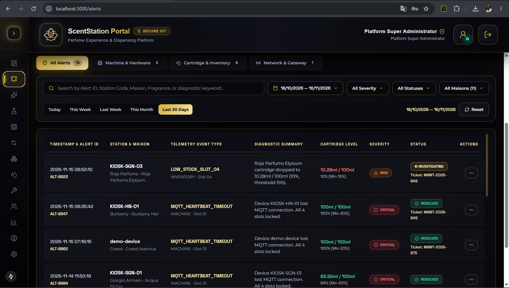
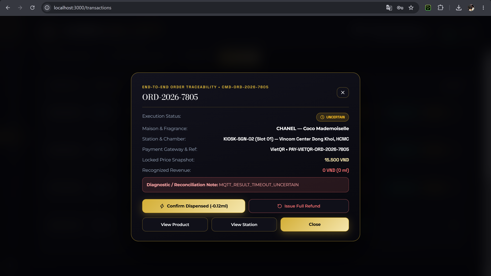
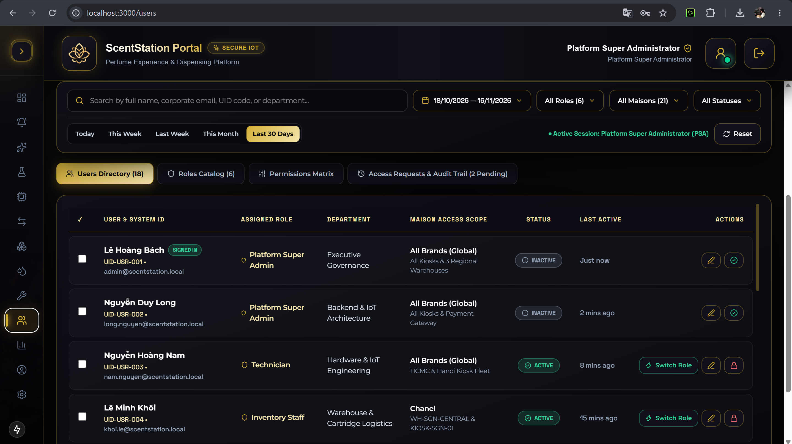
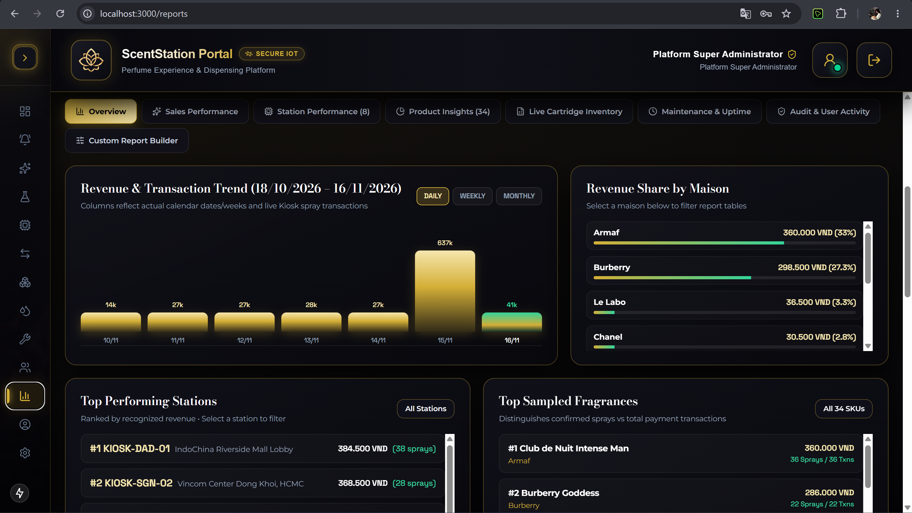
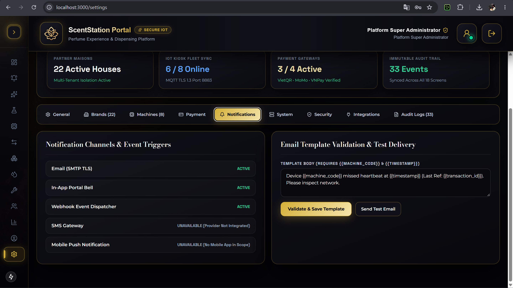
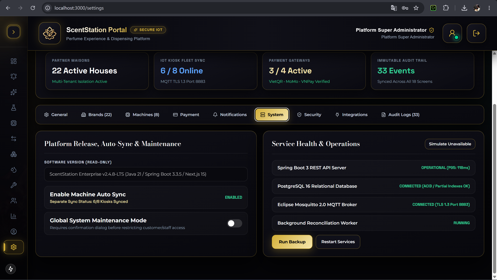
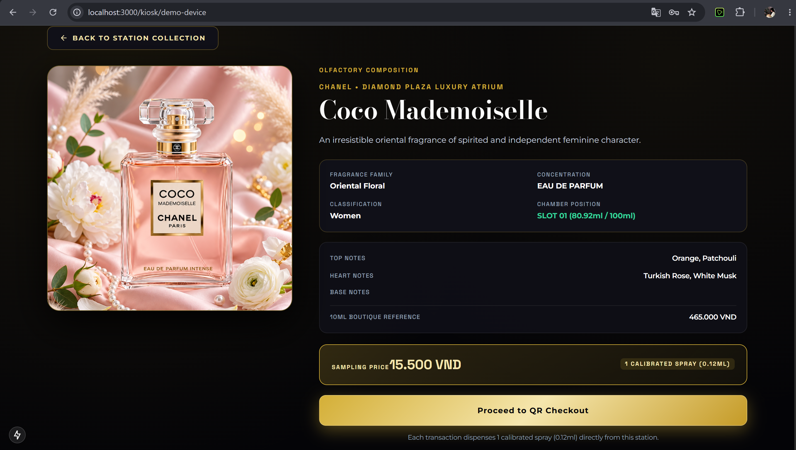
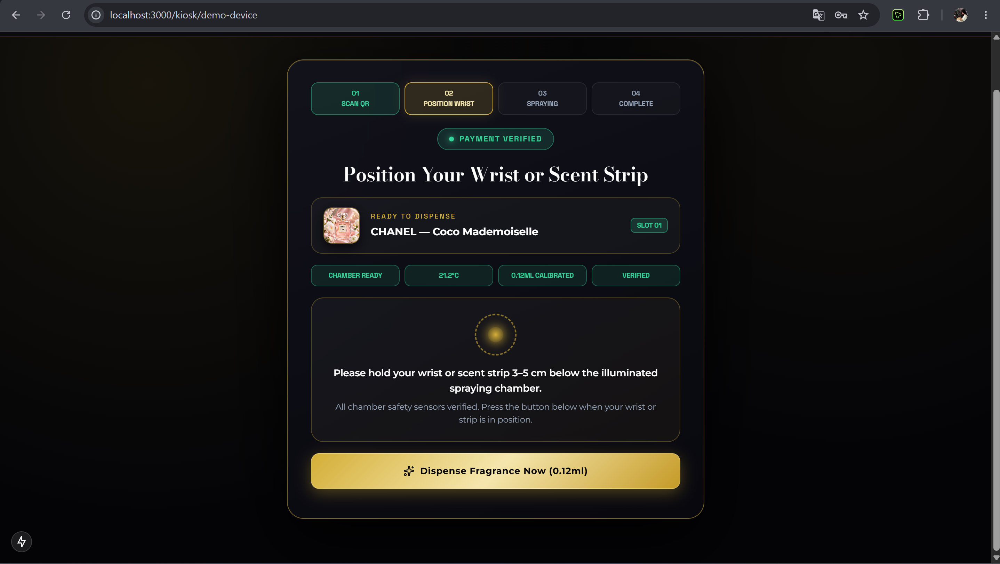
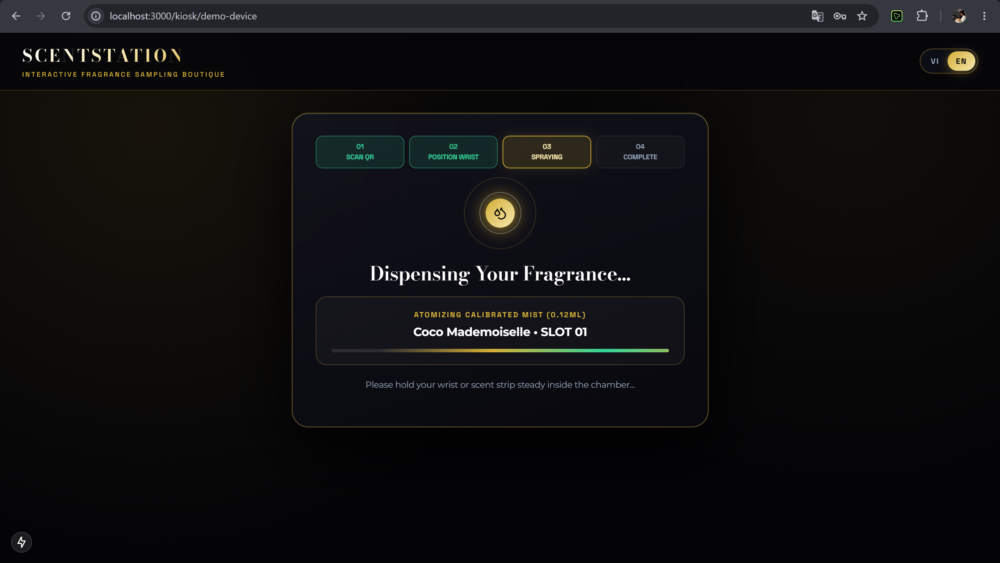
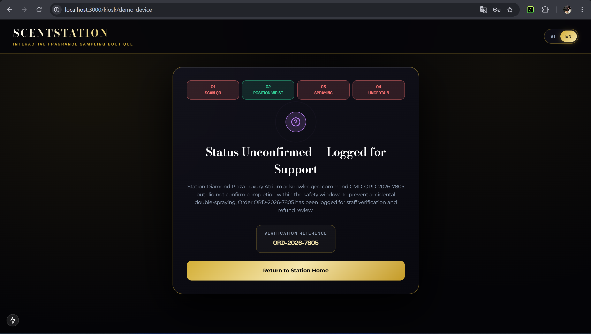

# Chapter 3. Implementation and Testing

## 3.1. Implementation Environment

### 3.1.1. What the system is built with

Section 1.5 chose the technologies and gave the reasons. This section records
the versions the implementation actually uses, so that the results in
Sections 3.5 to 3.7 can be reproduced on another machine.

| Tier | Technology | Version | Why this one |
| :--- | :--- | :--- | :--- |
| Backend | Java | 21 (LTS) | Long-term support, and records and pattern matching are used throughout the domain code |
| Backend | Spring Boot | 3.3.5 | Web, validation, AOP, Data JPA and Security as one managed set of versions |
| Backend | Spring Security | 6 (managed by Boot) | Stateless JWT, method-level authorisation |
| Backend | Hibernate / JPA | 6 (managed by Boot) | The `@Filter` that enforces brand isolation (BR13) |
| Backend | Flyway | managed by Boot | Versioned migrations; the schema is never generated from the entities |
| Backend | jjwt | 0.12.6 | Signing and verifying access tokens |
| Backend | Eclipse Paho | 1.2.5 | MQTT client for the device link |
| Database | PostgreSQL | 16 | Partial unique indexes, which carry BR2, BR6, NFR3.3 and NFR3.4 |
| Broker | Eclipse Mosquitto | 2.0 | MQTT 3.1.1 broker between the backend and the devices |
| Device | Java | 21 | The simulator is the device tier (Section 2.8.1), not a stand-in for it |
| Device | Jackson | 2.17.2 | The canonical JSON the command signature is computed over |
| Frontend | Next.js | 15.1.6 | App Router, React 19 |
| Frontend | TypeScript | 5 | Field names in `docs/api-contract.md` are checked at compile time |
| Frontend | Tailwind CSS | 4 | Utility styling for the portal and the kiosk screen |
| Tests | JUnit 5, Mockito, AssertJ | managed by Boot | Unit tests (Section 3.5) |
| Tests | Testcontainers (PostgreSQL) | managed by Boot | Integration tests against a real database (Section 3.6) |
| Build | Maven | 3.9 or later | Both Java projects |
| Build | Node.js | 20 or later | The frontend |
| Infrastructure | Docker Compose | v2 | Brings up PostgreSQL and Mosquitto identically for every member |
| Collaboration | Git and GitHub, Jira | — | One repository, one branch per task, one pull request per task |

PostgreSQL is the choice Section 1.5.2 argued for, and Section 2.7.4 is why.
Four business rules are enforced by partial unique indexes — an index with a
`WHERE` clause — and MySQL has no such feature. On MySQL those four rules
would exist only in Java, where two concurrent requests can both pass the
same check before either writes.

### 3.1.2. Bringing it up

The infrastructure is a container each, so that no member installs a database
by hand and every member runs the same versions:

```bash
docker compose up -d        # PostgreSQL 16 and Mosquitto 2.0
cd backend && mvn spring-boot:run
```

Flyway applies `V1__core.sql`, `V2__transaction.sql` and
`V3__refunds_and_audit.sql` on the first start. The API then answers on
`http://localhost:8080`, the broker listens on `1883`, and the database is
reachable on `5432` as the user `scent`.

The device tier and the frontend are started separately, each in its own
terminal:

```bash
cd simulator && mvn package && java -jar target/simulator.jar --device=KIOSK-001
cd frontend  && npm install && npm run dev        # http://localhost:3000
```

The simulator's `--secret` must match the backend's
`scentstation.mqtt.command-secret`. If it does not, every command is refused
on its signature and nothing is ever sprayed — which is the correct behaviour
under BR7, and the first thing to check when a demonstration will not work.

### 3.1.3. How the schema is managed

`ddl-auto` is set to `validate`, never `update`. Flyway owns the schema and
the entities are checked against it: if an entity no longer matches its table,
the application refuses to start rather than quietly altering the database.
Two reasons made this worth the extra discipline.

First, `update` cannot create a partial unique index, so the four constraints
of Section 2.7.4 would simply not exist. Second, a migration file is a record
of what changed and when, which is what lets five people change the schema in
one repository without overwriting one another.

The rule that follows from it: **a migration that has been pushed is never
edited.** A change to the schema is a new migration with the next number.

Three scripts under `backend/src/test/resources/` check the database without
the application running, and their output is the evidence used in Section 3.6:
`m1-schema-check.sql` for the core tables and the seeded accounts,
`m2-schema-check.sql` for the transaction and inventory tables, and
`constraint-check.sql` for the four partial unique indexes. In addition,
`tools/check_schema_mapping.py` compares every mapped column, type,
nullability and enumeration against the live database and reports all the
disagreements at once, rather than the single column a failed start-up would
name.

### 3.1.4. Configuration

Everything that differs between machines is a setting, not a code change.
Backend settings live under `scentstation` in `application.yml` and can be
overridden by environment variables; the frontend reads `NEXT_PUBLIC_API_URL`
and `NEXT_PUBLIC_USE_MOCKS` from `.env.local`.

| Setting | Default | What it governs |
| :--- | :--- | :--- |
| `security.jwt-secret` | a development value | Token signing; at least 32 bytes or the application refuses to start |
| `order.ttl-seconds` | 180 | How long an unpaid order stays `PENDING` (FR3.9) |
| `dispensing.command-ttl-seconds` | 30 | How long a command stays valid (BR7) |
| `dispensing.result-timeout-seconds` | 60 | After this, an order becomes `UNCERTAIN` (BR14, NFR4.5) |
| `dispensing.dose-ml` | 1 | Millilitres per spray, deducted from stock on a confirmed result |
| `mqtt.heartbeat-timeout-seconds` | 45 | After this, a machine is marked `OFFLINE` (FR5.2) |
| `mqtt.command-secret` | a development value | Must match the simulator's `--secret` |

The development values, including the seeded administrator account
`admin@scentstation.local`, exist so that the system can be started and
demonstrated from a fresh checkout. They are development credentials and are
documented as such in `docs/api-contract.md`; they would be replaced before
the system was put in front of anyone outside the team.

### 3.1.5. Working environment

Members work on different operating systems, which is itself a reason for
choosing Docker Compose over local installations: the database and the broker
are the same images and behave identically on every machine, so a defect is
never explained away by someone's setup.

<!-- TODO(Tra My): name the operating systems and the editors the five of us
     actually used, and the Java and Node versions each member has installed.
     Everything else in this section was read from the repository. -->

The repository is `tkimngan040/laptrinhjava` on GitHub. Each task has a branch
named after its Jira key and reaches `main` through a pull request that
another member reviews, so no one merges their own work unreviewed. Task
assignment, due dates and the four integration milestones are tracked in the
Jira project `SCENT`.

## 3.2. Source Code Structure

The repository holds three source projects, matching the three tiers of the
architecture in Section 2.8.1, plus the shared documents the team works from.

```
LapTrinhJava/
├── backend/                 Spring Boot: REST API and IoT gateway
├── simulator/               Java: the device tier
├── frontend/                Next.js: admin portal and kiosk screen
├── docs/                    API contract and test plan
├── tools/                   Schema, statistics and work-log scripts
├── Report/                  This report and its figures
└── Work Log/                Weekly logs, one file per member
```

<!-- TODO(Long): IDE screenshot of the project tree, saved as Report/Diagram_image/Ch3/fig-3-1-project-structure.png -->

*Figure 3.1. Project structure as shown in the IDE.*

### 3.2.1. Layering

Section 2.8.2 requires calls to flow in one direction only:

| Layer | Responsibility | May call |
|---|---|---|
| Controller | HTTP: parse the request, shape the response | Service |
| Service | Business rules and transaction boundaries | Repository |
| Repository | Persistence, one interface per aggregate | Entity |
| Entity | State and the invariants that belong to it | — |

A controller never reaches a repository directly, and an entity never depends
on a service. The package layout below makes a breach of that rule visible on
sight rather than something a reviewer has to go looking for.

### 3.2.2. Packages organised by business area

```
vn.edu.uth.scentstation
├── ScentStationApplication.java
├── config/              Clock, bound configuration properties
├── common/              BaseEntity, TimestampedEntity, ApiException, ApiError, GlobalExceptionHandler
├── security/            JWT, roles, tenant isolation
├── iot/                 MQTT gateway, topics, command signing
└── domain/
    ├── brand/           Tenants
    ├── user/            Accounts, roles, sign-in
    ├── catalog/         Products, machines, slots, locations
    ├── order/           Order state machine, ordering, payment, review and refunds
    ├── dispensing/      Dispensing commands and their results
    ├── inventory/       Batches, bottles, stock movements
    ├── alert/           Alerts and notifications
    ├── maintenance/     Tickets and checklists
    ├── audit/           Audit trail (BR11, BR12)
    └── report/          Dashboards and reports
```

The obvious alternative was to put `controller/`, `service/` and `repository/`
at the top level. With ten functional areas and twenty-three tables, those
three folders would each have grown to several dozen files, and reading one
flow end to end would mean jumping between three places.

Organising by business area instead makes each `domain/*` package a vertical
slice holding its own entity, repository, service and controller. Two
consequences matter for a team of five working in parallel. Each member owns a
few packages outright, so Git conflicts are rare. And the layering still
holds — it simply lives inside each package rather than above them all.

The ownership map is recorded in `OWNERS.md` at the repository root, so that
"who should change this file" never needs to be asked.

### 3.2.3. The IoT gateway sits apart but shares the services

`iot/` is deliberately outside `domain/`. It subscribes to the MQTT topics,
validates each inbound message, converts it to Java objects, and then calls
the same service a REST controller would call. It contains no business rule of
its own.

This follows Section 2.8.2 directly: *"There is therefore exactly one
implementation of each business rule, regardless of whether it is reached from
the web or from a device."* Stock is deducted by `InventoryService` whether the
spray was confirmed by a device result or corrected by an operator, and an
order changes state only through `OrderStateMachine` whichever direction the
request came from.

It also halves the work in Section 3.6: an integration test exercises one path
through the rules rather than two parallel ones that have to be kept in step.

### 3.2.4. Three classes exist in both projects

`Topics`, `CanonicalJson` and `CommandSigner` are duplicated, byte for byte,
in the backend and in the simulator.

The duplication is intentional. These three define the wire contract between
the two processes: the topic names, the exact string that gets signed, and the
HMAC over it. Sharing them through a library would make the simulator depend
on the backend's build, which would undermine the point of the simulator being
an independent device. Keeping two copies that must stay identical is the
smaller cost, and the class comment on each says so, because a silent drift
between them makes every command fail its signature check for reasons that
point nowhere near the cause.

### 3.2.5. Statistics

Counted on 4 November 2026 over production code only (`src/main`), with
`tools/code_stats.py`, which regenerates the table. Run it again before
submission: the `alert`, `maintenance` and `report` packages are still empty,
so these figures will grow.

| Measure | Value |
|---|---|
| Java source files (backend and simulator) | 91 |
| Lines of Java | 6,775 |
| Java packages | 14 |
| JPA entities | 15 |
| Database migrations | 3 |
| REST endpoints | 13 |
| Frontend TypeScript files | 32 |

The 15 entities are the ones written so far. Section 2.7 designs twenty-three
tables. Of the other eight, `USER_ROLES` needs no entity of its own because
`User` maps it as a many-to-many collection, and the remaining seven
(`DEVICE_EVENTS`, `TELEMETRY_READINGS`, `INCIDENTS`, `ALERTS`,
`NOTIFICATIONS`, `MAINTENANCE_TICKETS`, `MAINTENANCE_TASKS`) arrive with the
packages that own them.

<!-- TODO(Long): IDE screenshot of vn.edu.uth.scentstation expanded, saved as Report/Diagram_image/Ch3/fig-3-2-package-tree.png -->

*Figure 3.2. The `vn.edu.uth.scentstation` package tree.*

## 3.3. Implemented Features

<!-- Content. Retrieved from docs/nhat-ky/ -->

## 3.4. User Interface Results

The Next.js frontend (`frontend/src/app`) implements all fifteen screen groups
specified in Section 2.10.2 and Appendix B (Mockup Figures 2.7 to 2.29). All
thirty-four screenshots below (`Figure 3.3` to `Figure 3.36`, stored under
`Report/Diagram_image/Ch3/`) were captured in a single continuous run against
the live workspace (`21 Maisons`, `34 Scents`, and the calibrated `0.12 ml`
mist dose) so that brand counts, machine statuses, slot liquid volumes,
warehouse stock balances and settled transaction figures remain consistent
from the first figure to the last.

### 3.4.1. S01 — Login / Authentication (Appendix B.1)


*Figure 3.3. Màn hình đăng nhập và xác thực — Login and Authentication screen (`S01_login.png`).*

Compared with Appendix B.1 (Figure 2.7), the *Partner & Staff Sign In* screen
(`/login`) implements the validated corporate email input (`B.1.2`), the masked
password field with an eye-icon visibility toggle (`B.1.3`), the *"Keep me
signed in on this device"* checkbox (`B.1.4`), the *"Forgot password?"*
recovery link (`B.1.5`), the *"Sign In to Workspace"* button (`B.1.6`) and the
role-based security notice (`B.1.8`). In compliance with the design note in
Appendix B.1.7, the unsupported QR login option has been removed from the
production form, while the left panel adds a *Demo Role Switcher (Quick
Autofill)* helper that populates test credentials (`PSA`, `BA • 2FA`) without
bypassing server-side role redirection (BR13).

### 3.4.2. S02 — Dashboard (Appendix B.2)


*Figure 3.4. Màn hình bảng điều khiển tổng quan — Dashboard screen (`S02_dashboard.png`).*

Cross-referenced with Appendix B.2 (Figure 2.8), the Dashboard (`/dashboard`)
provides global search, date-range and brand filters, and six KPI cards (*Total
Brands*, *Total Machines*, *Total Transactions*, *Total Revenue*, *Total
Dispenses* and *Active Alerts*) that drill down to their respective modules.
The *Transaction & Revenue Trend* chart, *Machine Status* filter, *Top
Performing Brands*, *Recent Transactions*, *Active Alerts*, *Fragrance
Inventory Status*, *Maintenance Overview* and *Machine Locations* panels all
reflect live system figures while enforcing read-only mode for Viewer accounts
(FR1.11, UC-17).

### 3.4.3. S03 — Notifications / Alerts (Appendix B.3)



*Figure 3.5. Màn hình thông báo và cảnh báo — Notifications and Alerts screen (`S03_alerst.png`).*

In accordance with Appendix B.3 (Figure 2.9), the Alerts screen (`/alerts`)
displays severity summary cards (*All Alerts*, *Critical*, *High*, *Medium*,
*Low* in `B.3.1`), category tabs (*All*, *Machine*, *Inventory*, *System* in
`B.3.2`), keyword search (`B.3.3`) and combined severity, status and brand
filters (`B.3.4`). Selecting an alert row (`B.3.5–B.3.6`) opens the right-hand
detail panel with the machine code, remaining slot stock, threshold and last
sensor update timestamp, allowing authorised staff to execute *Mark as
Resolved* (`B.3.7`), *Create Maintenance Ticket* with duplicate prevention
(`B.3.8`), *View Machine Details* (`B.3.9`) or inspect read-only *View History*
records (`B.3.10`).

### 3.4.4. S04 — Profile / Account (Appendix B.4)


*Figure 3.6. Màn hình hồ sơ cá nhân và tài khoản — Profile and Account screen (`S04_profile.png`).*

Matching Appendix B.4 (Figure 2.10), the Profile screen (`/profile`) allows the
signed-in user to update their *Full Name*, *Phone Number* and avatar while
keeping *Email Address* and *Role* strictly read-only (`B.4.1`), and validates
password complexity and confirmation matching under *Change Password*
(`B.4.2`). It also implements *Two-Factor Authentication (2FA)* — correcting
the mockup's `"Enable 3FA"` button label to **`Enable 2FA`** as required by the
note in Appendix B.4.3 — alongside interface *Preferences* (`B.4.4`) and the
*Active Sessions* table (`B.4.5`) with confirmed remote session logout.

### 3.4.5. S05 — Brands (Appendix B.5)


*Figure 3.7. Màn hình quản lý thương hiệu — Brands management screen (`S05_brands.png`).*

Aligned with Appendix B.5 (Figure 2.11), the Brands screen (`/brands`) supports
keyword search (`B.5.1`), status filtering (*All*, *Active*, *Inactive*,
*Suspended* in `B.5.2`), sorting by name, creation date or revenue performance
(`B.5.3`), and *Grid / List View* switching (`B.5.4`) across the partner
maisons. Clicking a brand card (`B.5.5`) updates the right-hand details drawer
with *Add/Edit Brand* actions (`B.5.6–B.5.7`), *Overview* contact and logo
assets (`B.5.8`, `B.5.13`), and brand-scoped tabs for *Products* (`B.5.9`),
*Machines* (`B.5.10`), *Transactions* (`B.5.11`) and *Analytics* (`B.5.12`).

### 3.4.6. S06 — Perfume Products (Appendix B.6)


*Figure 3.8. Màn hình quản lý sản phẩm nước hoa — Perfume Products screen (`S06_products.png`).*

Following Appendix B.6 (Figure 2.12), the Perfume Products screen (`/products`)
provides keyword search (`B.6.1`), brand, category and status filters
(`B.6.2`), and four summary cards (*Total Products*, *Active Products*,
*Available for Machines* and *Most Popular* in `B.6.3`). Selecting a product
card (`B.6.4`) opens the right-hand panel supporting *Add/Edit Product*
(`B.6.5–B.6.6`), *Overview & Details* (`B.6.7`), *Usage in Machines* (`B.6.8`),
*Inventory* — explicitly separating commercial bottle capacity (such as 100 ml)
from the remaining liquid volume installed in a machine (`B.6.9`) — *Analytics*
(`B.6.10`) and *View in Customer App* (`B.6.11`).

### 3.4.7. S07 — Machines (Appendix B.7)


*Figure 3.9. Màn hình danh sách máy Kiosk — Machines overview screen (`S07_machines.png`).*

Cross-referenced with Appendix B.7.1 to B.7.6 (Figure 2.13), the Machines
overview (`/machines`) renders mutually exclusive status summary cards (*Total
Machines*, *Online*, *Offline*, *Maintenance* in `B.7.1`), keyword search
(`B.7.2`), status, brand and location filters (`B.7.3`), and both *Map View*
(`B.7.4`) and *List View* (`B.7.5`) layouts displaying each machine card
(`B.7.6`) with its venue location, occupied slot count and operational status.


*Figure 3.10. Màn hình chi tiết máy và khay nước hoa — Machine detail and Perfume Slots screen (`S07_machine_detail.png`).*

Validating Appendix B.7.7 to B.7.13 (Figure 2.13), the Machine Detail view
(`/machines/[id]`) displays *Machine Information* with non-editable telemetry
connection status (`B.7.7`), *Real-time Sensors* readings with last-update
timestamps (`B.7.8`), and the *Perfume Slots* configuration (`B.7.9`) showing
assigned fragrances and remaining millilitres synchronized with Inventory. It
also provides confirmed *Remote Control* commands (`B.7.10`), *Restart Machine*
(`B.7.11`), read-only *View Logs* (`B.7.12`) and *Create Maintenance Ticket*
with duplicate-ticket prevention (`B.7.13`).

### 3.4.8. S08 — Transactions (Appendix B.8)


*Figure 3.11. Màn hình lịch sử giao dịch — Transactions overview and table screen (`S08_transactions.png`).*

In compliance with Appendix B.8.1 to B.8.7 and B.8.9 to B.8.10 (Figure 2.14),
the Transactions screen (`/transactions`) displays four summary cards (*Total
Transactions*, *Total Revenue*, *Unique Customers*, *Top Product* in `B.8.1`),
strictly excluding failed or pending payments from recognised revenue, alongside
date-range and brand filters (`B.8.2`), the *Transaction Trend* chart (`B.8.3`)
and *Top Products & Top Machines* rankings (`B.8.4`). Users can search and
filter by status, brand, machine or payment method (`B.8.5–B.8.6`), review the
*Transactions Table* (`B.8.7`), switch across five grouping tabs with
pagination (`B.8.10`), and click *Export* (`B.8.9`) to download reconciliation
files.



*Figure 3.12. Màn hình chi tiết đơn hàng và giao dịch — Transaction and order details screen (`S08_order_detail.png`).*

Matching Appendix B.8.8 (Figure 2.14), selecting a transaction row opens the
*Transaction Details* panel displaying the transaction ID, verified payment
status, product, brand, machine code, venue location, settled amount, payment
method and sampling timestamp, together with direct actions for *View Product*,
*View Machine* and *Download Receipt*.

### 3.4.9. S09 — Inventory (Appendix B.9)


*Figure 3.13. Màn hình tổng quan tồn kho — Inventory overview and stock table screen (`S09_inventory01.png`).*

Consistent with Appendix B.9.1 to B.9.5 and B.9.8 to B.9.9 (Figure 2.15), the
primary Inventory view (`/inventory`) displays five summary cards (*Total
Bottles*, *Total Volume*, *Low Stock Items*, *In Machines*, *In Warehouse* in
`B.9.1`), strictly separating sealed warehouse bottles from liquid volumes
installed inside machines so stock is never double-counted. It supports SKU and
product search (`B.9.2`), brand, location and status filters (`B.9.3`), seven
inventory tabs (*All Inventory*, *By Product*, *By Brand*, *By Location*,
*Machine Stock*, *Warehouse Stock*, *Stock Movements* in `B.9.4`), the main
*Inventory Table* (`B.9.5`), and linked views for *Machines Using This Product*
(`B.9.8`) and *Warehouse Stock* (`B.9.9`).


*Figure 3.14. Màn hình nhập kho và biến động tồn kho — Inventory batch intake and stock movements screen (`S09_inventory02.png`).*

Fulfilling Appendix B.9.6, B.9.7 and B.9.10 to B.9.13 (Figure 2.15), this view
implements the *Add Stock* batch receipt workflow (`B.9.6`), *Manage Stock*
issuance, inter-warehouse transfers and machine allocations (`B.9.7`), the
read-only *Stock History* ledger (`B.9.10`), threshold-based *Low Stock Alerts*
(`B.9.11`), the historical *Stock Trend* chart (`B.9.12`) and confirmed
row-level *Product Actions* (`B.9.13`).

### 3.4.10. S10 — Refill / Replacement (Appendix B.10)


*Figure 3.15. Màn hình tiếp nhiên liệu và thay bình — Refill and Replacement task management screen (`S10_refill.png`).*

Cross-referenced with Appendix B.10 (Figure 2.16), the Refill screen (`/refill`)
renders five task summary cards (*Total Tasks*, *Pending*, *In Progress*,
*Completed*, *Overdue* in `B.10.1`), keyword search (`B.10.2`), brand, status
and location filters (`B.10.3`), the *Create Refill Task* form with warehouse
bottle availability warnings (`B.10.4`) and the *Task List* table (`B.10.5`).
Selecting a task opens the right-hand workflow panel covering *Task Details*
(`B.10.6`), *Technician Assignment* (`B.10.7`), the step-by-step *Refill /
Replacement Process* (`B.10.8`), *Inventory Confirmation* batch verification
(`B.10.9`), *Testing & Completion* checks (`B.10.10`) and immutable *History &
Notes* (`B.10.11`).

### 3.4.11. S11 — Maintenance (Appendix B.11)


*Figure 3.16. Màn hình quản lý bảo trì kỹ thuật — Maintenance tickets and inspection checklist screen (`S11_maintenance.png`).*

Aligned with Appendix B.11 (Figure 2.17), the Maintenance screen
(`/maintenance`) displays six summary cards including dynamically calculated
*Avg. Resolution Time* (`B.11.1`), the *Maintenance Trend* chart (`B.11.2`),
*Tickets by Issue Type* filters (*Pump Error*, *Door Sensor Fault*, *Connection
Lost*, *Payment Device Error*, *Spray Nozzle Clogged*, *Screen Issue* in
`B.11.3`), *Upcoming Maintenance* schedules (`B.11.4`), the *Create Ticket*
workflow (`B.11.5`), status tabs (`B.11.6`) and the *Maintenance Ticket Table*
(`B.11.7`). The right-hand *Ticket Details* panel (`B.11.8`) enforces the
mandatory *Inspection Checklist* (`B.11.9` — power supply, connection, pump,
spray nozzle and door sensor) alongside *Activity & Timeline* (`B.11.10`) and
*Attachments* (`B.11.11`) before permitting technicians to click *Mark as
Completed* (`B.11.12`).

### 3.4.12. S12 — Users & Roles (Appendix B.12)



*Figure 3.17. Màn hình quản lý người dùng và phân quyền — Users and Roles administration screen (`S12_users.png`).*

In accordance with Appendix B.12 (Figure 2.18), the Users & Roles module
(`/users`) provides live *User Summary* cards (*Total Users*, *Active Users*,
*Inactive Users*, *Total Roles* in `B.12.1`), search and role, brand and status
filters (`B.12.2`), the *Users Tab* table (`B.12.3`) and the *Invite User*
workflow (`B.12.4`) that scopes new accounts without granting default
super-admin privileges. Switching across the *Roles Tab* (`B.12.5`),
*Permissions Tab* (`B.12.6`) and *Access Requests & Audit Logs* (`B.12.10`)
exposes the seven-role permission matrix and right-hand *User Profile* drawer
(`B.12.7–B.12.9`) with *Brand Access* scoping and confirmed *Reset Password*,
*Deactivate User* and *View Audit Logs* actions.

### 3.4.13. S13 — Reports (Appendix B.13)



*Figure 3.18. Màn hình báo cáo thống kê — Analytical Reports screen (`S13_reports.png`).*

Compared against Appendix B.13.1 to B.13.12 (Figure 2.19), the Reports screen
(`/reports`) combines custom *Date Range* selection (`B.13.1`), right-hand
*Report Filters* (`B.13.6`) and five period-over-period *KPI Cards* (*Total
Revenue*, *Total Transactions*, *Total Sprays*, *Active Machines*, *Unique
Customers* in `B.13.2`) across eight *Report Categories* tabs (`B.13.3`). It
renders the *Revenue Trend* chart (`B.13.4`), *Revenue by Brand* pie chart
(`B.13.5`), *Top Performing Machines* (`B.13.7`), *Top Perfume Products*
(distinguishing spray counts from payment transactions in `B.13.8`),
*Transactions by Payment Method* (`B.13.9`), *Sales by Location* bar chart
(`B.13.10`), *Revenue vs. Sprays* scatter plot (`B.13.11`) and the *Daily
Performance Heatmap* (`B.13.12`).


*Figure 3.19. Màn hình xuất dữ liệu báo cáo CSV — Report CSV export verification screen (`S13_reports_CSV.png`).*

Fulfilling Appendix B.13.13 and B.13.14 (Figure 2.19), clicking *Export Report*
generates a permission-scoped `CSV` download matching the active report filters
while providing the *Custom Report* builder for authorised roles and enforcing
Viewer restrictions (FR1.11, UC-17).

### 3.4.14. S14 — Settings (Appendix B.14.1 to B.14.9)


*Figure 3.20. Màn hình cài đặt chung — Settings: General tab (`S14_settings_01.png`).*

Matching Appendix B.14.1 (Figure 2.20), the *General* tab of `/settings`
configures *Platform Information* and confirmed logo updates (`B.14.1.1`),
*Appearance & Theme* (`B.14.1.2`), *System Preferences* toggles (`B.14.1.3`),
masked SMTP *Email Settings* with connection testing (`B.14.1.4`),
*Notification Settings* (`B.14.1.5`), and *Data Management* backup, restore,
cache and configuration export/import actions (`B.14.1.6–B.14.1.9`).


*Figure 3.21. Màn hình cài đặt thương hiệu — Settings: Brands tab (`S14_settings_02.png`).*

Aligned with Appendix B.14.2 (Figure 2.21), the *Brands* tab combines the
filterable *Brand List* (`B.14.2.1`) with *Basic Information* (`B.14.2.2`),
*Visual Identity* colour and logo controls (`B.14.2.3`), *Operational Settings*
limits (`B.14.2.4`), backend-enforced *Access & Permissions* (`B.14.2.5`),
*Locations & Machines* links (`B.14.2.6`), *Quick Actions* (`B.14.2.7`),
audited *Brand Status* transitions (`B.14.2.8`) and *Save Changes* with
unsaved-change warnings (`B.14.2.9`).


*Figure 3.22. Màn hình cài đặt máy Kiosk — Settings: Machines tab (`S14_settings_03.png`).*

In compliance with Appendix B.14.3 (Figure 2.22), the *Machines* tab pairs the
*Machine List* (`B.14.3.1`) with *Basic Information* (`B.14.3.2`), *Status &
Health* telemetry (`B.14.3.3`), *Dispensing* calibration (`B.14.3.4` —
distinguishing *Saved* from hardware *Synced* states), *Product Configuration*
slot assignments (`B.14.3.5`), masked *Network & Connectivity* parameters
(`B.14.3.6`), *Display & Media* (`B.14.3.7`) and *Location Settings* operating
hours (`B.14.3.8`).


*Figure 3.23. Màn hình cài đặt thanh toán — Settings: Payment tab (`S14_settings_04.png`).*

Following Appendix B.14.4 (Figure 2.23), the *Payment* tab displays *Payment
Overview* cards separating gross revenue, refunds and net revenue (`B.14.4.1`),
*Payment Methods* toggles (`B.14.4.2`), *Method Configuration* for VietQR and
gateways with masked credentials (`B.14.4.3`), *Payment Flow Settings* timeouts
(`B.14.4.4`), *Pricing & Tax Settings* (`B.14.4.5`) and *Transaction Settings*
with verified refund rules (`B.14.4.6`).



*Figure 3.24. Màn hình cài đặt thông báo — Settings: Notifications tab (`S14_settings_05.png`).*

Cross-referenced with Appendix B.14.5 (Figure 2.24), the *Notifications* tab
manages *Notification Channels* (`B.14.5.1`), SMTP *Email Notification
Configuration* (`B.14.5.2`), *Event Triggers* (`B.14.5.3`), *Default
Recipients* (`B.14.5.4`), variable-validated *Email Templates* (`B.14.5.5`),
*Test Notification* dispatch (`B.14.5.6`) and the *Recent Notifications*
delivery table (`B.14.5.7`).



*Figure 3.25. Màn hình cài đặt vận hành hệ thống — Settings: System tab (`S14_settings_06.png`).*

Consistent with Appendix B.14.6 (Figure 2.25), the *System* tab presents
*Platform Information* with read-only software version (`B.14.6.1`),
*Operational Policies* (`B.14.6.2`), *Data Retention & Backup* (`B.14.6.3`),
confirmed *System Maintenance* mode (`B.14.6.4`), *System Operations*
(`B.14.6.5`), live *Service Health* statuses for the API Server, Database, MQTT
Broker and Background Worker (`B.14.6.6`), and *Recent System Events*
(`B.14.6.7`).


*Figure 3.26. Màn hình cài đặt bảo mật — Settings: Security tab (`S14_settings_07.png`).*

Validating Appendix B.14.7 (Figure 2.26), the *Security* tab configures
*Password & Authentication* complexity and MFA policies (`B.14.7.1`), *Session
Management* timeouts (`B.14.7.2`), *Account Lockout Policy* thresholds
(`B.14.7.3`), *IP Access Control* allowlists with administrative self-lockout
protection (`B.14.7.4`), *Active Sessions* termination (`B.14.7.5`), mandatory
*Audit & Security Monitoring* (`B.14.7.6`) and *Recent Security Events*
(`B.14.7.7`).


*Figure 3.27. Màn hình cài đặt tích hợp dịch vụ — Settings: Integrations tab (`S14_settings_08.png`).*

Matching Appendix B.14.8 (Figure 2.27), the *Integrations* tab provides the
filterable *Integration List* (`B.14.8.1`), *Integration Configuration* with
masked secrets and connection testing (`B.14.8.2`), *MQTT Broker — IoT Machine
Connectivity* configuration (`B.14.8.3`), signed *Webhook & Event Delivery*
rules (`B.14.8.4`), *Integration Summary* counters (`B.14.8.5`) and *Recent
Integration Events* (`B.14.8.6`).


*Figure 3.28. Màn hình nhật ký kiểm toán — Settings: Audit Logs tab (`S14_settings_09.png`).*

In compliance with Appendix B.14.9 (Figure 2.28), the *Audit Logs* tab delivers
multi-criteria *Audit Log Filters* (`B.14.9.1`), nine category *Quick Filters*
(`B.14.9.2`), the immutable *Audit Log Table* (`B.14.9.3`), the right-hand *Log
Details* drawer (`B.14.9.4`), permission-scoped *Export Logs* (`B.14.9.5`) and
backend *Pagination* (`B.14.9.6`).

### 3.4.15. S15 — Kiosk Experience (Appendix B.15)


*Figure 3.29. Màn hình trang chủ Kiosk và chọn ngôn ngữ — Kiosk Experience: Homepage and language selection (`S15_kiosk_01.png`).*

Cross-referenced with Appendix B.15.1 (Figure 2.29), the Kiosk homepage
(`/kiosk`) presents the ScentStation branding banner, step-by-step usage
instructions and the `VI` / `EN` language toggle, switching interface copy
without altering the loaded product catalog.



*Figure 3.30. Màn hình bộ lọc nhóm hương và tìm kiếm — Kiosk Experience: Perfume categories and search (`S15_kiosk_02.png`).*

Aligned with Appendix B.15.2 (Figure 2.29), customers can filter the active
machine's catalog across *All*, *Women*, *Men*, *Unisex*, *Niche* and *Best
Seller* categories or search by perfume name and brand.


*Figure 3.31. Màn hình chi tiết mùi hương và khay chứa — Kiosk Experience: Product details and slot availability (`S15_kiosk_03.png`).*

In accordance with Appendix B.15.3 (Figure 2.29), selecting a fragrance card
displays its brand, olfactory family, notes and live slot stock, preventing
selection if the perfume slot is empty or the machine is unavailable.



*Figure 3.32. Màn hình chọn số lần xịt và tạm tính — Kiosk Experience: Selected product and price summary (`S15_kiosk_04.png`).*

Completing Appendix B.15.3 (Figure 2.29), the selected fragrance and spray
count are added to the *Selected Products* summary, updating the total VND
amount due prior to checkout.



*Figure 3.33. Màn hình thanh toán mã QR — Kiosk Experience: QR code payment screen (`S15_kiosk_05.png`).*

Matching Appendix B.15.4 (Figure 2.29), the payment screen displays the dynamic
QR code, amount due, scanning instructions and supported payment methods while
waiting in the `Pending` verification state.


*Figure 3.34. Màn hình xác nhận thanh toán thành công — Kiosk Experience: Backend payment confirmation (`S15_kiosk_06.png`).*

In strict compliance with Appendix B.15.4 and B.15.5 (Figure 2.29), the screen
transitions to `Success` and displays nozzle positioning instructions only
after the backend verifies payment validity, never activating the machine from
browser notifications alone.


*Figure 3.35. Màn hình đang phun nước hoa — Kiosk Experience: Perfume spraying in progress (`S15_kiosk_07.png`).*

Validating Appendix B.15.5 (Figure 2.29), the backend dispatches the signed
MQTT dispense command for the authorised spray while enforcing duplicate-spray
prevention on the hardware unit.



*Figure 3.36. Màn hình hoàn tất trải nghiệm Kiosk — Kiosk Experience: Completion and return to homepage (`S15_kiosk_08.png`).*

Fulfilling Appendix B.15.6 (Figure 2.29), once the device reports completion,
the screen displays the completion confirmation, deducts the dispensed dose
from slot inventory, records the settled transaction for reconciliation, and
resets the cart to the homepage when the customer taps *Done* or after
inactivity.

## 3.5. Unit Testing

<!-- Content. Retrieved from docs/nhat-ky/ -->

## 3.6. Integration Testing

<!-- Content. Retrieved from docs/nhat-ky/ -->

## 3.7. Test Results Table

<!-- Content. Retrieved from docs/nhat-ky/ -->