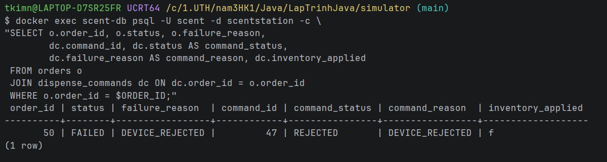
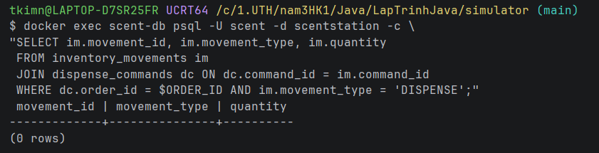
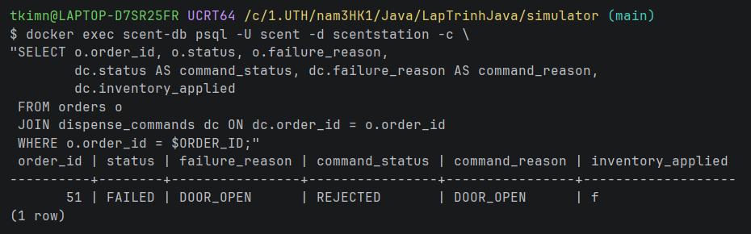
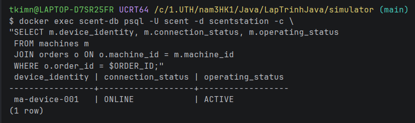

# N2 – Test Results Report

| Information | Value                                                                 |
|---|-----------------------------------------------------------------------|
| Project | ScentStation                                                          |
| Scope | N2 – Backend/Simulator Fault Mode integration testing                 |
| Device | `ma-device-001`                                                       |
| Tester | Tran Thi Kim Ngan                                                     |
| Test date | 17/11/2026                                                            |
| Test procedure | [N2-Test.md](N2-Test.md)                                              |
| Evidence screenshots | Reject: same directory as this file; other modes: `docs/evidence/N2/` |

> Record the actual results after each mode. Do not mark a mode as `PASS` if any required criterion has not been verified. Use `BLOCKED` when a check cannot be completed and state the reason. Save screenshots using the filenames specified in each section, then open the report to verify that they display correctly.

## 1. Results by Fault Mode

### 1.1. Reject — `N2-REJECT`

**Test date:** 17/11/2026  
**Order ID:** `50`  
**Command ID:** `47`

| Criterion | Expected result | Actual result | Assessment |
|---|---|---|---|
| Device and slot before test | Machine `ONLINE`, slot 1 available | Machine `ONLINE`, slot 1 `available: true` | PASS |
| Simulated payment | Recorded | `applied: true`, `Payment recorded` | PASS |
| Order | `FAILED` | `FAILED` | PASS |
| Failure reason | `DEVICE_REJECTED` | `DEVICE_REJECTED` | PASS |
| Command | `REJECTED` | `REJECTED`, command ID `47` | PASS |
| `inventory_applied` | `false` | `f` (`false`) | PASS |
| `DISPENSE` movement | None | Query returned `0 rows` | PASS |
| Incident for the Order | Incident exists | Query returned `0 rows` | **FAIL** |

**Mode assessment:** **FAIL** — no incident was created for the rejected Order.  
**Issue to resolve:** Investigate why the Backend did not create an incident for the `DEVICE_REJECTED` Order. Record an owner and retest after the issue is resolved.

**Evidence screenshots**

1. `ONLINE` menu; Order `50` created and paid:
   [img.png](img.png)
    

2. Order `50` is `FAILED`, command `47` is `REJECTED`, `inventory_applied = f`:
   [img_2.png](img_2.png)
   

3. No `DISPENSE` movement:
   [img_3.png](img_3.png)
   

4. No incident for the Order:
   [img_4.png](img_4.png)
   

   
### 1.2. Interlock — `N2-INTERLOCK`

**Test date:** 18/11/2026  
**Order ID:** `51`  
**Confirmation with Long:** The expected machine status after interlock has not been confirmed.

| Criterion | Expected result | Actual result | Assessment |
|---|---|---|---|
| Simulated payment | Recorded | `applied: true`, `Payment recorded` | PASS |
| Order | `FAILED` | `FAILED` | PASS |
| Failure reason | `DOOR_OPEN` | `DOOR_OPEN` | PASS |
| Command | Rejected due to interlock | `REJECTED`, reason `DOOR_OPEN` | PASS |
| `DISPENSE` movement | None | Movement count is `0` | PASS |
| Machine status | Updated according to agreed behavior | `ONLINE`, `ACTIVE`; expected status not confirmed | **BLOCKED** |
| Incident | Recorded as required for interlock | Query returned `0 rows` | **FAIL** |
| Alert | Created for the interlock event | Query returned `0 rows` | **FAIL** |

**Mode assessment:** **FAIL** — The Order was correctly rejected with `DOOR_OPEN` and no `DISPENSE` movement was created, but there was no incident or alert. The expected machine status also needs to be confirmed with Long.  
**Issue to resolve:** Coordinate with Long to agree on the expected machine status after interlock and address the incident/alert requirements.

**Evidence screenshots**

1. Order `51` created and paid: [img_5.png](img_5.png)

2. Order `51` is `FAILED`, command is `REJECTED` with reason `DOOR_OPEN`, `inventory_applied = f`: [img_6.png](img_6.png)

3. No `DISPENSE` movement: [img_7.png](img_7.png)

4. Machine `ma-device-001` is `ONLINE`, `ACTIVE`: [img_8.png](img_8.png)

5. No incident for the Order: [img_9.png](img_9.png)

6. No alert for the event: [img_10.png](img_10.png)

### 1.3. Silent — `N2-SILENT`

**Test date:** [Enter]  
**Order ID:** [Enter]  
**Actual timeout wait:** [Enter]

| Criterion | Expected result | Actual result | Assessment |
|---|---|---|---|
| Dispense result | None received | [Enter] | [PASS / FAIL / BLOCKED] |
| Order | `UNCERTAIN` | [Enter] | [PASS / FAIL / BLOCKED] |
| Command | One; expires on timeout | [Enter] | [PASS / FAIL / BLOCKED] |
| Automatic command retry | None | [Enter] | [PASS / FAIL / BLOCKED] |
| Inventory application | Not applied while result is unknown | [Enter] | [PASS / FAIL / BLOCKED] |

**Mode assessment:** [PASS / FAIL / BLOCKED]  
**Issue to resolve:** [Enter]

> Save the screenshot as `N2-silent.png` in `docs/evidence/N2/`.

### 1.4. Duplicate — `N2-DUPLICATE`

**Test date:** [Enter]  
**Order ID:** [Enter]

| Criterion | Expected result | Actual result | Assessment |
|---|---|---|---|
| Simulator response | Two responses for the same command | [Enter] | [PASS / FAIL / BLOCKED] |
| Command count | One | [Enter] | [PASS / FAIL / BLOCKED] |
| Order | `DISPENSED` | [Enter] | [PASS / FAIL / BLOCKED] |
| `DISPENSE` movement / inventory deduction | Recorded only once | [Enter] | [PASS / FAIL / BLOCKED] |
| Customer-sale movement | One record | [Enter] | [PASS / FAIL / BLOCKED] |

**Mode assessment:** [PASS / FAIL / BLOCKED]  
**Issue to resolve:** [Enter]

> Save the screenshot as `N2-duplicate.png` in `docs/evidence/N2/`.

### 1.5. Offline — `N2-OFFLINE`

**Test date:** [Enter]  
**Time from last heartbeat until the machine became `OFFLINE`:** [Enter]

| Criterion | Expected result | Actual result | Assessment |
|---|---|---|---|
| Machine status | `OFFLINE` | [Enter] | [PASS / FAIL / BLOCKED] |
| New Order request | Rejected with HTTP 4xx | [Enter HTTP status / response] | [PASS / FAIL / BLOCKED] |
| Order count before / after | Unchanged | [Enter] | [PASS / FAIL / BLOCKED] |
| Payment count before / after | Unchanged | [Enter] | [PASS / FAIL / BLOCKED] |

**Mode assessment:** [PASS / FAIL / BLOCKED]  
**Issue to resolve:** [Enter]

> Save the screenshot as `N2-offline.png` in `docs/evidence/N2/`.

## 2. Results Summary

| Fault Mode | Assessment | Order ID | Evidence screenshots | Notes |
|---|---|---|---|---|
| Reject | **FAIL** | `50` | `img.png`, `img_2.png`, `img_3.png`, `img_4.png` | Incident missing |
| Interlock | **FAIL** | `51` | `img_5.png`–`img_10.png` | Incident/alert missing; confirm machine status with Long |
| Silent | [PASS / FAIL / BLOCKED] | [Enter] | `N2-silent.png` | [Enter] |
| Duplicate | [PASS / FAIL / BLOCKED] | [Enter] | `N2-duplicate.png` | [Enter] |
| Offline | [PASS / FAIL / BLOCKED] | [Not applicable] | `N2-offline.png` | [Enter] |

**Total:** 5  
**PASS:** [Enter]  
**FAIL:** 2 (Reject — incident missing; Interlock — incident/alert missing)  
**BLOCKED:** [Enter]

## 3. Issues and Follow-Up

| No. | Issue | Owner | Resolution / coordination | Status |
|---:|---|---|---|---|
| 1 | Reject did not create an incident for Order `50` | [Enter] | Investigate and fix incident creation; rerun Reject to verify | Open |
| 2 | Interlock did not create an incident/alert for Order `51`; machine remains `ONLINE`, `ACTIVE` | Long / [collaborator] | Agree on the expected machine status; address the incident/alert and retest | Open |
| 3 | [Other issue, if any] | [Enter] | [Enter] | [Open / Resolved] |

## 4. Conclusion

**N2 conclusion:** **Incomplete** — Reject did not create an incident; Interlock did not create an incident/alert, and the machine status needs to be confirmed with Long. Results for the remaining modes have not yet been recorded in this report.

[Update the conclusion after all five modes are complete, open issues are resolved, and all evidence screenshots have been checked.]
