# N2 – Test Results Report

| Information | Value                                                                 |
|---|-----------------------------------------------------------------------|
| Project | ScentStation                                                          |
| Scope | N2 – Backend/Simulator Fault Mode integration testing                 |
| Device | `ma-device-001`                                                       |
| Tester | Tran Thi Kim Ngan                                                     |
| Test date | 17/11/2026                                                            |
| Test procedure | [N2-Test.md](N2-Test.md)                                              |
| Evidence screenshots | Images for each mode are stored in this directory |

> Record the actual results after each mode. Do not mark a mode as `PASS` if any required criterion has not been verified. Use `BLOCKED` when a check cannot be completed and state the reason. Save screenshots using the filenames specified in each section, then open the report to verify that they display correctly.

## 1. Results by Fault Mode

### 1.1. Reject — `N2-REJECT`

Test date: 17/11/2026  
Order ID: `50`  
Command ID: `47`

| Criterion | Actual result | Assessment |
|---|---|---|
| Device and slot before test | Machine `ONLINE`, slot 1 `available: true` | PASS |
| Simulated payment | `applied: true`, `Payment recorded` | PASS |
| Order | `FAILED` | PASS |
| Failure reason | `DEVICE_REJECTED` | PASS |
| Command | `REJECTED`, command ID `47` | PASS |
| `inventory_applied` | `f` (`false`) | PASS |
| `DISPENSE` movement | Query returned `0 rows` | PASS |
| Incident for the Order | Query returned `0 rows` | FAIL |

Mode assessment: FAIL — no incident was created for the rejected Order.  
Issue to resolve: Investigate why the Backend did not create an incident for the `DEVICE_REJECTED` Order. Record an owner and retest after the issue is resolved.

Evidence screenshots

1. `ONLINE` menu; Order `50` created and paid:
   [img.png](img.png)
    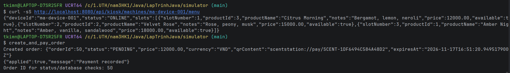

2. Order `50` is `FAILED`, command `47` is `REJECTED`, `inventory_applied = f`:
   [img_2.png](img_2.png)
   

3. No `DISPENSE` movement:
   [img_3.png](img_3.png)
   

4. No incident for the Order:
   [img_4.png](img_4.png)
   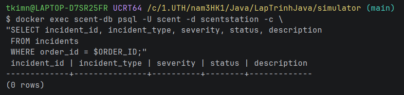

   
### 1.2. Interlock — `N2-INTERLOCK`

Test date: 18/11/2026  
Order ID: `51`  
Confirmation with Long: The expected machine status after interlock has not been confirmed.

| Criterion | Actual result | Assessment |
|---|---|---|
| Simulated payment | `applied: true`, `Payment recorded` | PASS |
| Order | `FAILED` | PASS |
| Failure reason | `DOOR_OPEN` | PASS |
| Command | `REJECTED`, reason `DOOR_OPEN` | PASS |
| `DISPENSE` movement | Movement count is `0` | PASS |
| Machine status | `ONLINE`, `ACTIVE`; expected status not confirmed | BLOCKED |
| Incident | Query returned `0 rows` | FAIL |
| Alert | Query returned `0 rows` | FAIL |

Mode assessment: FAIL — The Order was correctly rejected with `DOOR_OPEN` and no `DISPENSE` movement was created, but there was no incident or alert. The expected machine status also needs to be confirmed with Long.  
Issue to resolve: Coordinate with Long to agree on the expected machine status after interlock and address the incident/alert requirements.

Evidence screenshots

1. Order `51` created and paid: [img_5.png](img_5.png)
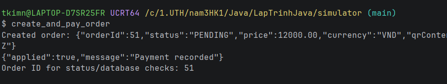

2. Order `51` is `FAILED`, command is `REJECTED` with reason `DOOR_OPEN`, `inventory_applied = f`: [img_6.png](img_6.png)

3. No `DISPENSE` movement: [img_7.png](img_7.png)
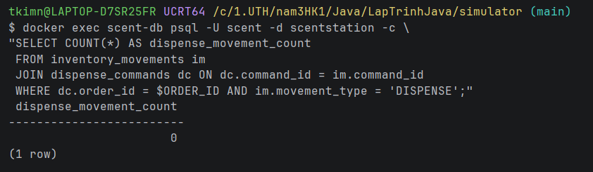

4. Machine `ma-device-001` is `ONLINE`, `ACTIVE`: [img_8.png](img_8.png)

5. No incident for the Order: [img_9.png](img_9.png)
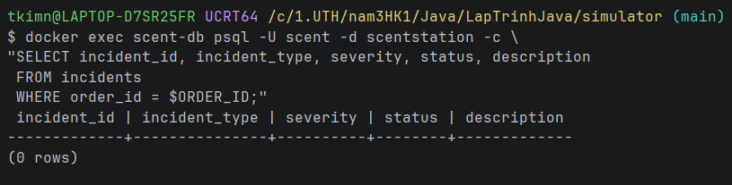

6. No alert for the event: [img_10.png](img_10.png)
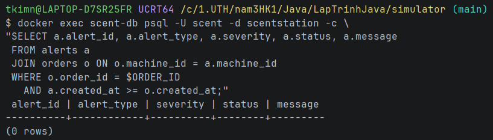

### 1.3. Silent — `N2-SILENT`

Test date: 18/11/2026  
Order ID: `52`  
Actual timeout wait: [Not shown in evidence]

| Criterion | Actual result | Assessment |
|---|---|---|
| Dispense result | Failure reason: `No result received from the device; needs human review` | PASS |
| Order | `UNCERTAIN` | PASS |
| Command | One command; status `TIMED_OUT` | PASS |
| Automatic command retry | Simulator log says no second command will be sent; database result shows one command | PASS |
| Inventory application | `inventory_not_applied = t` | PASS |

Mode assessment: PASS — the device sent no dispense result, the Order became `UNCERTAIN`, only one command timed out, and inventory was not applied.  
Issue to resolve: None for the tested Silent behavior.

Evidence screenshots

1. Order `52` created and paid: [img_11.png](img_11.png)
   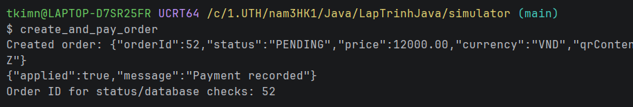

2. Order `52` is `UNCERTAIN`, command is `TIMED_OUT`, and inventory is not applied: [img_12.png](img_12.png)
   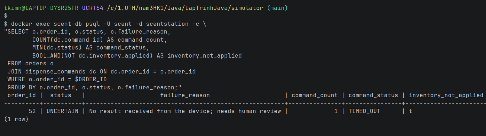

3. Silent Simulator log shows that no result or second command will be sent: [img_17.png](img_17.png)
   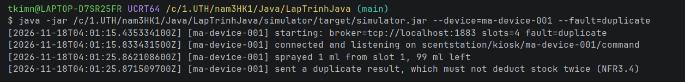

### 1.4. Duplicate — `N2-DUPLICATE`

Test date: 18/11/2026  
Order ID: `54`

| Criterion | Actual result | Assessment |
|---|---|---|
| Simulator response | Result sent twice for the same command | PASS |
| Command count | One command; status `SUCCEEDED` | PASS |
| Order | `DISPENSED` | PASS |
| `DISPENSE` movement / inventory deduction | One `DISPENSE` movement, total deducted: `1.000 ml` | PASS |
| Customer-sale movement | Not identified or verified; no separate customer-sale table was confirmed | BLOCKED |

Mode assessment: BLOCKED — the duplicate response, command, Order, and inventory deduction all passed, but the customer-sale movement has not been identified and counted.  
Issue to resolve: Identify the schema/entity used for customer-sale recording and verify exactly one record for Order `54`.

Evidence screenshots

1. Order `54` created and paid: [img_13.png](img_13.png)
   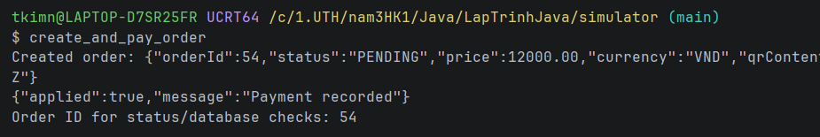

2. Order `54` status is `DISPENSED`: [img_14.png](img_14.png)
   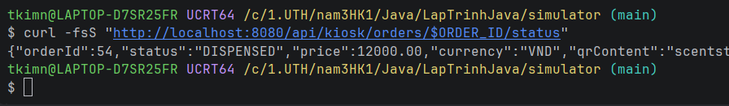

3. Order `54` has one successful command and inventory applied: [img_15.png](img_15.png)
   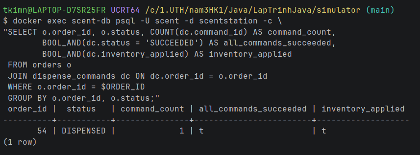

4. Order `54` has one `DISPENSE` movement and one `1.000 ml` deduction: [img_16.png](img_16.png)
   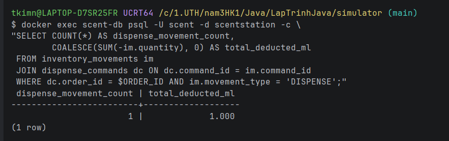

5. Duplicate Simulator log shows it sent the same result twice: [img_17.png](img_17.png)
   

### 1.5. Offline — `N2-OFFLINE`

Test date: 18/11/2026  
Time waited after stopping heartbeats: 60 seconds

| Criterion | Actual result | Assessment |
|---|---|---|
| Machine status | `ma-device-001` is `OFFLINE`, operating status `ACTIVE` | PASS |
| New Order request | HTTP `409`, response code `MACHINE_UNAVAILABLE` | PASS |
| Order count before / after | `39 / 39` | PASS |
| Payment count before / after | `37 / 37` | PASS |

Mode assessment: PASS — the machine was marked `OFFLINE`, the new Order request was rejected, and no Order or Payment was created.  
Issue to resolve: None for the tested Offline behavior.

Evidence screenshots

1. Offline Simulator started and stopped heartbeat sending: [img_18.png](img_18.png)
   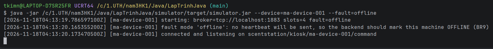

2. Backend watchdog logged that `ma-device-001` was marked `OFFLINE`: [img_19.png](img_19.png)
   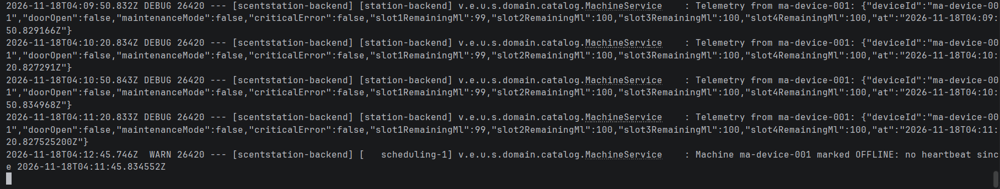

3. A 60-second wait completed and the database showed `OFFLINE`: [img_20.png](img_20.png)
   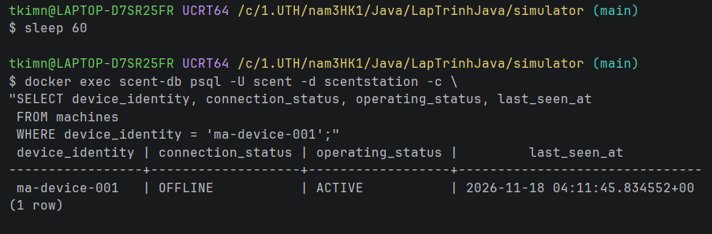

4. Order and Payment counts were recorded before the rejected request: [img_21.png](img_21.png)
   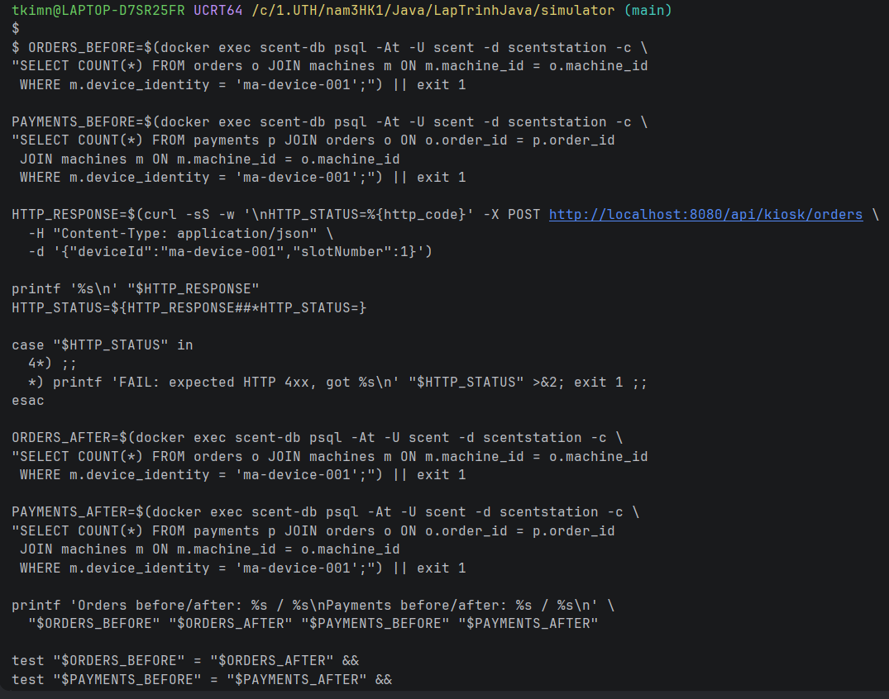

5. The request returned HTTP `409` and both counts remained unchanged: [img_22.png](img_22.png)
   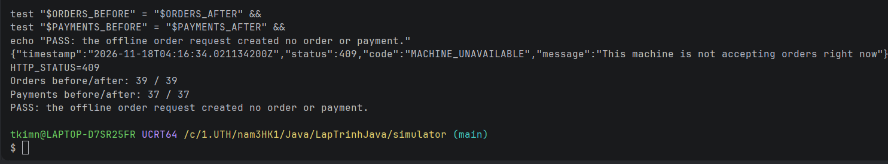

## 2. Results Summary

| Fault Mode | Assessment | Order ID | Evidence screenshots | Notes |
|---|---|---|---|---|
| Reject | FAIL | `50` | `img.png`, `img_2.png`, `img_3.png`, `img_4.png` | Incident missing |
| Interlock | FAIL | `51` | `img_5.png`–`img_10.png` | Incident/alert missing; confirm machine status with Long |
| Silent | PASS | `52` | `img_11.png`, `img_12.png`, `img_17.png` | No result, one timed-out command, no retry |
| Duplicate | BLOCKED | `54` | `img_13.png`–`img_17.png` | Duplicate response and inventory count pass; customer-sale record not yet verified |
| Offline | PASS | [Not applicable] | `img_18.png`–`img_22.png` | Machine offline; HTTP 409; no new Order or Payment |

Total: 5  
PASS: 2 (Silent, Offline)  
FAIL: 2 (Reject — incident missing; Interlock — incident/alert missing)  
BLOCKED: 1 (Duplicate — customer-sale movement not verified)

## 3. Issues and Follow-Up

| No. | Issue | Owner | Resolution / coordination | Status |
|---:|---|---|---|---|
| 1 | Reject did not create an incident for Order `50` | [Enter] | Investigate and fix incident creation; rerun Reject to verify | Open |
| 2 | Interlock did not create an incident/alert for Order `51`; machine remains `ONLINE`, `ACTIVE` | Long / [collaborator] | Agree on the expected machine status; address the incident/alert and retest | Open |
| 3 | Customer-sale movement for Order `54` was not identified or counted | [Enter] | Identify the customer-sale record in the current schema and verify exactly one record | Open |

## 4. Conclusion

N2 conclusion: Incomplete — Silent and Offline passed. Duplicate passed the duplicate-response, command, Order, and inventory criteria but remains blocked on customer-sale evidence. Reject did not create an incident; Interlock did not create an incident/alert, and the machine status needs to be confirmed with Long.
